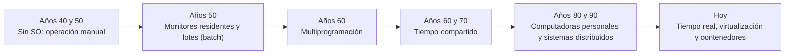

# Perspectivas del sistema operativo y evolución histórica

Esta página responde dos preguntas que van de la mano: **¿qué es y qué hace un sistema operativo, según desde dónde se le mire?** y **¿por qué existe tal como lo conocemos hoy?** La segunda tiene una respuesta histórica: cada tipo de sistema operativo nació para resolver el mayor desperdicio de la etapa anterior.

## 1. Las dos perspectivas del sistema operativo

Un sistema operativo (SO) es el software fundamental que administra el hardware y el software de una computadora y sirve de intermediario entre el usuario y la máquina. Sin él, un equipo es prácticamente inútil. Pero ese papel se puede describir desde dos puntos de vista complementarios.

| | Perspectiva del usuario | Perspectiva del sistema |
|---|---|---|
| El SO es... | Una **máquina extendida** (o máquina virtual) | Un **gestor de recursos** |
| Enfoque | De arriba hacia abajo: ocultar la complejidad del hardware | De abajo hacia arriba: repartir bien los recursos físicos |
| Objetivo principal | Facilidad de uso | Eficiencia y justicia en el reparto |
| Qué hace | Ofrece una interfaz sencilla para ejecutar programas y manejar archivos sin conocer detalles de bajo nivel | Asigna CPU, memoria, disco y dispositivos de E/S entre los programas y usuarios que los piden, resolviendo conflictos |
| Ejemplo cotidiano | Guardar un archivo sin saber en qué sectores del disco queda | Decidir qué programa usa el procesador en cada instante |

Estas dos visiones son las que describen los textos clásicos de la materia: el SO como máquina extendida (esconde el hardware real detrás de una abstracción más cómoda) y como administrador de recursos (evita que varios programas se pisen al usar los mismos dispositivos). Ninguna es "la correcta": un SO bien diseñado cumple ambas a la vez.

## 2. Evolución histórica

### 2.1 Sin sistema operativo (años 40 y 50)

Los primeros computadores se programaban directamente en lenguaje máquina y los operaba una persona frente a una consola. Cada programador reservaba un bloque de tiempo, cargaba su programa a mano y lo ejecutaba. **Problema:** gran parte del tiempo se perdía en la preparación (cargar, configurar, retirar resultados), con la costosa CPU parada.

### 2.2 Monitores residentes y sistemas por lotes (años 50)

La solución fue agrupar trabajos parecidos en **lotes** (*batch*) y encargar su secuencia a un programa pequeño que **permanece siempre en memoria**: el **monitor residente**. Este lee un trabajo, lo ejecuta y, al terminar, carga automáticamente el siguiente, guiado por instrucciones de control en el propio lote. Se considera la primera forma de sistema operativo. **Limitación:** durante una operación lenta de entrada o salida, la CPU quedaba ociosa esperando, y el usuario no podía interactuar con su programa mientras corría.

### 2.3 Multiprogramación (años 60)

Si un programa se detiene a esperar un dispositivo lento, ¿por qué no ejecutar otro mientras tanto? La **multiprogramación** mantiene varios programas en memoria a la vez y conmuta la CPU entre ellos cuando uno se bloquea por E/S. Aquí aparecen necesidades que siguen vigentes: **gestión de memoria**, **protección** entre programas e **interrupciones**. Familias de computadores como la IBM System/360 (1964) y su sistema OS/360 llevaron estas ideas a la práctica, a costa de una complejidad enorme. **Limitación:** los usuarios seguían sin interactuar directamente con sus programas.

### 2.4 Tiempo compartido (años 60 y 70)

El **tiempo compartido** extiende la multiprogramación para dar **interactividad**: muchos usuarios trabajan a la vez desde terminales, y el sistema reparte la CPU en rebanadas de tiempo muy cortas (*quantum*) para que cada uno sienta que tiene la máquina para sí. Es el origen directo de los planificadores como Round Robin que se estudian en la Unidad 2. Proyectos históricos de esta etapa: CTSS (MIT, 1961), Multics (desde 1964) y UNIX (Bell Labs, 1969), del que descienden, directa o conceptualmente, Linux (1991) y macOS.

### 2.5 Computadoras personales (años 70 y 80)

Con los microprocesadores, la computación llegó a una sola persona. Los primeros sistemas, como MS-DOS (1981), eran **monousuario y monotarea**, y con pocos mecanismos de protección. Después incorporaron multitarea, interfaces gráficas y protección entre procesos, recuperando casi todo lo que ya existía en los sistemas grandes.

### 2.6 Sistemas distribuidos (años 80 y 90)

Cuando las computadoras se conectaron en red, surgieron sistemas que coordinan **varias máquinas** para trabajar juntas, compartiendo recursos y repartiendo carga. Su meta es que el conjunto parezca un solo sistema. **Beneficios:** escalabilidad, compartir recursos y tolerancia a fallos. **Costo:** coordinar procesos y datos a través de una red (retrasos, fallos parciales, sincronización). Los clústeres y la nube actuales son sus descendientes.

### 2.7 Sistemas de tiempo real

En un **sistema de tiempo real** no basta con que el resultado sea correcto: debe llegar **antes de un plazo**. Se usan en industria, automóviles y equipos médicos. Se habla de tiempo real *estricto* (perder un plazo es un fallo grave) y *flexible* (perderlo degrada la calidad). Ejemplos: FreeRTOS, QNX y VxWorks, el sistema que usaba la sonda Mars Pathfinder en 1997.

### 2.8 Virtualización y contenedores (de los 2000 a hoy)

La **virtualización** permite que un mismo equipo físico ejecute varios sistemas operativos aislados, cada uno en una **máquina virtual** gestionada por un *hipervisor*. Los **contenedores** (popularizados por Docker en 2013) dan aislamiento más ligero: comparten el **mismo kernel** del anfitrión y se aíslan con funciones del propio Linux como los *namespaces* y los *cgroups*. Son más rápidos de iniciar y consumen menos, a cambio de un aislamiento menos estricto que el de una máquina virtual.

Un ejemplo cercano: las prácticas de este curso se hicieron en una máquina virtual Linux o en **WSL2**, que ejecuta un kernel de Linux real dentro de una máquina virtual ligera integrada en Windows.

## 3. Resumen: cada etapa resolvió un desperdicio

| Etapa | Qué problema resolvió | Qué limitación dejó |
|---|---|---|
| Sin SO | (punto de partida) | Mucho tiempo perdido en preparación manual |
| Monitor residente y lotes | Eliminó la preparación manual entre trabajos | CPU ociosa durante la E/S, sin interacción |
| Multiprogramación | Aprovechó la CPU mientras otro programa espera E/S | Exige gestión de memoria y protección, sin interactividad |
| Tiempo compartido | Dio interactividad a varios usuarios | Planificación y protección mucho más complejas |
| Computadoras personales | Computación accesible a una sola persona | Un solo usuario, poca protección al inicio |
| Sistemas distribuidos | Compartir recursos, escalar y tolerar fallos | Coordinación a través de la red |
| Virtualización y contenedores | Aprovechar el hardware y aislar cargas | Sobrecarga (máquinas virtuales) o menor aislamiento (contenedores) |

## Referencias

- Stallings, W. (2005). *Sistemas operativos: aspectos internos y principios de diseño* (5.ª ed.). Pearson Educación.
- Tanenbaum, A. S., & Bos, H. (2015). *Modern operating systems* (4.ª ed.). Pearson.