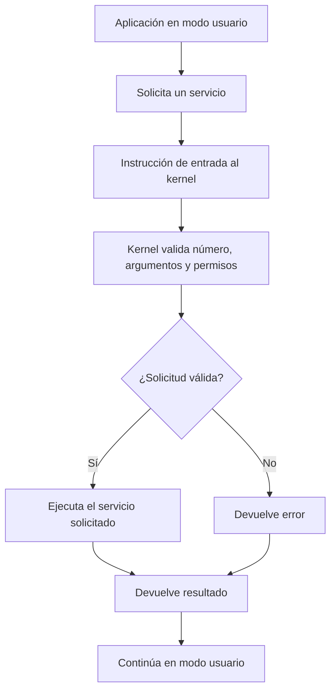

# Llamadas al sistema y protección del hardware

## ¿Por qué el sistema operativo necesita protección?

El sistema operativo comparte el procesador, la memoria y los dispositivos entre programas que pueden tener errores o comportarse de forma maliciosa. Si una aplicación pudiera modificar directamente cualquier dirección de memoria, controlar el disco sin restricciones o desactivar las interrupciones, podría afectar a otras aplicaciones y al propio sistema.

La protección combina mecanismos del hardware con reglas aplicadas por el kernel. El hardware impone límites de privilegio; el sistema operativo decide qué operaciones autoriza y comprueba los parámetros de las solicitudes.

## Modo usuario y modo kernel

Los procesadores modernos ofrecen niveles de privilegio. En una explicación básica se distinguen dos modos:

| Característica | Modo usuario | Modo kernel o supervisor |
|---|---|---|
| Uso típico | Aplicaciones comunes | Núcleo del sistema operativo y código privilegiado |
| Instrucciones privilegiadas | No se pueden ejecutar directamente | Se pueden ejecutar cuando la arquitectura lo permite |
| Acceso a dispositivos | Indirecto, mediante servicios autorizados | Controlado mediante drivers y mecanismos del kernel |
| Si ocurre un error | Normalmente se limita al proceso | Un fallo puede comprometer todo el sistema |

El cambio de modo no significa necesariamente que se cambie de proceso. Una llamada al sistema puede pasar temporalmente de modo usuario a modo kernel y volver al mismo proceso.

## ¿Qué es una llamada al sistema?

Una **llamada al sistema** (*system call*) es una interfaz controlada mediante la cual un programa solicita un servicio del kernel, por ejemplo abrir un archivo, crear un proceso o comunicarse con un dispositivo. La aplicación no obtiene privilegios ilimitados: entra al kernel por un mecanismo definido y el sistema valida la solicitud.

Ejemplos en sistemas tipo Unix:

- `read()` y `write()`: leer o escribir datos mediante un descriptor de archivo.
- `openat()`: abrir un archivo relativo a un directorio.
- `fork()`: crear un proceso hijo en sistemas que implementan esta interfaz.
- `execve()`: sustituir la imagen de programa del proceso actual.
- `mmap()`: establecer un mapeo de memoria.

Las bibliotecas del sistema pueden ofrecer funciones que terminan invocando una o varias llamadas al sistema. Por eso, una función de biblioteca y una system call no siempre son exactamente lo mismo.

## Interrupciones, excepciones y traps

Estos términos están relacionados, pero no son sinónimos perfectos:

- **Interrupción:** evento normalmente asíncrono respecto de la instrucción actual, a menudo generado por un dispositivo.
- **Excepción:** evento síncrono detectado al ejecutar una instrucción, como una división inválida o un acceso no permitido.
- **Trap o mecanismo de entrada al kernel:** transferencia controlada de ejecución que puede utilizarse para solicitar un servicio o gestionar una condición detectada por el procesador. La terminología exacta depende de la arquitectura.

Una llamada al sistema provoca una transición controlada al kernel; no debe confundirse con una interrupción de hardware ordinaria, aunque ambas requieren transferir el control a código privilegiado.

## Flujo simplificado de una llamada al sistema



## Ejemplo conceptual

Cuando un editor guarda un archivo, no debe escribir arbitrariamente sobre el disco físico. Solicita operaciones de archivo mediante interfaces del sistema. El kernel verifica permisos, coordina el sistema de archivos y los controladores, y comunica el resultado.

En Linux, `strace` permite observar muchas llamadas al sistema realizadas por un proceso:

```bash
strace -e trace=openat,read,write,close cat archivo.txt
```

El comando sirve para estudiar la interacción entre un programa y el kernel; la lista exacta de llamadas depende de la implementación y del entorno.

## Idea clave

La protección no depende solo de “tener permisos” en una aplicación. Requiere límites impuestos por el procesador, validaciones del kernel y mecanismos para aislar procesos y recursos. Las llamadas al sistema ofrecen una puerta controlada entre el código de usuario y los servicios privilegiados.

## Referencias

- Arpaci-Dusseau, R. y Arpaci-Dusseau, A. *Operating Systems: Three Easy Pieces*, capítulos sobre mecanismos de entrada al kernel y procesos. https://pages.cs.wisc.edu/~remzi/OSTEP/
- Linux man-pages project: `syscalls(2)`, `strace(1)`, `read(2)`, `write(2)`, `execve(2)`. https://man7.org/linux/man-pages/
