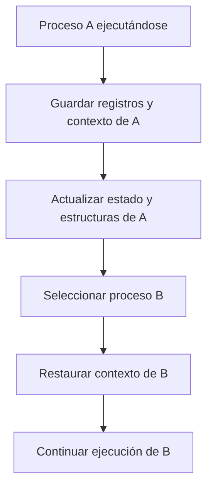

# Bloque de Control de Proceso (PCB)

El **Bloque de Control de Proceso** (*Process Control Block*, PCB) es el concepto que representa la información que el sistema operativo necesita para administrar un proceso. El nombre y la organización exacta de las estructuras varían entre sistemas operativos; el PCB es un modelo general, no necesariamente una estructura única con ese nombre en el código fuente de cada kernel.

## Campos principales

| Campo | Para qué sirve |
|---|---|
| PID | Identifica al proceso dentro del sistema |
| Estado | Indica si está listo, ejecutándose, bloqueado, etc. |
| Contador de programa | Permite saber qué instrucción debe continuar ejecutándose |
| Registros de CPU | Conserva el contexto de los registros cuando el proceso no está ejecutándose |
| Información de planificación | Prioridad, datos de cola u otra información usada por el planificador |
| Información de memoria | Referencias a tablas de páginas, regiones o espacio de direcciones |
| Archivos abiertos y E/S | Referencias a recursos asociados al proceso |
| Contabilidad y credenciales | Datos de uso y permisos, según la implementación |

No todos estos campos tienen que estar físicamente dentro de una misma estructura. Algunos pueden estar referenciados desde estructuras del kernel relacionadas.

## Relación con el cambio de contexto

Cuando el sistema deja de ejecutar un proceso y selecciona otro, debe guardar el contexto necesario del proceso saliente y restaurar el del proceso entrante. La información de control ayuda al kernel a recuperar la ejecución correcta.

## ¿Por qué es importante?

Sin información de control, el sistema no podría mantener múltiples ejecuciones independientes ni reanudar correctamente un proceso después de que otro use la CPU. El PCB contribuye a la multitarea, la planificación, la protección y la administración de recursos.

## Referencias

- Arpaci-Dusseau, R. y Arpaci-Dusseau, A. *Operating Systems: Three Easy Pieces*, capítulo “Processes”. https://pages.cs.wisc.edu/~remzi/OSTEP/
- Linux kernel documentation: documentación de procesos y planificador. https://docs.kernel.org/
