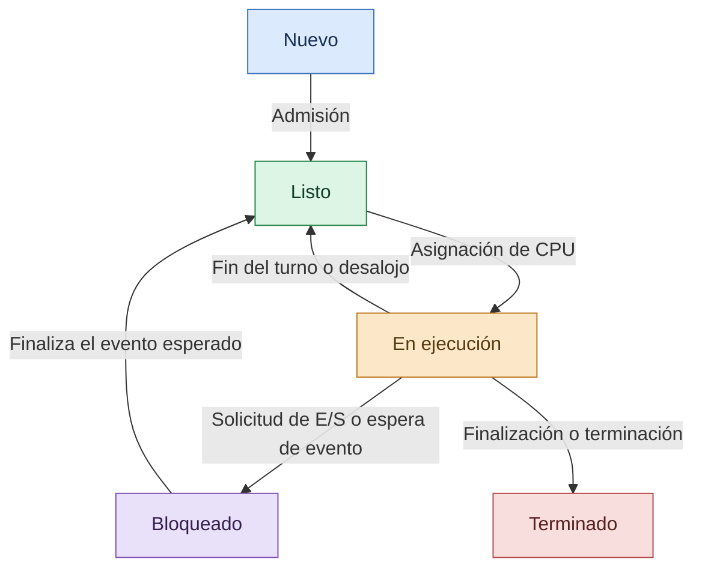

# Estados de los procesos

Antes de estudiar cómo el sistema operativo administra el procesador, la memoria y los recursos de una computadora, es necesario comprender **cómo se ejecutan los programas y qué estados atraviesan durante su funcionamiento**. Un programa almacenado en el disco no es lo mismo que un proceso en ejecución: cuando se inicia, el sistema operativo le asigna recursos y mantiene la información necesaria para controlar su actividad.

El estudio de los estados de los procesos permite entender cómo se organiza la multitarea, por qué algunos programas esperan mientras otros se ejecutan y cómo el sistema operativo distribuye el tiempo del procesador.

## ¿Qué es un proceso?

Un **proceso** es una instancia de un programa en ejecución. Incluye el código del programa y la información necesaria para ejecutarlo, como su espacio de memoria, los datos que utiliza, sus recursos asignados y uno o varios hilos de ejecución.

Por ejemplo, cuando un usuario abre una calculadora, el sistema operativo crea un proceso para ejecutar la aplicación. Si después abre un navegador, se inicia otro proceso o una estructura de procesos relacionada, según la arquitectura de esa aplicación.

Cada proceso posee características que permiten identificarlo y administrarlo. Entre las más importantes se encuentran:

- **Identificador del proceso (PID):** número o identificador único dentro del ámbito correspondiente que permite distinguirlo de otros procesos activos.
- **Estado:** indica la situación actual del proceso, como listo, en ejecución o bloqueado.
- **Contexto de ejecución:** incluye información necesaria para continuar el trabajo, como registros y el contador de programa.
- **Espacio de direcciones:** contiene las regiones de memoria que el proceso puede utilizar, conforme a los permisos establecidos.
- **Recursos asignados:** pueden incluir archivos abiertos, conexiones, dispositivos y otros objetos administrados por el sistema operativo.
- **Hilos:** unidades de ejecución que pertenecen al proceso y que pueden compartir sus recursos.

El sistema operativo utiliza esta información para controlar la ejecución de los programas, coordinar el acceso a los recursos y evitar que las aplicaciones interfieran indebidamente unas con otras.

## ¿Qué son los estados de los procesos?

Los **estados de los procesos** representan las diferentes situaciones por las que puede pasar un proceso durante su ciclo de vida. Estos estados permiten al sistema operativo determinar si un proceso puede utilizar el procesador, si debe esperar algún evento o si ya terminó su ejecución.

Un proceso no permanece necesariamente ejecutándose de manera continua. Puede alternar entre estados de espera, preparación y ejecución dependiendo de las operaciones que necesite realizar y de las decisiones del planificador.

En el modelo clásico de cinco estados se distinguen los siguientes:

### Estado nuevo (New)

Se presenta cuando el sistema operativo está creando el proceso. Durante esta etapa se establecen las estructuras de control, se prepara el entorno de ejecución y se asignan los recursos iniciales que sean necesarios.

Un proceso nuevo todavía no se encuentra ejecutando normalmente sus instrucciones de usuario. Primero debe completar las etapas necesarias para ser admitido en el sistema.

### Estado listo (Ready)

El proceso se encuentra preparado para ejecutarse y dispone de los recursos necesarios para competir por el procesador, pero todavía no se le ha asignado tiempo de CPU.

En sistemas con varios procesos activos, pueden existir numerosos procesos en estado listo. El planificador selecciona cuál debe ejecutarse considerando factores como la prioridad, la política de planificación y el tiempo de espera.

**Estar listo no significa estar ejecutándose:** significa que el proceso puede hacerlo cuando el sistema operativo le asigne un procesador.

### Estado en ejecución (Running)

El proceso está utilizando un procesador para ejecutar sus instrucciones. En un sistema con un solo procesador lógico disponible para esa ejecución, solo una tarea puede estar ejecutándose en ese procesador en un instante determinado.

En equipos multinúcleo pueden ejecutarse varios procesos o hilos simultáneamente, siempre que haya capacidad de procesamiento disponible y que el sistema operativo los programe en diferentes núcleos.

Un proceso puede abandonar este estado cuando termina, cuando necesita esperar una operación o cuando el planificador decide asignar el procesador a otra tarea.

### Estado bloqueado o en espera (Blocked/Waiting)

El proceso no puede continuar su ejecución hasta que ocurra un evento determinado. Puede estar esperando que termine una operación de entrada/salida, que lleguen datos de la red, que se libere un recurso o que otro componente le comunique un resultado.

Por ejemplo, un programa que solicita información de un archivo puede quedar esperando mientras se realiza la operación de almacenamiento.

Cuando se cumple la condición esperada, el proceso pasa normalmente al estado listo. No suele regresar directamente a ejecución, porque todavía debe competir por el procesador.

### Estado terminado (Terminated)

El proceso ha finalizado su ejecución o ha sido detenido. El sistema operativo realiza las tareas de cierre correspondientes y libera los recursos que ya no necesita mantener.

Dependiendo del sistema operativo, parte de la información del proceso puede conservarse temporalmente para que otros componentes consulten su resultado de terminación o completen las tareas de administración pendientes.

## Diagrama del ciclo de vida de un proceso

El siguiente diagrama representa el modelo clásico de cinco estados y las principales transiciones que pueden ocurrir durante la ejecución.

El diagrama muestra que el estado listo y el estado en ejecución están relacionados con la asignación del procesador, mientras que el estado bloqueado depende de un evento externo o de una condición que el proceso debe esperar.

Es importante recordar que este es un **modelo conceptual**. Los sistemas operativos reales pueden utilizar estados adicionales y diferentes nombres para representar situaciones específicas.

## Transiciones entre los estados

Una transición es el cambio de un estado a otro como consecuencia de un evento o de una decisión del sistema operativo.

| Transición | Causa principal |
| --- | --- |
| Nuevo → Listo | El proceso ha sido admitido para competir por el procesador. |
| Listo → En ejecución | El planificador le asigna tiempo de CPU. |
| En ejecución → Listo | Se agota el turno de ejecución o el proceso es desalojado para ejecutar otra tarea. |
| En ejecución → Bloqueado | El proceso debe esperar una operación o un evento. |
| Bloqueado → Listo | Se completa la operación esperada o se cumple la condición de espera. |
| En ejecución → Terminado | El proceso finaliza normalmente o es detenido. |

Estas transiciones permiten que el sistema operativo administre numerosos programas sin dedicar permanentemente el procesador a uno solo.

### ¿Por qué un proceso regresa al estado listo?

En los sistemas multitarea, el procesador puede asignarse temporalmente a un proceso. Cuando se agota su intervalo de tiempo, el sistema operativo puede interrumpir su ejecución y devolverlo al estado listo para que otra tarea tenga la oportunidad de ejecutarse.

Este mecanismo es importante para la planificación preventiva, que permite retirar el procesador a una tarea aunque esta todavía no haya terminado.

### ¿Por qué un proceso pasa al estado bloqueado?

Un proceso puede solicitar una operación que no termina inmediatamente. En lugar de consumir tiempo de CPU mientras espera, puede quedar bloqueado hasta que se produzca el evento correspondiente.

Esta estrategia ayuda a aprovechar el procesador: mientras un proceso espera datos o un recurso, el sistema operativo puede ejecutar otra tarea preparada.

## Bloque de control de procesos (PCB)

El sistema operativo necesita almacenar la información necesaria para identificar, administrar y reanudar cada proceso. Para ello utiliza una estructura conocida como **Process Control Block (PCB)** o bloque de control de procesos.

El PCB constituye una referencia fundamental para la administración de procesos, porque contiene o permite localizar los datos que el sistema necesita para controlar su ejecución.

Entre los elementos que pueden encontrarse en esta estructura se incluyen:

- **Identificador del proceso:** permite distinguir el proceso de los demás.
- **Estado del proceso:** registra si está listo, en ejecución, bloqueado u otra condición definida por el sistema.
- **Contador de programa:** indica la ubicación de la siguiente instrucción que debe ejecutarse cuando se reanude el contexto guardado.
- **Registros del procesador:** almacenan valores necesarios para continuar la ejecución.
- **Información de planificación:** puede incluir prioridades y otros datos utilizados por el planificador.
- **Información de memoria:** describe o referencia las estructuras que administran el espacio de direcciones del proceso.
- **Información de entrada/salida:** puede incluir referencias a archivos abiertos y otros recursos asociados.
- **Datos de contabilidad y seguridad:** según la implementación, pueden registrar tiempos de uso, credenciales u otra información administrativa.

La organización exacta del PCB depende del sistema operativo. No todos los sistemas guardan todos estos campos en una única estructura; parte de la información puede encontrarse en estructuras relacionadas.

### Importancia del PCB

Cuando el sistema operativo necesita suspender temporalmente un proceso, debe conservar la información que permita continuar su ejecución más adelante. Las estructuras de control de procesos hacen posible identificar su contexto, consultar su estado y administrar sus recursos.

Sin este mecanismo, sería mucho más difícil alternar correctamente entre procesos y mantener la continuidad de las aplicaciones.

## Cambio de contexto (Context Switch)

El **cambio de contexto** es el procedimiento mediante el cual el sistema operativo deja de ejecutar una tarea y prepara el procesador para continuar con otra.

Durante este procedimiento, el sistema conserva la información necesaria de la tarea que se interrumpe y restaura el contexto de la tarea seleccionada. Dependiendo de la implementación, esto puede involucrar registros del procesador, el contador de programa, información de memoria y datos de planificación.

El cambio de contexto puede producirse cuando:

- Se agota el intervalo de tiempo asignado al proceso o hilo.
- La tarea debe esperar una operación de entrada/salida.
- Se presenta una interrupción que lleva a reconsiderar la planificación.
- Una tarea de mayor prioridad necesita utilizar el procesador.
- El proceso termina y se selecciona otra tarea.

### Etapas simplificadas de un cambio de contexto

1. Se interrumpe temporalmente la ejecución de la tarea actual.
2. Se guarda la información necesaria para poder reanudarla.
3. El planificador determina qué tarea debe ejecutarse a continuación, si corresponde realizar una nueva selección.
4. Se restaura el contexto de la tarea seleccionada.
5. El procesador continúa ejecutando sus instrucciones.

El cambio de contexto tiene un costo, porque durante parte del procedimiento el procesador realiza trabajo administrativo en lugar de ejecutar instrucciones de las aplicaciones. Por esta razón, los sistemas operativos deben equilibrar la capacidad de respuesta con la sobrecarga de planificación.

## Colas de planificación de procesos

Los sistemas operativos pueden organizar los procesos mediante diferentes colas que representan las situaciones en las que se encuentran.

### Cola de listos

Contiene procesos o tareas que pueden ejecutarse y esperan que se les asigne un procesador. El planificador selecciona de esta cola según la política utilizada.

### Colas de espera o de dispositivos

Agrupan tareas que esperan determinados eventos u operaciones, como la finalización de una lectura de disco o la recepción de datos. La organización concreta depende del sistema operativo y de sus mecanismos internos.

### Cola de trabajos

En los modelos clásicos de planificación, representa los trabajos que el sistema mantiene para su admisión y posterior procesamiento. Este concepto es especialmente útil para explicar sistemas por lotes y políticas de admisión.

Las colas permiten organizar las tareas y facilitar las decisiones de planificación, aunque los sistemas actuales pueden utilizar estructuras más complejas que las colas tradicionales.

## Estados suspendidos y otros estados adicionales

El modelo de cinco estados resulta útil para estudiar los fundamentos, pero algunos sistemas operativos incorporan estados adicionales para describir situaciones más específicas.

Por ejemplo, un proceso puede estar suspendido temporalmente y no ser elegible para ejecutarse hasta que se reactive. En modelos clásicos de siete estados se distingue entre listo suspendido y bloqueado suspendido.

La suspensión puede utilizarse para representar procesos que han sido retirados temporalmente de la memoria principal o que se mantienen inactivos por decisiones administrativas. Sin embargo, los sistemas modernos gestionan la memoria y la planificación mediante mecanismos propios, por lo que no todos implementan literalmente ese modelo.

También pueden existir estados específicos de creación, finalización, espera de recursos o administración de tareas, según la arquitectura del sistema operativo.

## Ejemplo práctico: ejecución de un navegador

Supongamos que un usuario abre un navegador y solicita una página web.

1. **Nuevo:** el sistema operativo crea el proceso o las estructuras de ejecución necesarias.
2. **Listo:** una vez preparado, el proceso o sus hilos pueden competir por el procesador.
3. **En ejecución:** el procesador ejecuta las instrucciones necesarias para procesar la solicitud.
4. **Bloqueado:** una tarea puede esperar datos de la red u otra operación que todavía no ha terminado.
5. **Listo:** cuando llegan los datos esperados, la tarea puede continuar compitiendo por el procesador.
6. **En ejecución:** el procesador vuelve a ejecutar sus instrucciones cuando el planificador le asigna tiempo.
7. **Terminado:** cuando el proceso finaliza, el sistema operativo realiza las tareas de cierre correspondientes.

Este ejemplo es simplificado. Un navegador real puede utilizar múltiples procesos y numerosos hilos, de modo que diferentes componentes pueden encontrarse en estados distintos al mismo tiempo.

## Importancia de los estados de los procesos en un sistema operativo

La administración de los estados permite al sistema operativo organizar la ejecución de las aplicaciones y distribuir el uso del procesador. También facilita la coordinación de tareas que esperan datos, dispositivos o recursos compartidos.

Entre sus principales beneficios se encuentran:

- **Uso eficiente de la CPU:** permite ejecutar otras tareas mientras una está bloqueada.
- **Multitarea:** facilita alternar entre diferentes procesos y ofrecer una respuesta adecuada al usuario.
- **Planificación organizada:** proporciona información para decidir qué tarea debe ejecutarse.
- **Control de recursos:** contribuye a administrar la memoria, los dispositivos y otros recursos asociados a los procesos.
- **Continuidad de la ejecución:** permite guardar y restaurar el contexto cuando se cambia de una tarea a otra.
- **Diagnóstico de problemas:** conocer los estados ayuda a investigar tareas bloqueadas, procesos que consumen recursos y problemas de rendimiento.

## Conclusión

Los estados de los procesos constituyen uno de los fundamentos de los sistemas operativos. Describen las situaciones por las que atraviesa un proceso y permiten comprender cómo se relacionan la ejecución, la espera, la planificación y la finalización de los programas.

El PCB conserva información necesaria para administrar los procesos, mientras que el cambio de contexto permite alternar entre tareas sin perder la continuidad de su ejecución. Por su parte, las colas de planificación ayudan a organizar las tareas que esperan el procesador o determinados eventos.

Comprender estos mecanismos es esencial para estudiar los hilos, la concurrencia, la sincronización y la administración de memoria, temas que permiten profundizar en el funcionamiento interno de sistemas operativos como Windows y Linux.

## Referencias bibliográficas

- Silberschatz, A., Galvin, P. B., y Gagne, G. (2018). *Operating System Concepts* (10.ª ed.). Wiley.
- Stallings, W. (2018). *Operating Systems: Internals and Design Principles* (9.ª ed.). Pearson.
- Microsoft Learn. *About Processes and Threads*. https://learn.microsoft.com/en-us/windows/win32/procthread/about-processes-and-threads
- Linux Kernel Documentation. *Core API and Process Management Documentation*. https://www.kernel.org/doc/html/latest/
