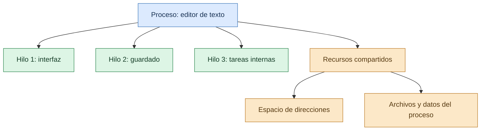
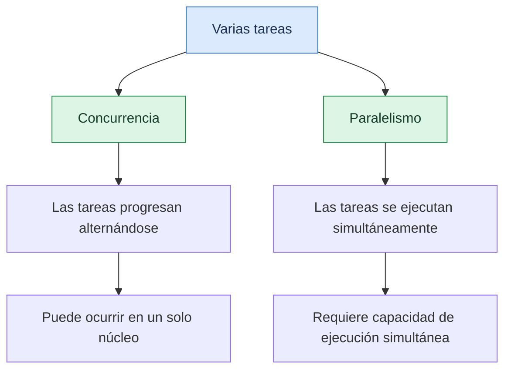
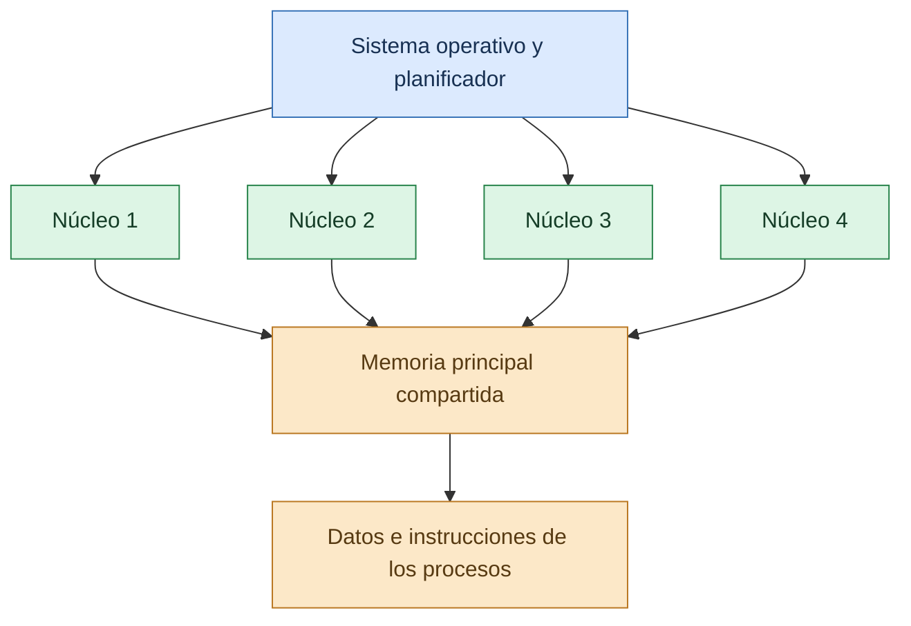

# Hilos y Multiprocesamiento Simétrico

Los sistemas operativos modernos necesitan ejecutar múltiples tareas, responder a las acciones del usuario y aprovechar la capacidad de los procesadores actuales. Para lograrlo, utilizan mecanismos como los **hilos de ejecución (threads)** y las arquitecturas de **multiprocesamiento simétrico (SMP)**.

Los hilos permiten dividir el trabajo de un proceso en unidades de ejecución más pequeñas, mientras que el multiprocesamiento simétrico permite utilizar varios procesadores o núcleos para ejecutar tareas concurrentemente. Ambos conceptos son fundamentales para comprender la multitarea, el paralelismo y el rendimiento de los sistemas operativos.

## ¿Qué es un hilo de ejecución?

Un **hilo (thread)** es una unidad básica de ejecución que pertenece a un proceso. Cada hilo sigue su propia secuencia de instrucciones, pero puede compartir con otros hilos del mismo proceso recursos como el código, los datos globales y los archivos abiertos.

A diferencia de un proceso, que normalmente posee su propio espacio de direcciones, los hilos de un mismo proceso comparten gran parte del entorno de ejecución. Sin embargo, cada hilo mantiene información propia necesaria para continuar su trabajo.

Por ejemplo, un editor de texto puede utilizar un hilo para responder a las acciones del usuario, otro para guardar información y otros para realizar tareas internas. Esta organización permite que distintas actividades avancen sin tener que implementar cada tarea como un proceso independiente.

Los hilos son especialmente importantes en aplicaciones que necesitan mantener una interfaz receptiva, atender solicitudes simultáneas o distribuir cálculos entre varios núcleos del procesador.

## Diferencia entre procesos e hilos

Aunque los procesos y los hilos están relacionados, representan conceptos diferentes. El proceso proporciona el entorno y los recursos en los que se ejecutan las tareas, mientras que el hilo representa una unidad de ejecución dentro de ese entorno.

| Característica | Proceso | Hilo |
| --- | --- | --- |
| Definición | Instancia de un programa en ejecución. | Unidad de ejecución dentro de un proceso. |
| Espacio de direcciones | Normalmente posee uno propio. | Comparte el espacio de direcciones con los demás hilos del proceso. |
| Recursos | Tiene recursos asociados, como identificadores y archivos abiertos. | Utiliza los recursos del proceso al que pertenece. |
| Información propia | Mantiene información de administración y ejecución del proceso. | Mantiene su propio contexto, registros y pila de ejecución. |
| Comunicación | Puede requerir mecanismos de comunicación entre procesos (IPC). | Puede compartir datos directamente con otros hilos del mismo proceso. |
| Aislamiento | Los espacios de direcciones separados proporcionan una barrera importante entre procesos. | El acceso a datos compartidos exige coordinación y sincronización. |
| Ejemplo | Una aplicación de reproducción de música. | Un hilo que procesa audio dentro de esa aplicación. |

La separación entre procesos ofrece aislamiento, mientras que los hilos facilitan la cooperación y el intercambio de información. Sin embargo, compartir memoria también implica riesgos: un hilo que modifica incorrectamente datos compartidos puede afectar a los demás hilos del mismo proceso.

## Componentes de un hilo

Cada hilo necesita información que permita al sistema operativo administrarlo y reanudar su ejecución después de una interrupción o cambio de contexto.

Entre sus componentes principales se encuentran:

- **Identificador del hilo:** permite distinguirlo de otros hilos.
- **Contador de programa:** indica cuál es la siguiente instrucción que debe ejecutarse.
- **Registros del procesador:** almacenan valores necesarios durante la ejecución.
- **Pila de ejecución (stack):** conserva información de llamadas a funciones, parámetros y variables locales.
- **Estado del hilo:** indica si está listo, ejecutándose, esperando o en otra situación definida por el sistema.
- **Prioridad y datos de planificación:** pueden utilizarse para decidir cuándo recibe tiempo de procesador.

Por otra parte, los hilos de un mismo proceso normalmente comparten el código ejecutable, los datos globales y el espacio de direcciones. Esta combinación permite que trabajen sobre información común sin tener que duplicar todos los recursos del proceso.

## Diagrama de un proceso con varios hilos

El siguiente esquema representa un proceso que contiene varios hilos. Cada hilo mantiene su propio contexto de ejecución, mientras que todos comparten determinados recursos.

Este diagrama es conceptual: no todas las aplicaciones utilizan exactamente esos tres hilos ni distribuyen sus tareas de la misma manera. La organización depende del diseño del programa y de las bibliotecas que utiliza.

## ¿Qué es el multihilo o multithreading?

El **multithreading** es una técnica que permite que un proceso utilice varios hilos para organizar distintas actividades. El sistema operativo puede planificar esos hilos de forma independiente, según las posibilidades de la plataforma y las reglas de ejecución.

El multihilo puede mejorar la capacidad de respuesta y facilitar el aprovechamiento de los recursos disponibles. Sin embargo, utilizar varios hilos no garantiza automáticamente que una aplicación funcione más rápido: el resultado depende de cómo se distribuya el trabajo y de la coordinación necesaria entre las tareas.

### Tipos de hilos según su administración

**Hilos a nivel de usuario**

Son administrados mediante bibliotecas o entornos de ejecución que operan en espacio de usuario. En ciertos modelos, la creación y coordinación de los hilos puede realizarse con poca intervención directa del núcleo.

No obstante, si muchos hilos de usuario se asignan a un único hilo del sistema operativo, pueden existir limitaciones para bloquear operaciones y aprovechar varios núcleos simultáneamente.

**Hilos a nivel del núcleo**

Son conocidos y administrados por el sistema operativo. El planificador puede asignarlos a diferentes procesadores o núcleos, cuando existen recursos disponibles y las condiciones de ejecución lo permiten.

Este modelo facilita la ejecución paralela de hilos independientes, aunque la administración de los cambios de contexto y otras operaciones también implica costos.

**Modelos híbridos**

Algunos entornos combinan mecanismos de usuario y del núcleo para administrar grupos de hilos. La forma de realizar esta combinación depende de la implementación, y no todos los sistemas actuales utilizan el mismo modelo.

## Ventajas del multithreading

- **Mejor capacidad de respuesta:** una aplicación puede continuar atendiendo al usuario mientras realiza otras operaciones.
- **Uso eficiente de los recursos:** los hilos pueden compartir memoria y recursos del mismo proceso.
- **Paralelismo:** en plataformas con varios núcleos, distintas tareas pueden ejecutarse simultáneamente.
- **Organización del trabajo:** permite dividir programas complejos en tareas más manejables.
- **Atención de múltiples solicitudes:** los servidores y otras aplicaciones pueden gestionar varias operaciones concurrentemente.

## Problemas y desafíos de los hilos

La programación multihilo requiere controlar cuidadosamente la interacción entre tareas. Cuando varios hilos acceden a los mismos datos, pueden aparecer errores difíciles de reproducir.

### Condiciones de carrera (Race Conditions)

Una condición de carrera ocurre cuando el resultado depende del orden o del momento en que se ejecutan varias operaciones concurrentes sobre datos compartidos.

Por ejemplo, dos hilos podrían intentar incrementar la misma variable al mismo tiempo. Si las operaciones de lectura y escritura no están coordinadas, uno de los incrementos podría perderse.

Para evitar estos problemas se utilizan mecanismos de sincronización, como mutexes, semáforos y otras primitivas proporcionadas por el sistema operativo o las bibliotecas.

### Interbloqueos (Deadlocks)

Un interbloqueo puede ocurrir cuando dos o más hilos esperan indefinidamente recursos que mantienen otros hilos. Como ninguno libera el recurso que el otro necesita, las tareas no pueden continuar.

Una forma de reducir este riesgo consiste en establecer un orden consistente para adquirir recursos, limitar las esperas y diseñar cuidadosamente las secciones críticas.

### Sobrecarga de administración

Crear demasiados hilos puede incrementar el consumo de memoria y el costo de la planificación. Si la coordinación entre ellos resulta más costosa que el trabajo que realizan, el rendimiento puede empeorar en lugar de mejorar.

## Concurrencia y paralelismo

Aunque están relacionados, la concurrencia y el paralelismo no significan exactamente lo mismo.

**Concurrencia** significa que varias tareas progresan durante un mismo intervalo de tiempo. En un sistema con un solo núcleo, el sistema operativo puede alternar rápidamente entre ellas para que todas avancen.

**Paralelismo** significa que varias tareas se ejecutan físicamente al mismo tiempo, por ejemplo, en diferentes núcleos del procesador.

Un sistema puede ofrecer concurrencia sin disponer de varios núcleos. En cambio, para obtener paralelismo real entre dos tareas de CPU se necesita capacidad de ejecución simultánea, como la que proporcionan varios núcleos o procesadores.

## Multiprocesamiento simétrico (SMP)

El **multiprocesamiento simétrico (Symmetric Multiprocessing, SMP)** es una arquitectura en la que dos o más procesadores, o núcleos de procesamiento, trabajan bajo un mismo sistema operativo y comparten la memoria principal.

En un sistema SMP, los procesadores pueden ejecutar tareas diferentes y acceder a recursos compartidos. El sistema operativo distribuye el trabajo entre los procesadores disponibles mediante mecanismos de planificación y coordinación.

En las computadoras actuales, el concepto también se aplica a sistemas multinúcleo en los que varios núcleos forman parte de un mismo procesador físico. Aunque un procesador multinúcleo y una computadora con varios procesadores físicos no tienen exactamente la misma organización física, ambos pueden ofrecer capacidad de ejecución paralela bajo un mismo sistema operativo.

### Características del SMP

- **Memoria principal compartida:** los procesadores tienen acceso a un espacio de memoria común, sujeto a las reglas de protección del sistema.
- **Sistema operativo común:** los procesadores trabajan bajo el control de un mismo sistema operativo.
- **Planificación de tareas:** el sistema distribuye hilos ejecutables entre los procesadores disponibles.
- **Ejecución paralela:** varios hilos pueden ejecutarse simultáneamente en diferentes núcleos.
- **Coordinación de recursos:** los accesos a memoria y los datos compartidos requieren mecanismos de sincronización.
- **Administración integrada:** el sistema operativo coordina el uso de procesadores, memoria y dispositivos.

## Arquitectura básica de un sistema SMP

En el siguiente diagrama se muestra una representación simplificada de cómo varios núcleos pueden ejecutar hilos diferentes y acceder a la memoria principal compartida.

La memoria compartida facilita que los procesadores trabajen con datos comunes, pero también requiere mecanismos que mantengan la coherencia de los datos y coordinen los accesos concurrentes.

En la práctica, los sistemas SMP pueden incluir memorias caché por núcleo, interconexiones internas y otros mecanismos de hardware que no se muestran en este esquema.

## Ventajas del multiprocesamiento simétrico

**Mayor capacidad de procesamiento.** Varias tareas pueden ejecutarse simultáneamente en distintos núcleos, lo que resulta útil para cálculos y aplicaciones que pueden dividir su trabajo.

**Mejor aprovechamiento del hardware.** El sistema operativo puede distribuir tareas entre los procesadores disponibles en lugar de depender exclusivamente de un solo núcleo.

**Mejor respuesta en cargas concurrentes.** Los equipos pueden atender diferentes procesos y servicios al mismo tiempo, siempre que exista capacidad de procesamiento suficiente.

**Escalabilidad dentro de los límites de la plataforma.** La incorporación de más núcleos puede aumentar el rendimiento de ciertas cargas de trabajo, aunque la mejora depende del programa y de los recursos compartidos.

## Desventajas y limitaciones del SMP

- **Complejidad de coordinación:** los procesadores deben coordinarse para acceder correctamente a datos compartidos.
- **Contención de recursos:** varios núcleos pueden competir por memoria, caché, buses u otros recursos.
- **Sobrecarga de sincronización:** los mecanismos que protegen los datos compartidos pueden limitar el paralelismo.
- **Rendimiento desigual:** un programa secuencial no necesariamente se beneficia de contar con más núcleos.
- **Mayor costo de hardware:** los sistemas con más capacidad de procesamiento pueden requerir componentes más costosos y consumir más energía.

La ley de Amdahl ayuda a explicar por qué no siempre se obtiene una mejora proporcional al número de procesadores: las partes de un programa que deben ejecutarse secuencialmente limitan la aceleración total posible.

## Diferencia entre SMP y sistemas asimétricos

En el multiprocesamiento simétrico, los procesadores participan bajo una arquitectura común y el sistema operativo puede distribuir tareas entre ellos. En el multiprocesamiento asimétrico, en cambio, los procesadores pueden tener funciones diferenciadas o asumir responsabilidades específicas.

La distinción depende del diseño del sistema. Los sistemas SMP suelen ofrecer una organización flexible para distribuir cargas de trabajo, mientras que una arquitectura asimétrica puede ser conveniente cuando se requiere asignar funciones particulares a determinados procesadores.

## Ejemplo práctico: procesamiento de imágenes

Imaginemos una aplicación que necesita procesar un conjunto de imágenes de gran tamaño. El programa puede dividir el trabajo en varias tareas independientes y asignarlas a diferentes hilos.

En una computadora con varios núcleos, el sistema operativo puede programar esos hilos para que trabajen simultáneamente. Si las tareas son suficientemente independientes y el programa está bien diseñado, el tiempo total de procesamiento puede disminuir.

Sin embargo, si todos los hilos intentan modificar los mismos datos o esperan constantemente los resultados de otros, el beneficio puede reducirse. Por eso el rendimiento depende tanto del hardware como de la forma en que se organiza el programa.

## Relación entre hilos y SMP

Los hilos y el multiprocesamiento simétrico se complementan, pero cumplen funciones distintas.

Los hilos dividen la ejecución de una aplicación en unidades de trabajo que pueden administrarse de forma independiente. SMP proporciona una arquitectura que permite ejecutar varias de esas unidades simultáneamente en diferentes procesadores o núcleos.

Por ejemplo, un programa puede tener cuatro hilos y ejecutarse en una computadora con cuatro núcleos. Si los cuatro hilos están listos, pueden llegar a ejecutarse simultáneamente. No obstante, esto depende de la disponibilidad de los núcleos, de las restricciones del programa y de las decisiones del planificador.

## Aplicaciones en los sistemas operativos modernos

El multithreading y SMP son importantes en numerosas áreas:

- **Servidores:** permiten atender múltiples solicitudes y realizar tareas concurrentes.
- **Bases de datos:** facilitan el procesamiento de consultas y otras operaciones que pueden ejecutarse en paralelo.
- **Sistemas multimedia:** ayudan a coordinar audio, video, procesamiento y respuesta de la interfaz.
- **Simulaciones científicas:** permiten distribuir cálculos entre varios núcleos.
- **Computadoras personales:** contribuyen a ejecutar aplicaciones y servicios en segundo plano.
- **Sistemas operativos:** permiten aprovechar el hardware multinúcleo y administrar múltiples tareas.

## Conclusión

Los hilos de ejecución permiten dividir el trabajo de un proceso en unidades más pequeñas que comparten determinados recursos. Esta organización puede mejorar la capacidad de respuesta, facilitar la concurrencia y permitir el paralelismo cuando el hardware y el programa lo admiten.

El multiprocesamiento simétrico proporciona una arquitectura en la que varios procesadores o núcleos trabajan bajo un mismo sistema operativo y comparten la memoria principal. De esta manera, el sistema puede distribuir tareas entre los recursos disponibles.

Sin embargo, aprovechar estas tecnologías requiere controlar la sincronización, evitar condiciones de carrera e interbloqueos y considerar los costos de planificación. Comprender la relación entre hilos, concurrencia, paralelismo y SMP permite analizar mejor el rendimiento y el funcionamiento interno de los sistemas operativos actuales.

## Referencias bibliográficas

- Silberschatz, A., Galvin, P. B., y Gagne, G. (2018). *Operating System Concepts* (10.ª ed.). Wiley.
- Stallings, W. (2018). *Operating Systems: Internals and Design Principles* (9.ª ed.). Pearson.
- Microsoft Learn. *About Processes and Threads*. https://learn.microsoft.com/en-us/windows/win32/procthread/about-processes-and-threads
- Linux Kernel Documentation. *Scheduler*. https://www.kernel.org/doc/html/latest/scheduler/
