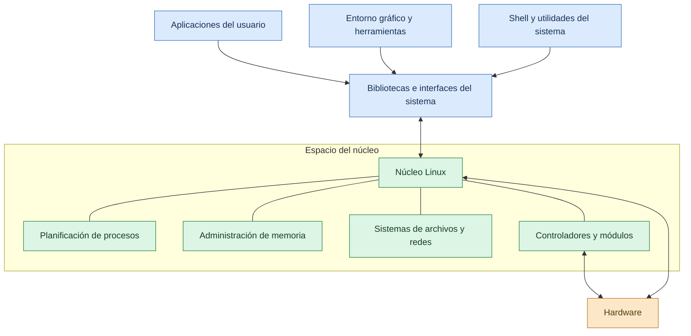
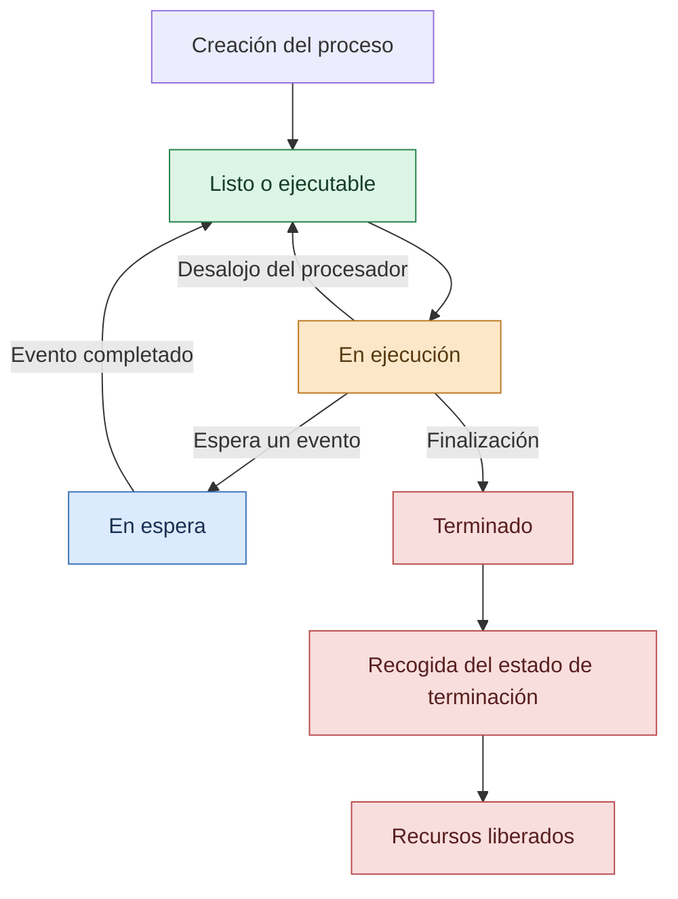

# Linux

Los sistemas operativos permiten administrar los recursos de una computadora y proporcionar un entorno para ejecutar aplicaciones. Entre las alternativas disponibles, **Linux** destaca por su flexibilidad, estabilidad, seguridad y amplia utilización en servidores, computadoras personales, supercomputadoras, dispositivos integrados y sistemas en la nube.

Linux se basa en un núcleo de código abierto que administra los procesos, la memoria, los dispositivos y otras funciones fundamentales. Junto con las herramientas del sistema y las aplicaciones, permite construir sistemas operativos completos adaptados a diferentes necesidades.

Comprender Linux es importante para estudiar la arquitectura de los sistemas operativos, administrar servidores, utilizar herramientas de desarrollo y conocer una alternativa ampliamente utilizada en el ámbito de la Ingeniería en Sistemas.

## ¿Qué es Linux?

**Linux es un núcleo (kernel)** creado originalmente por Linus Torvalds en 1991. Su función principal consiste en administrar los recursos de hardware y proporcionar servicios esenciales para que los programas puedan ejecutarse.

En el uso cotidiano, la palabra *Linux* también se emplea para referirse a sistemas operativos completos construidos alrededor de ese núcleo. Estos sistemas suelen combinar el kernel Linux con herramientas del proyecto GNU, otros programas de código abierto, un sistema de inicialización, gestores de paquetes y una interfaz gráfica o de línea de comandos.

Por ejemplo, Ubuntu, Debian, Fedora y Linux Mint son distribuciones que utilizan el núcleo Linux y proporcionan conjuntos de herramientas y aplicaciones para diferentes tipos de usuarios.

A diferencia de un producto único con una configuración idéntica en todos los equipos, Linux se utiliza en múltiples distribuciones que pueden variar en sus programas, herramientas administrativas, interfaces y políticas de actualización.

## Características principales de Linux

Linux ofrece diversas características que lo hacen adecuado para una gran variedad de entornos informáticos.

- **Código abierto:** el código fuente del núcleo está disponible para su estudio, modificación y redistribución de acuerdo con las condiciones de su licencia.
- **Multitarea:** permite ejecutar y administrar múltiples procesos y tareas concurrentes.
- **Multiusuario:** admite distintos usuarios y mecanismos para separar sus permisos y recursos.
- **Portabilidad:** el núcleo se ha adaptado a numerosas arquitecturas de hardware.
- **Seguridad:** dispone de permisos de archivos, cuentas de usuario, mecanismos de aislamiento y herramientas adicionales de protección.
- **Estabilidad:** puede funcionar durante largos periodos si el sistema, el hardware y los servicios están correctamente configurados.
- **Redes:** proporciona herramientas y servicios para administrar conexiones, servidores y comunicaciones.
- **Personalización:** permite elegir componentes, entornos gráficos, servicios y herramientas según las necesidades.
- **Automatización:** facilita la creación de scripts para ejecutar tareas administrativas repetitivas.

Estas características dependen de la distribución, la configuración y los componentes instalados. El hecho de utilizar Linux no garantiza por sí solo que un equipo esté protegido frente a todos los ataques o errores.

## Diferencia entre Linux, el núcleo y una distribución

Es importante distinguir tres conceptos relacionados.

**Núcleo Linux:** es el componente central que interactúa con el hardware y proporciona mecanismos para administrar procesos, memoria, dispositivos y otras funciones esenciales.

**Distribución Linux:** es un sistema operativo completo que integra el núcleo con herramientas, bibliotecas, aplicaciones, mecanismos de instalación y administración de software.

**Entorno de escritorio:** es la interfaz gráfica que permite interactuar con ventanas, iconos, menús y aplicaciones. Algunos ejemplos son GNOME, KDE Plasma y Xfce.

Una computadora puede utilizar el mismo núcleo Linux con diferentes distribuciones y entornos de escritorio. Por eso, la apariencia y las herramientas disponibles pueden cambiar considerablemente de un sistema a otro.

## Arquitectura general de Linux

Linux se clasifica generalmente como un **núcleo monolítico modular**. Esto significa que numerosas funciones fundamentales se ejecutan en el espacio del núcleo, pero el sistema permite cargar y descargar módulos que amplían sus capacidades cuando corresponde.

Entre las funciones que se encuentran dentro del núcleo están la planificación de procesos, la administración de memoria, las interfaces de entrada/salida, las redes y una parte importante de los controladores de dispositivos.

En el espacio de usuario se ejecutan las aplicaciones, los intérpretes de comandos, los servicios y las herramientas administrativas. Estos programas utilizan interfaces del sistema para solicitar operaciones al núcleo.

### Diagrama de la arquitectura de Linux



El diagrama es una representación conceptual. Las bibliotecas, las herramientas y los servicios pueden organizarse de diferentes maneras según la distribución. Asimismo, no todos los controladores o módulos están cargados simultáneamente.

## Componentes principales de Linux

### Núcleo (Kernel)

El kernel es el componente central del sistema. Administra los recursos y proporciona servicios que las aplicaciones necesitan para realizar operaciones controladas.

Entre sus responsabilidades se encuentran:

- Planificar la ejecución de procesos e hilos.
- Administrar la memoria física y virtual.
- Coordinar el acceso a los dispositivos.
- Proporcionar mecanismos de comunicación entre procesos.
- Implementar funciones de red.
- Facilitar el acceso a los sistemas de archivos.
- Aplicar mecanismos de protección y aislamiento.

El kernel opera con privilegios elevados y controla el acceso a recursos que las aplicaciones no pueden administrar libremente.

### Shell o intérprete de comandos

La **shell** es un programa que interpreta comandos y permite interactuar con el sistema mediante una terminal. Algunas shells conocidas son Bash, Zsh y Fish.

A través de ella, los usuarios pueden consultar archivos, ejecutar aplicaciones, administrar procesos y automatizar tareas.

Por ejemplo, el comando `ls` muestra el contenido de un directorio en muchas distribuciones, mientras que `pwd` permite consultar la ubicación actual.

La shell no es el núcleo: es una herramienta del espacio de usuario que utiliza los servicios proporcionados por el sistema operativo.

### Bibliotecas del sistema

Las bibliotecas proporcionan funciones reutilizables que simplifican el desarrollo y la ejecución de aplicaciones. Algunas permiten trabajar con archivos, memoria, cadenas de texto y otros recursos.

En muchos sistemas Linux, las aplicaciones utilizan bibliotecas como glibc para acceder a funciones comunes y realizar operaciones que finalmente pueden requerir servicios del núcleo.

No todas las aplicaciones utilizan exactamente las mismas bibliotecas, ya que esto depende de su lenguaje, su entorno de ejecución y su forma de compilación.

### Utilidades y servicios

Las distribuciones incorporan herramientas para configurar el sistema, administrar usuarios, instalar programas, supervisar recursos y ejecutar servicios en segundo plano.

Por ejemplo, pueden incluir herramientas para administrar conexiones de red, consultar registros del sistema, programar tareas y controlar servicios que se inician automáticamente.

La selección de utilidades depende de la distribución y de su finalidad.

## Administración de procesos en Linux

Linux permite ejecutar múltiples procesos y administrar sus recursos mediante identificadores, estados, prioridades y otros datos de control.

Cada proceso tiene un identificador conocido como **PID (Process ID)**. Los procesos también pueden crear otros procesos, establecer relaciones de parentesco y utilizar mecanismos de comunicación.

En Linux, la implementación de procesos e hilos se basa en estructuras de tareas administradas por el kernel. Los procesos pueden tener espacios de direcciones separados, mientras que los hilos de un mismo programa pueden compartir recursos de acuerdo con la forma en que fueron creados.

### Estados de los procesos

Los procesos pueden encontrarse en distintas situaciones, por ejemplo:

- **Ejecutándose o listo para ejecutarse:** el proceso está utilizando un procesador o puede recibir tiempo de CPU.
- **En espera interrumpible:** espera un evento y, normalmente, puede responder a determinadas señales.
- **En espera no interrumpible:** espera una condición específica del sistema, a menudo relacionada con una operación de entrada/salida.
- **Detenido:** su ejecución ha sido suspendida por una señal u otra condición.
- **Zombi:** el proceso ya terminó, pero todavía se conserva una entrada mínima con información de su terminación hasta que el proceso padre la recoge.

Estos estados son detalles de implementación de Linux y no coinciden exactamente con el modelo conceptual de cinco estados utilizado para introducir los procesos.

### Diagrama simplificado de estados



Este diagrama simplifica varios detalles internos. En Linux existen estados adicionales y diferentes rutas de transición dependiendo de las señales, los recursos y las condiciones de ejecución.

## Administración de memoria en Linux

Linux utiliza mecanismos de memoria virtual para proporcionar espacios de direcciones a los procesos y controlar su acceso a la memoria.

La memoria virtual permite organizar las direcciones utilizadas por un programa sin exigir que todas las regiones se encuentren permanentemente en la RAM física.

### Memoria virtual y paginación

La memoria se organiza en páginas. El sistema operativo y el hardware de administración de memoria coordinan la traducción de direcciones virtuales a direcciones físicas.

Cuando una página necesaria no está disponible en memoria física, puede producirse un fallo de página. El kernel determina cómo atenderlo según la causa: puede cargar información desde el almacenamiento, asignar una página nueva o aplicar otro mecanismo apropiado.

### Memoria física y espacio de intercambio

La RAM contiene las páginas que están residentes en la memoria principal. En sistemas configurados para ello, el espacio de intercambio (*swap*) permite trasladar determinadas páginas al almacenamiento cuando la memoria física está bajo presión.

El uso de swap no significa que el sistema disponga de RAM adicional con la misma velocidad. El almacenamiento es mucho más lento que la memoria principal, por lo que una presión excesiva de memoria puede afectar el rendimiento.

### Aislamiento de memoria

Cada proceso dispone de un espacio de direcciones y de permisos que limitan su acceso a la memoria. Estos mecanismos ayudan a impedir que una aplicación acceda arbitrariamente a las regiones privadas de otro proceso.

El aislamiento depende del soporte de hardware, del kernel y de la configuración de los recursos.

## Sistema de archivos en Linux

Linux utiliza una jerarquía de directorios que comienza en el directorio raíz, representado por `/`. A partir de él se organizan archivos, carpetas, dispositivos y puntos de montaje.

En Linux, muchos recursos se presentan mediante interfaces de archivos, aunque no todo lo que aparece en el sistema corresponde a un archivo almacenado de manera convencional en un disco.

### Directorios importantes

- **`/`**: directorio raíz de toda la jerarquía.
- **`/home`**: suele contener los directorios personales de los usuarios.
- **`/etc`**: almacena numerosos archivos de configuración del sistema.
- **`/var`**: contiene datos variables, como registros y colas de servicios.
- **`/tmp`**: se utiliza para archivos temporales, conforme a las políticas del sistema.
- **`/dev`**: contiene interfaces de dispositivos.
- **`/proc`**: proporciona información virtual sobre procesos y aspectos del kernel.
- **`/sys`**: expone información sobre dispositivos, controladores y objetos del kernel.
- **`/usr`**: contiene una gran parte de las aplicaciones, bibliotecas y datos de solo lectura del sistema.

La organización exacta puede variar y algunos directorios pueden ser enlaces simbólicos o puntos de montaje.

### Sistemas de archivos compatibles

Linux admite distintos sistemas de archivos. Entre los más conocidos se encuentran:

- **ext4:** utilizado ampliamente en numerosas distribuciones.
- **XFS:** diseñado para manejar diferentes cargas de trabajo y volúmenes de almacenamiento.
- **Btrfs:** ofrece características como instantáneas y administración avanzada de volúmenes.
- **FAT y exFAT:** empleados con frecuencia para intercambiar datos con dispositivos extraíbles.
- **NTFS:** puede utilizarse para acceder a volúmenes de Windows mediante los controladores y herramientas compatibles.

No existe un único sistema de archivos obligatorio para todas las distribuciones. La elección depende de los requisitos técnicos y de compatibilidad.

## Permisos y seguridad en Linux

Linux utiliza cuentas, grupos y permisos para controlar el acceso a archivos y otros recursos.

Los permisos tradicionales de archivos distinguen entre el propietario, el grupo y los demás usuarios. Para cada categoría pueden definirse permisos de lectura, escritura y ejecución.

Por ejemplo, un archivo puede permitir que su propietario lo modifique, que un grupo lo lea y que los demás usuarios no tengan acceso.

### Usuarios y grupos

Los usuarios representan identidades utilizadas para acceder al sistema. Los grupos permiten asignar permisos a conjuntos de usuarios.

La administración de cuentas y grupos facilita aplicar el principio de mínimo privilegio, según el cual cada usuario debe disponer únicamente de los permisos necesarios.

### Usuario administrador y sudo

La cuenta administrativa tradicional de Linux se conoce como `root`. Tiene privilegios elevados y puede realizar numerosas operaciones que los usuarios ordinarios no están autorizados a efectuar.

En muchas distribuciones, `sudo` permite ejecutar comandos con privilegios elevados a los usuarios autorizados, de acuerdo con la configuración del sistema.

Por ejemplo, la instalación de un paquete puede requerir permisos administrativos. Sin embargo, no es recomendable ejecutar comandos privilegiados sin comprender su propósito y sus consecuencias.

### Herramientas de seguridad

Según la distribución, pueden utilizarse herramientas como un cortafuegos, mecanismos de control de acceso obligatorio, sistemas de auditoría y programas de detección de amenazas.

La seguridad efectiva depende de mantener los programas actualizados, configurar correctamente los permisos, limitar los servicios expuestos y proteger las credenciales.

## Distribuciones populares de Linux

Una **distribución Linux** reúne el kernel con herramientas, aplicaciones y mecanismos de administración para ofrecer un sistema operativo utilizable.

### Ubuntu

Ubuntu es una distribución conocida por su facilidad de instalación, su documentación y su uso en computadoras personales, servidores y entornos de desarrollo.

### Debian

Debian es una distribución reconocida por su organización comunitaria y su enfoque en la estabilidad y la administración de paquetes. También sirve de base para otras distribuciones.

### Fedora

Fedora incorpora tecnologías recientes y se utiliza en entornos de escritorio, desarrollo y aprendizaje de tecnologías relacionadas con Linux.

### Linux Mint

Linux Mint ofrece una experiencia de escritorio orientada a usuarios que buscan una interfaz familiar y herramientas de configuración accesibles.

### Otras distribuciones

Existen muchas otras distribuciones con objetivos específicos, como Arch Linux, openSUSE, Rocky Linux y Alpine Linux. Algunas se orientan a usuarios avanzados, otras a servidores y otras a entornos mínimos o especializados.

No existe una distribución universalmente mejor: la elección depende del hardware, los conocimientos del usuario, el soporte requerido y el uso previsto.

## Comandos básicos de Linux

La terminal permite ejecutar comandos para administrar archivos, consultar información y realizar tareas del sistema.

| Comando | Función |
| --- | --- |
| `pwd` | Muestra el directorio actual. |
| `ls` | Lista archivos y directorios. |
| `cd` | Cambia de directorio. |
| `mkdir` | Crea un directorio. |
| `cp` | Copia archivos o directorios, según los argumentos. |
| `mv` | Mueve o cambia el nombre de archivos y directorios. |
| `rm` | Elimina archivos o directorios según las opciones utilizadas. |
| `cat` | Muestra o concatena el contenido de archivos. |
| `grep` | Busca patrones de texto en entradas o archivos. |
| `ps` | Muestra información sobre procesos. |
| `top` | Permite observar procesos y uso de recursos de forma interactiva. |
| `free` | Muestra información sobre la memoria. |
| `df` | Muestra el uso del espacio de los sistemas de archivos. |
| `man` | Abre las páginas del manual de muchos comandos. |

Los comandos y sus opciones pueden variar entre distribuciones. Es importante revisar la documentación antes de utilizar comandos que modifiquen o eliminen información.

### Ejemplo práctico en la terminal

El siguiente ejemplo crea un directorio de práctica y un archivo de texto dentro de él:

```bash
mkdir practica_linux
cd practica_linux
echo "Mi primera práctica en Linux" > notas.txt
ls
cat notas.txt
```

El resultado esperado es que aparezca el archivo `notas.txt` y que su contenido muestre el mensaje escrito. Estos comandos permiten practicar la navegación por directorios, la creación de archivos y la consulta de información.

## Administración de paquetes

Las distribuciones Linux suelen incluir gestores de paquetes para instalar, actualizar y eliminar programas.

Por ejemplo, las distribuciones basadas en Debian y Ubuntu utilizan habitualmente `apt`, mientras que Fedora utiliza `dnf`.

En Ubuntu o Debian, un administrador autorizado puede actualizar la información de paquetes con:

```bash
sudo apt update
```

En Fedora, el comando equivalente para actualizar la información de repositorios es:

```bash
sudo dnf check-update
```

Estos comandos no son idénticos en su comportamiento. El primero actualiza la información local de paquetes; el segundo comprueba si existen actualizaciones disponibles. Las operaciones administrativas deben ejecutarse con cuidado y de acuerdo con la distribución instalada.

## Linux en servidores y computación en la nube

Linux tiene una presencia importante en servidores y plataformas de computación en la nube debido a su flexibilidad, su variedad de herramientas de administración y su capacidad para funcionar en diferentes arquitecturas.

En estos entornos puede utilizarse para alojar sitios web, ejecutar bases de datos, administrar servicios de red y desplegar aplicaciones.

Las herramientas de automatización, los sistemas de contenedores y las plataformas de orquestación también utilizan ampliamente tecnologías del ecosistema Linux. Sin embargo, cada entorno requiere una configuración adecuada de recursos, permisos, actualizaciones y seguridad.

## Ventajas de Linux

- **Flexibilidad:** permite elegir herramientas, servicios y entornos de escritorio.
- **Código abierto:** facilita estudiar el funcionamiento del núcleo y de muchos componentes del sistema.
- **Automatización:** las shells y los scripts permiten realizar tareas repetitivas.
- **Variedad de distribuciones:** existen alternativas para computadoras personales, servidores y dispositivos especializados.
- **Herramientas de desarrollo:** ofrece compiladores, intérpretes, sistemas de control de versiones y numerosas utilidades.
- **Administración de servidores:** proporciona herramientas para configurar servicios, redes y almacenamiento.
- **Control de permisos:** permite administrar usuarios, grupos y accesos a recursos.

## Desventajas y limitaciones de Linux

- **Curva de aprendizaje:** algunas tareas administrativas requieren conocer la terminal y los conceptos del sistema.
- **Compatibilidad de aplicaciones:** ciertos programas comerciales están diseñados principalmente para Windows o macOS.
- **Controladores específicos:** algunos dispositivos pueden necesitar controladores que no están disponibles o que requieren configuración adicional.
- **Fragmentación entre distribuciones:** las herramientas y los procedimientos pueden variar de un sistema a otro.
- **Mantenimiento:** es necesario administrar actualizaciones, permisos, servicios y copias de seguridad.
- **Configuración avanzada:** determinadas tareas requieren conocimientos técnicos para evitar errores o problemas de seguridad.

Estas limitaciones no afectan a todos los usuarios por igual. Muchas distribuciones actuales ofrecen instaladores gráficos y herramientas que simplifican el uso cotidiano.

## Comparación general entre Windows y Linux

| Característica | Windows | Linux |
| --- | --- | --- |
| Desarrollador y modelo | Familia de sistemas operativos desarrollada por Microsoft. | Núcleo abierto mantenido por una comunidad y empresas; se integra en numerosas distribuciones. |
| Código fuente | Gran parte del sistema es propietario. | El núcleo Linux se distribuye como software libre y de código abierto. |
| Interfaz | Interfaz gráfica integrada en las ediciones de escritorio. | Puede utilizar diferentes entornos gráficos o funcionar sin interfaz gráfica. |
| Aplicaciones | Amplio catálogo de programas comerciales y profesionales. | Amplio catálogo de herramientas abiertas, comerciales y de desarrollo. |
| Administración | Herramientas gráficas, terminal y utilidades administrativas. | Terminal, herramientas gráficas y gestores de paquetes, según la distribución. |
| Personalización | Algunas partes se pueden configurar, con límites definidos por el producto. | Generalmente permite modificar una amplia variedad de componentes. |
| Uso en servidores | Se utiliza en numerosos entornos empresariales. | Tiene una presencia destacada en servidores y plataformas de nube. |
| Gestión de software | Instaladores, Microsoft Store y otros mecanismos compatibles. | Gestores de paquetes y otros mecanismos que dependen de la distribución. |

La elección entre ambos depende de las necesidades del usuario, los programas requeridos, la compatibilidad del hardware, el soporte disponible y los objetivos del proyecto.

## Importancia de Linux en Ingeniería en Sistemas

El conocimiento de Linux permite comprender aspectos fundamentales de los sistemas operativos y practicar habilidades útiles para el desarrollo y la administración de infraestructura informática.

Entre las actividades que pueden realizarse se encuentran:

- Administrar usuarios y permisos.
- Consultar procesos y consumo de recursos.
- Gestionar archivos y directorios.
- Instalar y actualizar aplicaciones.
- Configurar servicios de red.
- Automatizar tareas mediante scripts.
- Consultar registros y diagnosticar problemas.
- Trabajar con herramientas de desarrollo y control de versiones.

Estas habilidades son aplicables en áreas como administración de servidores, desarrollo de software, ciberseguridad, redes y computación en la nube.

## Conclusión

Linux es un núcleo de sistema operativo de código abierto que constituye la base de numerosas distribuciones utilizadas en computadoras personales, servidores, dispositivos integrados y plataformas de nube.

Su arquitectura monolítica modular permite integrar numerosos servicios y controladores en el núcleo, mientras que las aplicaciones y herramientas de usuario utilizan interfaces definidas para acceder a los recursos del sistema. La administración de procesos, memoria, archivos, dispositivos y permisos permite coordinar la ejecución de las aplicaciones.

Además, la variedad de distribuciones y herramientas hace posible adaptar Linux a diferentes necesidades. Aunque puede requerir aprendizaje y configuración en determinadas tareas, conocerlo proporciona habilidades valiosas para la Ingeniería en Sistemas y facilita la comparación con otros sistemas operativos, como Windows.

## Referencias bibliográficas

- Love, R. (2010). *Linux Kernel Development* (3.ª ed.). Addison-Wesley Professional.
- Tanenbaum, A. S., y Bos, H. (2015). *Modern Operating Systems* (4.ª ed.). Pearson.
- Linux Kernel Documentation. *The Linux Kernel Documentation*. https://www.kernel.org/doc/html/latest/
- The Linux Documentation Project. *Guides and HOWTOs*. https://tldp.org/
- Ubuntu Documentation. *Official Ubuntu Documentation*. https://help.ubuntu.com/