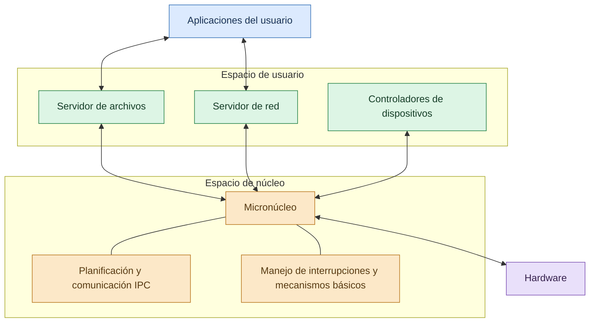
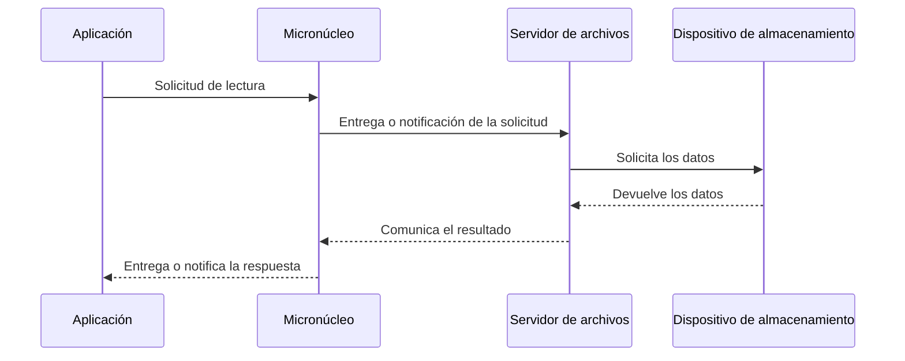

# Micronúcleos

La arquitectura de un sistema operativo determina cómo se organizan sus componentes y cómo interactúan para administrar los recursos de una computadora. Uno de los enfoques utilizados para diseñar estos sistemas es la arquitectura de **micronúcleo (microkernel)**, que busca mantener dentro del núcleo únicamente los mecanismos esenciales y trasladar numerosos servicios a procesos que se ejecutan en espacio de usuario.

Este diseño se relaciona con objetivos como la modularidad, la seguridad, el aislamiento de componentes y la facilidad de mantenimiento. Sin embargo, también presenta desafíos relacionados con la comunicación entre procesos y el rendimiento.

## ¿Qué es un micronúcleo?

Un **micronúcleo** es una arquitectura de sistema operativo en la que el núcleo mantiene un conjunto reducido de funciones esenciales para controlar la ejecución y permitir que los componentes del sistema se comuniquen.

Entre las responsabilidades que pueden permanecer en el micronúcleo se encuentran la planificación de hilos, los mecanismos básicos de comunicación entre procesos (IPC), el manejo de interrupciones y ciertas funciones fundamentales de administración de memoria.

Otros servicios, como algunos controladores de dispositivos, sistemas de archivos y componentes de red, pueden ejecutarse como procesos independientes en espacio de usuario.

La distribución exacta de responsabilidades depende de cada implementación. Por eso, un micronúcleo no se define únicamente por tener pocas líneas de código, sino principalmente por la separación de funciones y por qué servicios se ejecutan dentro o fuera del núcleo privilegiado.

## Arquitectura de un micronúcleo

En esta arquitectura, las aplicaciones utilizan servicios que pueden encontrarse fuera del núcleo. Cuando necesitan una operación, se comunican con el componente correspondiente mediante mecanismos controlados por el sistema operativo.

El micronúcleo proporciona los mecanismos fundamentales para gestionar la comunicación, la planificación y la protección entre los componentes.

El esquema representa una organización conceptual. En un sistema real, las aplicaciones no acceden directamente a todos los servicios ni al hardware; las operaciones se realizan mediante interfaces, permisos y mecanismos de comunicación establecidos por el sistema operativo.

## Componentes principales de un micronúcleo

### Planificador de tareas

El planificador decide qué hilo ejecutable debe recibir tiempo de procesador. Puede considerar prioridades, disponibilidad de los procesadores y otras políticas de planificación.

Su función es esencial para que las aplicaciones y los servicios del sistema puedan progresar de forma coordinada.

### Comunicación entre procesos (IPC)

La **comunicación entre procesos (Inter-Process Communication, IPC)** permite que los componentes intercambien información mediante mecanismos definidos por el sistema.

En un micronúcleo, la IPC tiene especial importancia porque numerosos servicios se ejecutan en procesos separados. Una aplicación puede enviar una solicitud a un servidor y recibir una respuesta sin necesitar que todo el servicio se ejecute dentro del núcleo.

Los mecanismos concretos pueden incluir paso de mensajes, canales de comunicación y otras formas de intercambio controlado de información.

### Administración básica de memoria

El micronúcleo proporciona o coordina mecanismos fundamentales para administrar la memoria y establecer las protecciones necesarias entre procesos.

La asignación detallada de recursos y la política de memoria pueden variar según el diseño. Lo importante es que los componentes no puedan acceder libremente a la memoria de otros procesos sin la autorización correspondiente.

### Manejo de interrupciones

Las interrupciones son señales que requieren atención del procesador, por ejemplo, cuando un dispositivo necesita comunicar que una operación ha terminado.

El micronúcleo participa en el manejo de estas interrupciones y puede coordinar la notificación a los componentes que deben responder al evento.

### Mecanismos de protección

La separación entre espacio de usuario y espacio de núcleo ayuda a limitar los privilegios de los componentes. Los servicios externos al núcleo suelen ejecutarse con permisos más restringidos que el código privilegiado del sistema.

Esta separación no elimina todos los riesgos, pero puede reducir el impacto de determinados errores y limitar el acceso a recursos sensibles.

## ¿Cómo funciona un micronúcleo?

Para comprender su funcionamiento, imaginemos que una aplicación necesita leer un archivo.

1. La aplicación solicita la operación mediante la interfaz correspondiente.
2. El sistema operativo dirige la solicitud al servicio encargado de administrar los archivos.
3. El servicio realiza las operaciones necesarias utilizando los mecanismos autorizados.
4. Si necesita comunicarse con otro componente, utiliza los canales o mecanismos de IPC correspondientes.
5. El servicio devuelve el resultado a la aplicación.
6. La aplicación continúa su ejecución con la información recibida.

Este proceso puede implicar varias comunicaciones entre componentes. La separación permite organizar los servicios de manera independiente, pero también puede aumentar el número de intercambios necesarios para completar una operación.

## Comunicación entre procesos en un micronúcleo

La IPC es una de las características más importantes de esta arquitectura. Como los servicios se ejecutan en procesos separados, necesitan intercambiar solicitudes, datos y resultados de forma controlada.

Por ejemplo, una aplicación puede enviar un mensaje al servidor de archivos para solicitar la lectura de un documento. El servidor procesa la petición y responde con los datos solicitados o con un código que indique el resultado de la operación.

El diagrama es simplificado: la ruta exacta de los mensajes, el acceso al dispositivo y la participación del micronúcleo dependen de la implementación. Su objetivo es mostrar cómo una operación puede distribuirse entre varios componentes.

## Características de los micronúcleos

Los micronúcleos suelen presentar las siguientes características:

- **Núcleo reducido:** mantiene un conjunto limitado de mecanismos privilegiados.
- **Separación de servicios:** numerosos componentes pueden ejecutarse como procesos independientes.
- **Comunicación controlada:** utiliza IPC para coordinar los servicios.
- **Aislamiento:** la separación de procesos puede limitar el impacto de determinados fallos.
- **Modularidad:** los componentes pueden diseñarse y mantenerse de manera independiente.
- **Protección de recursos:** las interfaces y los permisos ayudan a controlar el acceso a la memoria y los dispositivos.

Estas características dependen del diseño concreto y no garantizan por sí solas que todos los sistemas basados en micronúcleo sean más seguros o rápidos que cualquier otra arquitectura.

## Ventajas de los micronúcleos

### Mayor aislamiento de componentes

Cuando ciertos servicios se ejecutan fuera del núcleo, un error en uno de ellos puede quedar limitado a ese proceso en lugar de afectar directamente a todo el código privilegiado. No obstante, los fallos del micronúcleo o de componentes críticos todavía pueden comprometer el sistema.

### Mejor modularidad

Los servicios se organizan en componentes separados. Esto puede facilitar el desarrollo, las pruebas, el mantenimiento y la sustitución de determinados módulos.

### Reducción del código privilegiado

Al mantener menos servicios dentro del núcleo, se reduce la cantidad de código que opera con privilegios elevados. Esto puede disminuir la superficie de ataque y facilitar el análisis de seguridad.

### Mayor flexibilidad de diseño

Los servicios pueden implementarse de manera independiente y adaptarse a los requisitos de diferentes sistemas. Esta flexibilidad resulta útil en entornos especializados.

### Posible mejora de la confiabilidad

Si la arquitectura y sus mecanismos de protección están bien diseñados, algunos servicios pueden fallar y reiniciarse sin necesidad de detener completamente el sistema.

## Desventajas y limitaciones

### Sobrecarga de comunicación

La comunicación entre procesos puede requerir cambios de contexto, validaciones y transferencias de mensajes. Estas operaciones pueden incrementar el tiempo necesario para completar determinadas solicitudes.

### Complejidad de coordinación

Los servicios independientes necesitan protocolos claros para intercambiar información, gestionar errores y coordinar las operaciones.

### Dependencia entre componentes

Aunque los servicios estén separados, pueden depender unos de otros. Si un servicio esencial deja de responder, otras partes del sistema pueden quedar esperando o perder funcionalidad.

### Desafíos de rendimiento

El rendimiento depende de la eficiencia del IPC, la planificación, la administración de memoria y la organización de los servicios. Un micronúcleo mal diseñado puede presentar costos elevados, mientras que una implementación optimizada puede reducirlos considerablemente.

## Micronúcleo y núcleo monolítico

Un **núcleo monolítico** incorpora numerosas funciones del sistema operativo dentro del espacio privilegiado del núcleo. En cambio, un micronúcleo intenta mantener ese conjunto de funciones más reducido y trasladar servicios a procesos externos.

| Característica | Micronúcleo | Núcleo monolítico |
| --- | --- | --- |
| Organización | Mantiene pocos mecanismos esenciales dentro del núcleo. | Integra numerosos servicios en el núcleo. |
| Servicios | Muchos pueden ejecutarse en espacio de usuario. | Muchos se ejecutan en espacio de núcleo. |
| Comunicación | Puede depender más de IPC entre procesos. | Muchos componentes se comunican mediante llamadas internas. |
| Aislamiento | Facilita separar determinados servicios. | Un fallo en un componente privilegiado puede afectar al sistema completo. |
| Rendimiento | La comunicación entre servicios puede introducir sobrecarga. | Las llamadas internas pueden ser eficientes, según la implementación. |
| Mantenimiento | Favorece la separación de componentes. | Puede ser modular internamente, aunque los componentes comparten el entorno privilegiado. |

Ninguna arquitectura es automáticamente superior en todos los casos. La elección depende de los requisitos de rendimiento, seguridad, confiabilidad, complejidad y mantenimiento.

## Diferencia entre micronúcleo y núcleo híbrido

Un núcleo híbrido combina características de distintas arquitecturas y mantiene determinados servicios en el espacio privilegiado por razones de diseño, compatibilidad o rendimiento.

Windows utiliza una arquitectura que suele describirse como híbrida. Aunque incorpora una organización por componentes, muchos servicios esenciales y controladores se ejecutan en modo de núcleo.

Por otro lado, Linux se clasifica generalmente como un núcleo monolítico modular: admite módulos cargables, pero numerosos subsistemas y controladores siguen ejecutándose dentro del espacio del núcleo.

Por eso, Windows y Linux no deben presentarse como ejemplos clásicos de micronúcleos puros.

## Ejemplos de sistemas operativos basados en micronúcleo

### MINIX 3

MINIX 3 es un sistema operativo conocido por su diseño basado en micronúcleo y su enfoque en la confiabilidad. Es útil para estudiar cómo se separan determinados servicios del núcleo y cómo se organizan los componentes de un sistema operativo.

### QNX Neutrino

QNX Neutrino es un sistema operativo comercial de tiempo real que utiliza una arquitectura de micronúcleo. Se emplea en diferentes sistemas integrados y entornos especializados donde pueden ser importantes la previsibilidad de la ejecución y la confiabilidad.

### seL4

seL4 es un micronúcleo conocido por su enfoque en la seguridad y la verificación formal de determinadas propiedades de su implementación. Se estudia en contextos donde el aislamiento y las garantías de seguridad tienen especial relevancia.

Estos sistemas presentan objetivos y características diferentes; no todos se utilizan en los mismos tipos de dispositivos ni bajo las mismas condiciones.

## Aplicaciones de los micronúcleos

Los micronúcleos pueden resultar adecuados en entornos donde se valora la separación de componentes, la confiabilidad o el control preciso de los recursos.

Entre sus posibles ámbitos de aplicación se encuentran:

- **Sistemas embebidos:** dispositivos con funciones específicas y recursos controlados.
- **Sistemas de tiempo real:** aplicaciones que necesitan cumplir requisitos temporales definidos.
- **Equipos industriales:** sistemas de control y supervisión.
- **Sistemas especializados:** plataformas que requieren aislamiento entre servicios.
- **Investigación y educación:** entornos utilizados para estudiar arquitecturas, IPC y mecanismos de protección.

La elección de un sistema basado en micronúcleo debe considerar los requisitos concretos del proyecto, ya que no todos los micronúcleos están diseñados para las mismas aplicaciones.

## Conclusión

Los micronúcleos representan una forma de organizar los sistemas operativos mediante la separación de los mecanismos esenciales del núcleo y numerosos servicios que pueden ejecutarse en espacio de usuario. Esta arquitectura busca favorecer el aislamiento, la modularidad y la reducción del código privilegiado.

La comunicación entre procesos constituye uno de sus mecanismos fundamentales, ya que permite que las aplicaciones y los servicios intercambien solicitudes y resultados de manera controlada.

Aunque los micronúcleos pueden ofrecer ventajas en seguridad y confiabilidad, también presentan desafíos relacionados con la comunicación, la coordinación y el rendimiento. Por ello, su eficacia depende del diseño y de los objetivos del sistema operativo.

Comprender esta arquitectura permite compararla con los núcleos monolíticos y los núcleos híbridos, así como analizar por qué diferentes sistemas operativos adoptan distintas formas de organizar sus componentes.

## Referencias bibliográficas

- Tanenbaum, A. S., y Bos, H. (2015). *Modern Operating Systems* (4.ª ed.). Pearson.
- Stallings, W. (2018). *Operating Systems: Internals and Design Principles* (9.ª ed.). Pearson.
- MINIX 3. *The MINIX 3 Operating System*. https://www.minix3.org/
- seL4 Foundation. *seL4 Documentation*. https://docs.sel4.systems/
- QNX. *QNX Operating System*. https://blackberry.qnx.com/
