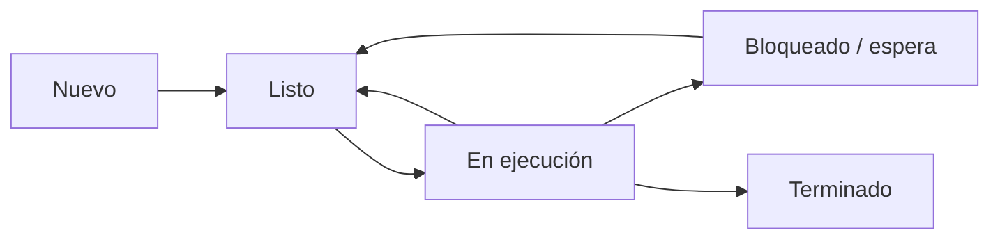

# Concepto de proceso vs. programa

Un **programa** es un conjunto de instrucciones almacenadas, por ejemplo un archivo ejecutable. Un **proceso** es una instancia de un programa en ejecución junto con el estado y los recursos que el sistema operativo necesita para administrarlo.

Un mismo programa puede originar varios procesos. Si se abren dos ventanas independientes de una aplicación, el sistema puede crear procesos separados, aunque compartan el mismo archivo ejecutable. La relación exacta depende de la aplicación y del sistema operativo.

| Aspecto | Programa | Proceso |
|---|---|---|
| Naturaleza | Archivo o conjunto de instrucciones | Entidad activa administrada por el SO |
| Estado de ejecución | No tiene estado de CPU por sí solo | Tiene estado, contador de programa y registros guardados |
| Recursos | No posee por sí mismo los recursos de una ejecución | Puede tener memoria, archivos abiertos y otros recursos |
| Identificación | Nombre/ruta del archivo, entre otros | Identificador de proceso (PID) durante su vida |

## ¿Qué contiene un proceso?

De forma conceptual, el sistema debe mantener o poder reconstruir:
- el contexto de ejecución (contador de programa y registros);
- la información de planificación y estado;
- el espacio de direcciones y sus mapeos;
- los recursos asociados, como descriptores de archivo;
- la relación con otros procesos.

Parte de esta información se representa en el **Bloque de Control de Proceso (PCB)**; otros detalles pueden estar en estructuras específicas del kernel.

## Ciclo de vida resumido



El diagrama muestra el modelo básico. Los sistemas reales pueden tener estados adicionales, como suspensión, y las transiciones exactas dependen del sistema operativo.

## Ejemplo en Linux

```bash
sleep 30 &
echo $!
ps -o pid,ppid,stat,comm -p $!
```

` sleep 30 ` es el programa/comando que se solicita ejecutar; al iniciarlo, el sistema crea un proceso. El shell muestra el PID del trabajo en segundo plano y `ps` permite consultar información del proceso mientras exista.

## Idea clave

El programa describe qué instrucciones pueden ejecutarse; el proceso representa una ejecución concreta que el sistema operativo puede planificar, pausar, reanudar y finalizar.

## Referencias

- Arpaci-Dusseau, R. y Arpaci-Dusseau, A. *Operating Systems: Three Easy Pieces*, capítulo “Processes”. https://pages.cs.wisc.edu/~remzi/OSTEP/
- Linux man-pages: `proc(5)`, `ps(1)`. https://man7.org/linux/man-pages/
