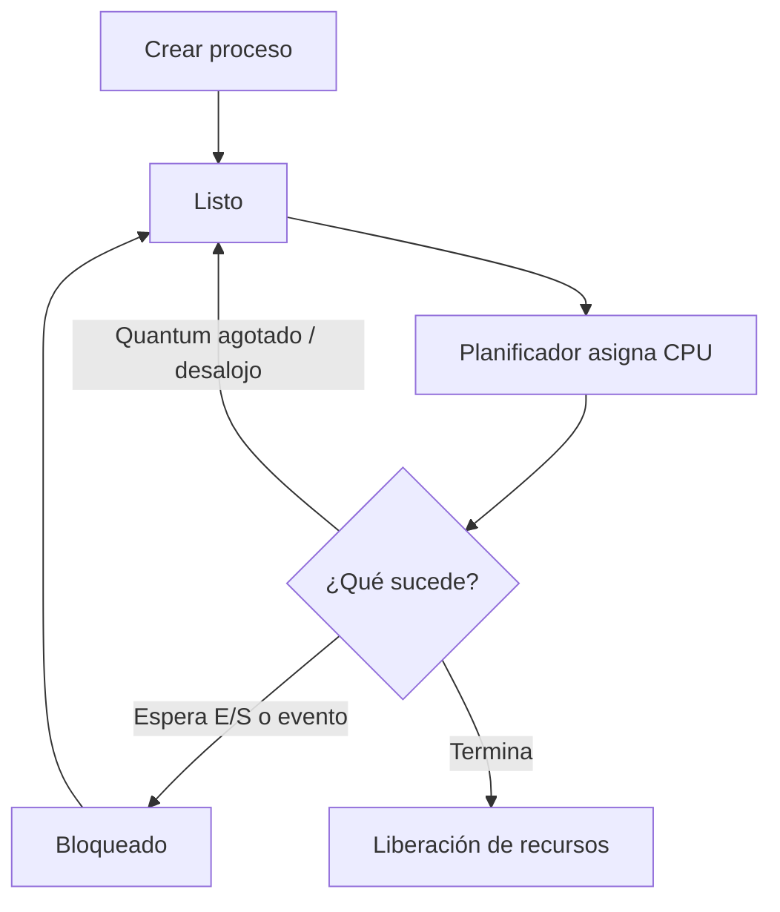

# Transiciones y control de procesos

El sistema operativo no solo registra los estados de los procesos: también controla cómo se crean, cuándo reciben CPU, cómo esperan por eventos y cómo terminan. Tres conceptos centrales son el cambio de contexto, la creación y la terminación.

## Cambio de contexto (*context switch*)

Un cambio de contexto ocurre cuando el sistema deja de ejecutar un hilo y comienza a ejecutar otro. El kernel guarda el contexto necesario del hilo saliente y restaura el del hilo entrante para que ambos puedan continuar como si su ejecución se hubiera pausado temporalmente.

El cambio puede producirse, por ejemplo, porque se agotó el quantum, llegó una interrupción, el hilo se bloqueó esperando E/S o se hizo elegible una tarea de mayor prioridad.

## Overhead o costo del sistema operativo

Durante el cambio de contexto se realizan tareas administrativas que no son trabajo útil directo de la aplicación: guardar y restaurar registros, ejecutar el planificador y actualizar estructuras. Además, el cambio puede afectar la caché y la TLB. Por eso, cambiar de contexto con demasiada frecuencia puede reducir el rendimiento.

No hay un costo universal fijo: depende de la CPU, el kernel, la carga, el cambio entre hilos del mismo proceso o procesos distintos, y los efectos sobre las cachés.

## Creación de procesos

El sistema operativo crea un nuevo contexto de ejecución y prepara sus recursos. La interfaz concreta depende del sistema:

- En sistemas tipo Unix, `fork()` crea un proceso hijo y `execve()` puede reemplazar la imagen del proceso por otro programa.
- En Windows, las interfaces de creación de procesos siguen un modelo diferente, como `CreateProcess()`.

En Unix, `fork()` suele aprovechar técnicas como *copy-on-write*: las páginas pueden compartirse inicialmente y copiarse si uno de los procesos modifica el contenido, en vez de duplicar inmediatamente toda la memoria.

## Terminación de procesos

Un proceso puede terminar normalmente devolviendo un código de salida, o ser terminado por una señal, una excepción o una acción administrativa. El kernel libera recursos y registra el estado de terminación. En sistemas tipo Unix, un proceso padre puede recoger el estado de un hijo mediante `wait()` o una interfaz relacionada.

## Resumen del ciclo de control



## Ejemplo práctico en Linux

```c
#include <stdio.h>
#include <unistd.h>
#include <sys/wait.h>

int main(void) {
    pid_t pid = fork();

    if (pid < 0) {
        perror("fork");
        return 1;
    }
    if (pid == 0) {
        printf("Proceso hijo: PID=%ld\n", (long)getpid());
        _exit(0);
    }

    printf("Proceso padre: hijo=%ld\n", (long)pid);
    wait(NULL);
    return 0;
}
```

Compilación: `gcc ejemplo.c -o ejemplo`. El ejemplo ilustra creación y espera; el orden exacto de los mensajes puede variar según la planificación.

## Referencias

- Arpaci-Dusseau, R. y Arpaci-Dusseau, A. *Operating Systems: Three Easy Pieces*. https://pages.cs.wisc.edu/~remzi/OSTEP/
- Linux man-pages: `fork(2)`, `execve(2)`, `wait(2)`. https://man7.org/linux/man-pages/
