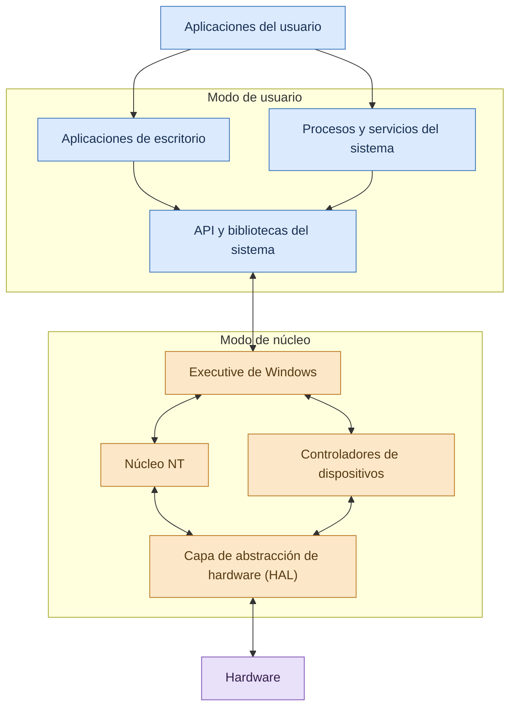

# Windows

Los sistemas operativos permiten que los usuarios y las aplicaciones utilicen los recursos de una computadora de forma organizada. Entre los sistemas operativos de propósito general, **Microsoft Windows** destaca por su amplia utilización en computadoras personales, equipos empresariales y entornos educativos.

Windows proporciona una interfaz gráfica, herramientas para ejecutar aplicaciones, mecanismos de administración de memoria y procesos, controladores de dispositivos y funciones de seguridad. Para comprender su funcionamiento, es necesario estudiar su arquitectura interna y la forma en que administra los recursos del hardware.

## ¿Qué es Windows?

**Windows** es una familia de sistemas operativos desarrollada por Microsoft. Sus versiones modernas para computadoras personales se basan en la arquitectura Windows NT, que incorpora mecanismos para administrar procesos, memoria, dispositivos, archivos, usuarios y permisos.

Su objetivo principal es proporcionar un entorno en el que las aplicaciones puedan ejecutarse sin tener que controlar directamente todos los detalles del hardware.

Por ejemplo, cuando un usuario abre un navegador, Windows crea o utiliza las estructuras de ejecución necesarias, asigna memoria virtual, planifica los hilos de la aplicación y facilita el acceso a dispositivos como la pantalla, el teclado y la conexión de red.

Estas tareas se realizan mediante distintos componentes del sistema operativo, que trabajan de manera coordinada para ofrecer estabilidad, seguridad y compatibilidad con las aplicaciones.

## Características principales de Windows

Windows incorpora diversas características que permiten utilizarlo en actividades personales, académicas y profesionales.

- **Interfaz gráfica de usuario:** proporciona ventanas, iconos, menús, cuadros de diálogo y otros elementos que facilitan la interacción con el equipo.
- **Multitarea:** permite mantener múltiples aplicaciones y servicios activos y distribuir el tiempo de procesamiento entre sus tareas.
- **Administración de memoria virtual:** utiliza mecanismos de memoria virtual y protección para organizar el espacio de direcciones de los procesos.
- **Compatibilidad con hardware:** emplea controladores para permitir que el sistema operativo y las aplicaciones utilicen distintos dispositivos.
- **Sistema de archivos:** admite sistemas como NTFS y, según la versión y el medio de almacenamiento, otros formatos.
- **Seguridad integrada:** incluye mecanismos de autenticación, permisos, control de acceso y protección del sistema.
- **Redes y comunicación:** ofrece herramientas y servicios para conectarse a redes locales e Internet.
- **Compatibilidad con aplicaciones:** proporciona interfaces de programación y entornos de ejecución utilizados por numerosos programas.
- **Administración de usuarios:** permite configurar cuentas, permisos y políticas de acceso, especialmente en entornos organizacionales.

Las características disponibles pueden variar según la versión de Windows, la edición instalada y la configuración del equipo.

## Evolución de Windows

Windows ha evolucionado desde un entorno gráfico que funcionaba sobre MS-DOS hasta una familia de sistemas operativos con arquitectura NT.

Algunas versiones importantes en su evolución son:

- **Windows 95:** popularizó una interfaz gráfica con menú Inicio y barra de tareas en las computadoras personales.
- **Windows XP:** consolidó el uso de la arquitectura NT en un sistema ampliamente utilizado tanto en hogares como en organizaciones.
- **Windows 7:** introdujo mejoras en la experiencia de usuario, la administración de ventanas y la compatibilidad.
- **Windows 10:** unificó numerosas funciones de escritorio y añadió mecanismos modernos de seguridad y administración.
- **Windows 11:** continuó la evolución de la interfaz y los requisitos de seguridad y hardware en las computadoras compatibles.

Esta evolución refleja cambios tanto en la apariencia del sistema como en la administración de recursos, la protección de datos y la compatibilidad con nuevas tecnologías.

## Arquitectura de Windows NT

Las versiones modernas de Windows para computadoras personales utilizan la arquitectura **Windows NT**, organizada en componentes que cooperan para ejecutar aplicaciones y administrar el hardware.

Una distinción fundamental es la separación entre el **modo de usuario** y el **modo de núcleo**.

### Modo de usuario (User Mode)

En este modo se ejecutan las aplicaciones habituales y numerosos procesos de sistema que no necesitan acceso directo a las funciones privilegiadas del procesador.

Los procesos en modo de usuario cuentan con espacios de direcciones protegidos y permisos específicos. Por regla general, una aplicación no puede acceder directamente a la memoria privada de otro proceso ni ejecutar instrucciones reservadas para el núcleo.

Cuando necesita un servicio privilegiado, utiliza las interfaces proporcionadas por el sistema operativo.

### Modo de núcleo (Kernel Mode)

En el modo de núcleo se ejecutan componentes con privilegios elevados para administrar recursos esenciales del sistema.

Entre ellos se encuentran el núcleo de Windows, el ejecutivo del sistema operativo y numerosos controladores de dispositivos. Estos componentes pueden realizar operaciones privilegiadas conforme a las reglas del sistema.

Un error en un componente de núcleo puede tener consecuencias graves, ya que dispone de un nivel de acceso superior al de una aplicación convencional.

### ¿Por qué se separan ambos modos?

La separación permite limitar los privilegios de las aplicaciones y establecer una frontera de protección. Si un programa común intenta ejecutar una operación que no tiene autorizada, el sistema puede impedirla sin concederle acceso irrestricto al hardware.

Esta protección no elimina todos los riesgos, pero constituye una parte importante de la estabilidad y la seguridad del sistema operativo.

## Diagrama de la arquitectura de Windows

El siguiente diagrama presenta una visión simplificada de la relación entre las aplicaciones, las interfaces del sistema, los componentes del núcleo y el hardware.

El esquema es conceptual y no representa todas las dependencias internas. En Windows NT, el núcleo, el ejecutivo, los controladores y la capa de abstracción de hardware tienen responsabilidades diferentes, aunque cooperan para proporcionar los servicios del sistema operativo.

## Componentes principales de Windows NT

### Núcleo NT (NT Kernel)

El núcleo proporciona mecanismos esenciales para la ejecución de hilos, el manejo de interrupciones y excepciones, la sincronización de bajo nivel y la coordinación con otros componentes privilegiados.

También participa en la planificación de la ejecución. El objetivo es que los hilos reciban tiempo de procesador de acuerdo con las políticas del sistema y las condiciones de ejecución.

### Ejecutivo de Windows (Windows Executive)

El ejecutivo reúne componentes que implementan numerosos servicios de alto nivel del sistema operativo. Entre sus responsabilidades se encuentran:

- **Administrador de procesos y hilos:** mantiene estructuras y servicios para crear, controlar y finalizar procesos e hilos.
- **Administrador de memoria:** participa en la gestión de la memoria virtual, la protección y la asignación de memoria.
- **Administrador de objetos:** proporciona mecanismos para representar y administrar objetos del sistema, junto con sus referencias y permisos.
- **Administrador de entrada/salida:** coordina solicitudes de entrada/salida y la interacción con los controladores.
- **Administrador de seguridad:** participa en la aplicación de permisos y decisiones de acceso.
- **Administrador de configuración:** administra información de configuración almacenada, entre otros lugares, en el Registro de Windows.

La distribución precisa de estas funciones corresponde a la implementación interna de Windows NT; no todas se ejecutan como procesos independientes.

### Capa de abstracción de hardware (HAL)

La **Hardware Abstraction Layer (HAL)** ayuda a aislar determinados detalles específicos de la plataforma de hardware.

Esta capa permite que otros componentes utilicen interfaces comunes para determinadas operaciones relacionadas con la plataforma, en lugar de depender directamente de cada particularidad física.

La abstracción del hardware contribuye a la portabilidad del sistema operativo entre plataformas compatibles, aunque no elimina la necesidad de controladores específicos para numerosos dispositivos.

### Controladores de dispositivos (Drivers)

Los controladores permiten que Windows se comunique con dispositivos como tarjetas de red, adaptadores gráficos, impresoras y unidades de almacenamiento.

Un controlador traduce las solicitudes del sistema operativo en operaciones que el dispositivo puede realizar. Los controladores pueden ejecutarse en diferentes entornos según su diseño; muchos controladores tradicionales de Windows operan en modo de núcleo, mientras que existen otros modelos.

Debido a sus privilegios, los controladores deben desarrollarse, instalarse y actualizarse cuidadosamente.

## Administración de procesos e hilos en Windows

Windows administra los procesos y los hilos para ejecutar aplicaciones, servicios y tareas del sistema.

Un **proceso** proporciona el entorno de ejecución de una aplicación, incluyendo su espacio de direcciones y recursos asociados. Un **hilo** representa una unidad de ejecución que el planificador puede asignar a un procesador lógico.

Un proceso puede contener varios hilos, los cuales comparten determinados recursos del proceso, pero mantienen su propio contexto de ejecución.

Por ejemplo, una aplicación puede utilizar diferentes hilos para procesar datos, responder a eventos de la interfaz y realizar operaciones de entrada/salida.

### Ciclo de ejecución de un hilo

Los hilos pueden encontrarse en diferentes estados, como listo, en ejecución, esperando o terminado. Windows utiliza sus propios estados y mecanismos internos de planificación, que no deben confundirse exactamente con el modelo conceptual de cinco estados de los procesos.

Este modelo simplificado ayuda a comprender cómo un hilo puede alternar entre ejecución y espera. El estado real de un hilo depende de las condiciones que administra el sistema operativo.

## Planificación del procesador

Windows utiliza mecanismos de planificación preventiva para distribuir el tiempo del procesador entre los hilos ejecutables.

El planificador considera factores como la prioridad, la disponibilidad de los procesadores y las necesidades de respuesta del sistema. Las decisiones pueden cambiar cuando un hilo termina, queda esperando o se presenta una situación que requiere reconsiderar qué tarea debe ejecutarse.

En equipos con varios núcleos, Windows puede distribuir hilos entre diferentes procesadores lógicos. Esto permite aprovechar el paralelismo disponible, aunque el rendimiento final también depende de la aplicación y de la sincronización entre sus tareas.

## Administración de memoria en Windows

La memoria es uno de los recursos más importantes de una computadora. Windows utiliza **memoria virtual** para proporcionar a los procesos espacios de direcciones protegidos y administrar la relación entre las direcciones virtuales y la memoria física.

La memoria virtual permite que cada proceso tenga una vista organizada de su espacio de direcciones sin que todas sus páginas deban permanecer necesariamente en la RAM durante toda su ejecución.

### Memoria virtual

Cada proceso dispone de un espacio de direcciones virtuales sujeto a la arquitectura, la configuración y las restricciones del sistema. El administrador de memoria coordina la asignación, la protección y la disponibilidad de las páginas de memoria.

Las direcciones virtuales se traducen a direcciones físicas mediante mecanismos de hardware y del sistema operativo. Cuando una página necesaria no está disponible en memoria física, puede producirse un fallo de página que requiere atención del sistema.

### Archivo de paginación

Windows puede utilizar un archivo de paginación para respaldar determinadas páginas de memoria comprometida cuando no es necesario o posible mantenerlas todas en la RAM.

Este archivo no es equivalente a la memoria RAM: el almacenamiento suele ser mucho más lento. Si el sistema depende excesivamente de operaciones de paginación, el rendimiento puede disminuir.

### Protección de memoria

El sistema operativo aplica permisos para controlar qué regiones pueden leerse, escribirse o ejecutarse. Estas restricciones ayudan a evitar accesos indebidos y a aislar los espacios de direcciones de los procesos.

La protección depende de la cooperación entre el sistema operativo y las funciones de hardware del procesador.

## Sistema de archivos en Windows

El sistema de archivos organiza la información almacenada en unidades de almacenamiento. Windows admite diferentes sistemas de archivos según el dispositivo y el uso previsto.

### NTFS

**NTFS (New Technology File System)** es uno de los sistemas de archivos principales de Windows. Ofrece funciones como:

- Permisos de acceso a archivos y carpetas mediante listas de control de acceso.
- Registro de cambios para ayudar a recuperar la consistencia del sistema de archivos después de determinados fallos.
- Compatibilidad con archivos y volúmenes de gran tamaño, dentro de los límites de la implementación.
- Compresión y otras funciones de administración.
- Características de seguridad y administración utilizadas en entornos personales y empresariales.

### FAT32 y exFAT

FAT32 es un sistema de archivos antiguo que continúa siendo compatible con numerosos dispositivos, aunque tiene limitaciones importantes, como un tamaño máximo de archivo individual de 4 GB.

exFAT se utiliza con frecuencia en unidades extraíbles y ofrece compatibilidad con archivos grandes. La elección del sistema de archivos depende del dispositivo, la compatibilidad necesaria y el propósito del almacenamiento.

### Organización de archivos

Windows utiliza rutas como `C:\Users\Usuario\Documents` para identificar ubicaciones dentro del sistema de archivos.

Los permisos y las políticas de acceso determinan qué usuarios y procesos pueden consultar, modificar o eliminar determinados archivos. Por ello, el acceso a una ubicación no depende solamente de conocer su ruta, sino también de las autorizaciones correspondientes.

## Administración de dispositivos y entrada/salida

Windows coordina las operaciones de entrada/salida para que las aplicaciones puedan utilizar dispositivos sin tener que administrar directamente todos los detalles del hardware.

El administrador de entrada/salida y los controladores participan en la recepción de solicitudes, la comunicación con los dispositivos y la notificación de resultados.

Entre los mecanismos utilizados se encuentran:

- **Solicitudes de entrada/salida:** representan operaciones que deben realizarse sobre dispositivos u otros recursos.
- **Interrupciones:** permiten que el hardware comunique determinados eventos que requieren atención.
- **Operaciones asíncronas:** permiten que una aplicación continúe realizando otras tareas mientras una operación está pendiente, cuando la interfaz utilizada lo admite.
- **Búferes:** ayudan a organizar temporalmente los datos que se transfieren.
- **Controladores:** proporcionan la lógica necesaria para interactuar con dispositivos específicos.

Estos mecanismos permiten coordinar el uso de los dispositivos y reducir la necesidad de que las aplicaciones controlen directamente el hardware.

## Seguridad en Windows

La seguridad de Windows combina mecanismos de autenticación, autorización, protección de memoria, aislamiento de procesos y herramientas para reducir los riesgos de software malicioso.

### Cuentas y autenticación

Las cuentas permiten identificar a los usuarios o entidades que acceden al sistema. La autenticación comprueba su identidad mediante los mecanismos configurados.

En entornos empresariales, Windows también puede integrarse con sistemas centralizados de identidad y políticas de administración.

### Control de acceso

Windows utiliza permisos y mecanismos de seguridad para determinar qué operaciones puede realizar un usuario o proceso sobre archivos, carpetas, servicios y otros objetos.

El principio de mínimo privilegio recomienda conceder solamente los permisos necesarios para cumplir una tarea.

### Control de cuentas de usuario (UAC)

El Control de cuentas de usuario ayuda a reducir el riesgo de que una aplicación realice cambios que requieren privilegios administrativos sin la autorización correspondiente.

Dependiendo de la configuración y del contexto, Windows puede solicitar confirmación o credenciales para permitir una operación elevada.

### Microsoft Defender y otras protecciones

Las versiones actuales de Windows incluyen herramientas de seguridad que pueden detectar amenazas, supervisar determinados comportamientos y ayudar a proteger el sistema.

La protección efectiva también depende de mantener el sistema actualizado, utilizar software confiable, aplicar contraseñas adecuadas y evitar ejecutar archivos de procedencia dudosa.

## Herramientas de administración de Windows

Windows incorpora herramientas que permiten observar el rendimiento, administrar procesos y revisar la configuración del sistema.

### Administrador de tareas

Permite consultar las aplicaciones y los procesos activos, observar el consumo de CPU y memoria, revisar el uso de recursos y administrar determinadas tareas.

Es útil para identificar programas que consumen demasiados recursos o que dejan de responder.

### Monitor de recursos

Ofrece información más detallada sobre el uso de CPU, memoria, disco y red. Ayuda a investigar qué procesos están utilizando los recursos del sistema.

### Administrador de dispositivos

Permite consultar el hardware detectado, revisar el estado de los dispositivos y administrar determinados controladores.

### Visor de eventos

Registra eventos del sistema, las aplicaciones y la seguridad. Puede utilizarse para investigar errores, problemas de inicio y otros sucesos importantes.

### Servicios de Windows

Permite consultar y administrar servicios que se ejecutan en segundo plano. Algunos servicios proporcionan funciones esenciales, por lo que no conviene detenerlos sin comprender su propósito.

## Ejemplo práctico: abrir una aplicación en Windows

Cuando un usuario abre una aplicación, Windows realiza una serie de operaciones coordinadas.

1. El usuario inicia la aplicación desde el menú Inicio, un acceso directo o el Explorador de archivos.
2. Windows solicita la creación del proceso o utiliza los mecanismos correspondientes para iniciar la aplicación.
3. El sistema prepara el espacio de direcciones y carga las partes necesarias del programa.
4. Se crean o inicializan los hilos que la aplicación necesita.
5. El planificador asigna tiempo de procesador a los hilos ejecutables.
6. Si la aplicación necesita leer un archivo o utilizar un dispositivo, solicita los servicios correspondientes al sistema operativo.
7. Cuando el usuario cierra la aplicación, se finaliza el proceso o sus componentes de ejecución y se liberan los recursos que ya no se necesitan.

Esta secuencia es una explicación simplificada. Los detalles varían según el tipo de aplicación, las bibliotecas utilizadas, los servicios que requiere y la versión de Windows.

## Ventajas de Windows

- **Facilidad de uso:** su interfaz gráfica resulta familiar para muchos usuarios.
- **Amplia compatibilidad:** existe una gran variedad de aplicaciones comerciales, educativas y profesionales.
- **Soporte de hardware:** numerosos fabricantes proporcionan controladores para dispositivos compatibles.
- **Herramientas administrativas:** incluye utilidades para gestionar procesos, servicios, dispositivos y eventos.
- **Integración empresarial:** permite utilizar políticas, herramientas de administración e infraestructuras de identidad.
- **Funciones de seguridad:** incorpora mecanismos de control de acceso, protección y detección de amenazas.

## Desventajas y limitaciones de Windows

- **Licenciamiento:** determinadas ediciones y usos pueden requerir una licencia de pago.
- **Requisitos de hardware:** algunas versiones necesitan equipos que cumplan condiciones específicas de compatibilidad.
- **Consumo de recursos:** los servicios, las aplicaciones y las tareas en segundo plano pueden consumir memoria y procesador.
- **Actualizaciones:** algunas actualizaciones pueden requerir reinicios o causar incompatibilidades en determinadas configuraciones.
- **Exposición a amenazas:** su popularidad lo convierte en un objetivo frecuente de ataques, aunque el riesgo también depende de las prácticas de seguridad y la configuración.
- **Menor flexibilidad en ciertos componentes:** algunas modificaciones avanzadas pueden ser más limitadas que en sistemas que ofrecen mayor control directo sobre sus componentes.

Estas limitaciones no se presentan de la misma manera en todos los equipos ni en todas las versiones.

## Windows en entornos académicos y profesionales

Windows se utiliza ampliamente en oficinas, centros educativos, laboratorios informáticos y empresas. Su compatibilidad con herramientas de desarrollo, aplicaciones de productividad y numerosos dispositivos lo convierte en una plataforma común para el aprendizaje y el trabajo.

En Ingeniería en Sistemas, conocer Windows permite practicar la administración de procesos, la gestión de archivos, la instalación de software, la revisión de eventos y el diagnóstico de problemas.

También es importante comprender sus límites y compararlo con otros sistemas operativos para elegir la plataforma más adecuada según los requisitos de cada proyecto.

## Conclusión

Windows es una familia de sistemas operativos que proporciona servicios para ejecutar aplicaciones y administrar los recursos de una computadora. Su arquitectura NT organiza componentes que cooperan para gestionar procesos, hilos, memoria virtual, dispositivos, archivos y seguridad.

La separación entre el modo de usuario y el modo de núcleo establece una frontera de privilegios que ayuda a proteger los recursos del sistema. Asimismo, los controladores, el administrador de memoria y los mecanismos de planificación permiten que las aplicaciones utilicen el hardware de manera coordinada.

Conocer la arquitectura y las herramientas de Windows es importante para comprender su funcionamiento, solucionar problemas y administrar equipos en entornos académicos y profesionales. Estos conocimientos también sirven como base para compararlo con Linux, que se estudiará en el siguiente tema de la unidad.

## Referencias bibliográficas

- Russinovich, M. E., Solomon, D. A., Ionescu, A., y Yosifovich, P. (2017). *Windows Internals, Part 1* (7.ª ed.). Microsoft Press.
- Microsoft Learn. *Windows Architecture*. https://learn.microsoft.com/en-us/windows-hardware/drivers/gettingstarted/
- Microsoft Learn. *Processes and Threads*. https://learn.microsoft.com/en-us/windows/win32/procthread/about-processes-and-threads
- Microsoft Learn. *Memory Management*. https://learn.microsoft.com/en-us/windows/win32/memory/memory-management
- Microsoft Support. *Windows Help and Learning*. https://support.microsoft.com/windows