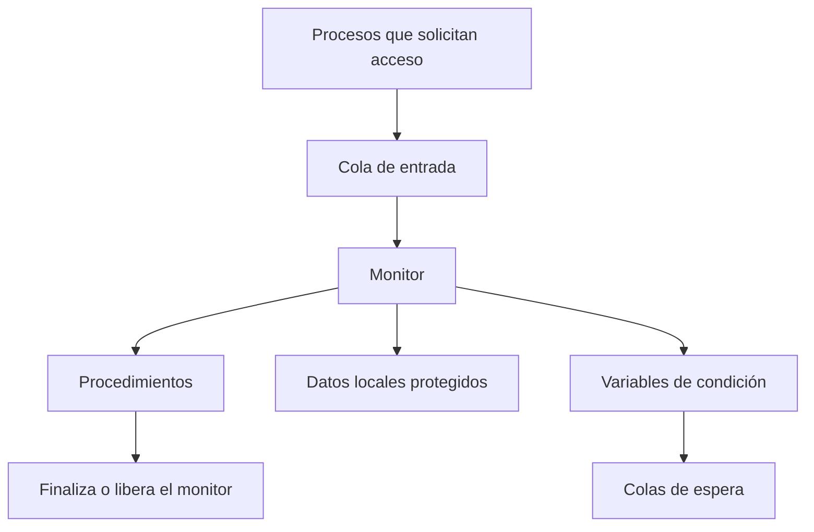
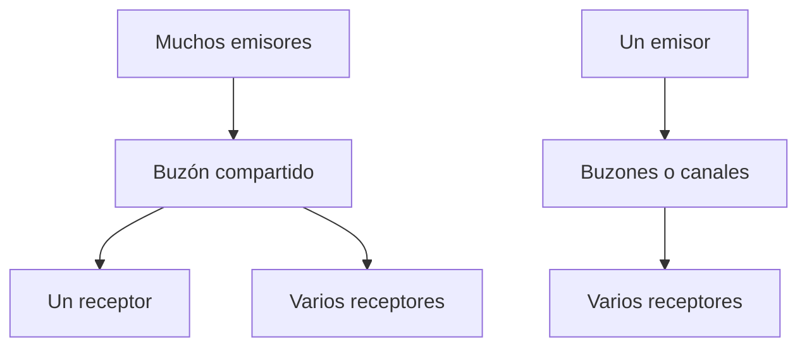
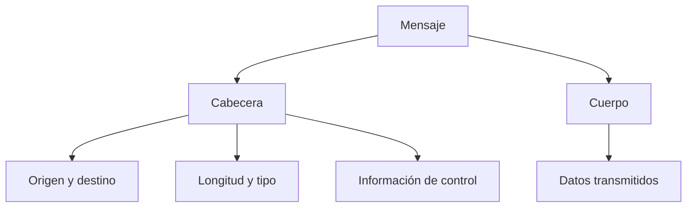
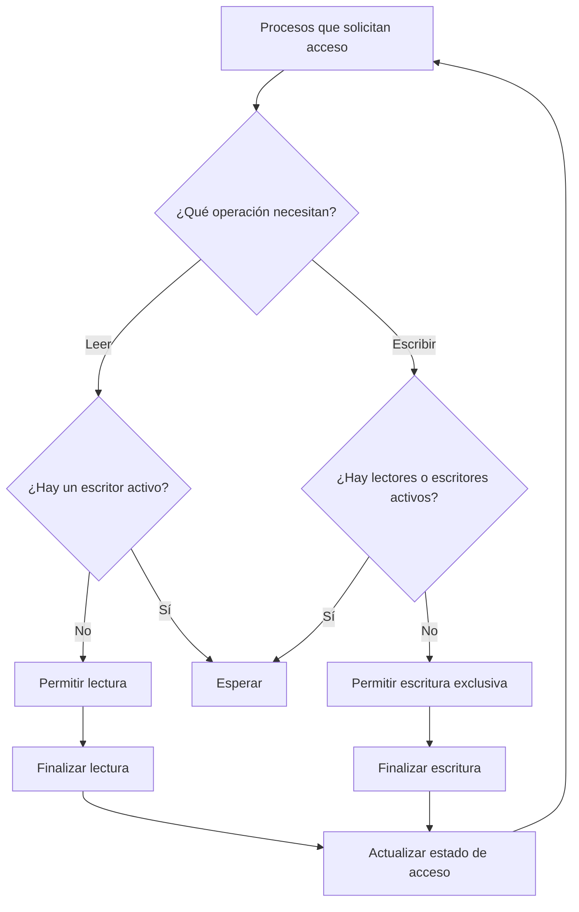

# Concurrencia: Monitores, Mensajes y Lectores/Escritores

## Introducción

En la programación concurrente, los semáforos permiten coordinar procesos y controlar el acceso a los recursos compartidos. Sin embargo, su utilización requiere cuidado, porque un error en el orden de las operaciones puede provocar señales perdidas, interbloqueos o errores difíciles de detectar.

Para reducir estos riesgos, existen mecanismos de sincronización de más alto nivel, como los monitores y el paso de mensajes. Los monitores agrupan los datos compartidos y los procedimientos que los manipulan, mientras que el paso de mensajes permite que los procesos se comuniquen sin depender necesariamente de la memoria compartida.

En esta sesión también se estudia el problema de los lectores y escritores, que permite comprender cómo varios procesos pueden acceder a los mismos datos de manera segura sin limitar innecesariamente las operaciones de lectura.

## Objetivos

- Explicar cómo los monitores proporcionan exclusión mutua y ayudan a reducir errores de sincronización.
- Diferenciar los modelos de monitores de Hoare y Mesa.
- Comprender cómo funciona la comunicación entre procesos mediante el paso de mensajes y los buzones.
- Identificar las modalidades de envío, recepción y direccionamiento de mensajes.
- Explicar el problema de los lectores y escritores.
- Comparar las soluciones que dan prioridad a los lectores y las que dan prioridad a los escritores.

## 1. De los semáforos a herramientas de más alto nivel

Los semáforos permiten sincronizar procesos mediante operaciones como `semWait` y `semSignal`. No obstante, si estas operaciones se colocan incorrectamente o se ejecutan en un orden inadecuado, pueden aparecer errores de sincronización.

Por ejemplo, en el problema productor-consumidor, una señal puede perderse si un proceso intenta esperar después de que otro ya haya enviado la señal. Este tipo de situación demuestra que la sincronización necesita una estructura cuidadosa.

Para reducir esos riesgos, se estudian dos mecanismos:

- **Monitores:** agrupan los datos compartidos y los procedimientos que acceden a ellos, proporcionando exclusión mutua automática.
- **Paso de mensajes:** permite intercambiar información y coordinar procesos mediante operaciones de envío y recepción.

Ambos mecanismos ofrecen alternativas para organizar la sincronización de forma más estructurada.

## 2. Monitores: concepto y estructura

Un **monitor** es un módulo de software que agrupa datos locales, procedimientos y una secuencia de inicialización. Los procesos acceden a sus datos mediante los procedimientos definidos dentro del monitor.

Sus principales características son:

1. Los datos locales solo pueden manipularse mediante los procedimientos del propio monitor.
2. Los procesos acceden al monitor invocando uno de sus procedimientos.
3. Solo un proceso puede ejecutar dentro del monitor a la vez; los demás deben esperar su turno.

La tercera característica es fundamental, porque la exclusión mutua está integrada en la estructura del monitor. A diferencia de los semáforos, el programador no necesita colocar manualmente un mecanismo de exclusión mutua en cada acceso al módulo.

### Variables de condición

Los monitores utilizan variables de condición para suspender procesos hasta que una condición necesaria se cumpla.

| Operación | Función |
|---|---|
| `cwait(c)` | Suspende al proceso que espera la condición `c` y permite que otro proceso entre al monitor. |
| `csignal(c)` | Reactiva a un proceso que espera la condición `c`, si existe alguno. |
| `cnotify(c)` | En el modelo Mesa, notifica a un proceso que espera una condición, sin exigir que se ejecute inmediatamente. |
| `cbroadcast(c)` | Notifica a todos los procesos que esperan una condición. |

Si no hay procesos esperando cuando se realiza una señal, esta no queda necesariamente almacenada para una futura espera. Por eso, es importante comprender la semántica de cada operación.

### Estructura conceptual de un monitor



*Figura 1. Componentes principales de un monitor.*

## 3. Monitor de Hoare: ejemplo del búfer acotado

El problema productor-consumidor puede resolverse utilizando un monitor que centralice las operaciones sobre un búfer de capacidad limitada.

El monitor administra:

- Un arreglo donde se almacenan los datos.
- Un índice de entrada y otro de salida.
- Un contador de elementos disponibles.
- Una condición para los productores que esperan espacio.
- Una condición para los consumidores que esperan datos.

### Pseudocódigo

```text
monitor buffer_acotado:
    buffer[N]
    dentro = 0
    fuera = 0
    cuenta = 0

    condicion no_lleno
    condicion no_vacio

    agregar(dato):
        if cuenta == N:
            cwait(no_lleno)

        buffer[dentro] = dato
        dentro = (dentro + 1) % N
        cuenta += 1
        csignal(no_vacio)

    extraer():
        if cuenta == 0:
            cwait(no_vacio)

        dato = buffer[fuera]
        fuera = (fuera + 1) % N
        cuenta -= 1
        csignal(no_lleno)

        return dato
```

Este ejemplo es pseudocódigo conceptual y representa la organización de un monitor; no es un programa listo para ejecutarse directamente en Python.

### ¿Cómo funciona?

1. El productor llama al procedimiento `agregar`.
2. Si el búfer está lleno, espera hasta que exista espacio.
3. Cuando puede continuar, almacena el dato y actualiza el contador.
4. El consumidor llama a `extraer`.
5. Si no hay datos disponibles, espera.
6. Cuando puede continuar, retira un dato y libera un espacio.

La exclusión mutua la proporciona el monitor, mientras que las variables de condición coordinan la disponibilidad de datos y espacios.

### Regla del monitor de Hoare

En el modelo original de Hoare, cuando un proceso ejecuta `csignal` y existe otro proceso esperando esa condición, el proceso despertado obtiene inmediatamente el control del monitor. El proceso que señaló debe cederlo o esperar en una cola urgente.

Esta regla permite que el proceso despertado actúe bajo una condición de ejecución específica, pero puede requerir cambios adicionales de proceso.

## 4. Modelo Mesa: notificación y difusión

El modelo Mesa propone una forma diferente de manejar las variables de condición.

Cuando un proceso ejecuta una notificación, continúa ejecutándose dentro del monitor. El proceso notificado pasa a estar disponible para ejecutarse posteriormente, pero no tiene garantizado que será el siguiente en entrar.

Por esta razón, en el modelo Mesa se recomienda comprobar las condiciones con un bucle `while` y no solamente con una instrucción `if`.

### Ejemplo conceptual

```text
agregar(dato):
    while cuenta == N:
        cwait(no_lleno)

    buffer[dentro] = dato
    dentro = (dentro + 1) % N
    cuenta += 1
    cnotify(no_vacio)

extraer():
    while cuenta == 0:
        cwait(no_vacio)

    dato = buffer[fuera]
    fuera = (fuera + 1) % N
    cuenta -= 1
    cnotify(no_lleno)

    return dato
```

### ¿Por qué se utiliza `while`?

Un proceso puede recibir una notificación y, antes de entrar nuevamente al monitor, otro proceso puede modificar el estado compartido. Por eso, la condición que provocó la espera podría dejar de cumplirse.

El bucle `while` permite volver a comprobarla y esperar otra vez si es necesario. Así se evita que un proceso actúe suponiendo que la condición sigue siendo válida.

La operación `cbroadcast` permite notificar a todos los procesos que esperan una condición. Resulta útil cuando no se conoce de antemano cuántos procesos podrán continuar.

### Comparación entre Hoare y Mesa

| Aspecto | Modelo Hoare | Modelo Mesa |
|---|---|---|
| Operación característica | `csignal` | `cnotify` y `cbroadcast` |
| Control después de la señal | El proceso despertado recibe inmediatamente el monitor. | El proceso que notifica continúa ejecutándose. |
| Comprobación habitual | `if`, bajo la semántica original del modelo. | `while`, para comprobar nuevamente la condición. |
| Planificación | Requiere transferir el control al proceso despertado. | La notificación no garantiza ejecución inmediata. |
| Consideración principal | Su semántica es precisa, pero puede requerir cambios adicionales de proceso. | Es más flexible para la programación práctica, siempre que se reevalúen las condiciones. |

## 5. Paso de mensajes: fundamentos

El **paso de mensajes** es un mecanismo de comunicación entre procesos que permite intercambiar información y coordinar actividades.

Las dos operaciones básicas son:

```text
send(destino, mensaje)
receive(origen, mensaje)
```

- `send` envía un mensaje a un destinatario o canal.
- `receive` recibe un mensaje procedente de un origen o canal.

Su ventaja principal es que permite coordinar procesos sin depender de una zona de memoria compartida. Por ello, puede utilizarse tanto en sistemas centralizados como en sistemas distribuidos conectados mediante una red.

### Envío y recepción bloqueantes y no bloqueantes

Una operación bloqueante puede suspender al proceso hasta que se cumpla la condición requerida. Una operación no bloqueante permite que el proceso continúe sin esperar a que la comunicación se complete.

| Combinación | Comportamiento |
|---|---|
| Envío bloqueante y recepción bloqueante | Ambos procesos pueden esperar hasta que se complete la entrega del mensaje; puede producirse un encuentro sincronizado (*rendezvous*). |
| Envío no bloqueante y recepción bloqueante | El emisor continúa, mientras el receptor espera hasta que llegue el mensaje solicitado. |
| Envío no bloqueante y recepción no bloqueante | Ninguno espera obligatoriamente; el receptor debe comprobar si el mensaje está disponible. |

La combinación adecuada depende de las necesidades de coordinación de la aplicación.

## 6. Direccionamiento directo e indirecto

Los mensajes pueden dirigirse de dos formas principales.

### Direccionamiento directo

El emisor especifica el identificador del proceso destinatario. El receptor puede esperar un mensaje de un proceso determinado o aceptar mensajes de diferentes orígenes, según el mecanismo utilizado.

Este método establece una relación explícita entre los procesos que se comunican.

### Direccionamiento indirecto

Los mensajes se depositan en una estructura intermedia llamada **buzón** (*mailbox*). Los procesos envían y reciben mensajes utilizando ese buzón, lo que reduce la dependencia directa entre el emisor y el receptor.

Un buzón también puede denominarse puerto cuando se utiliza como punto de comunicación, especialmente en ciertos modelos cliente-servidor.

### Relaciones entre emisores y receptores

| Relación | Descripción | Ejemplo |
|---|---|---|
| Uno a uno | Un emisor se comunica con un receptor. | Dos procesos que intercambian datos. |
| Muchos a uno | Varios emisores envían mensajes a un mismo receptor. | Varios clientes que envían solicitudes a un servidor. |
| Uno a muchos | Un emisor comunica información a varios receptores. | Difusión de una notificación. |
| Muchos a muchos | Varios emisores y receptores intercambian mensajes. | Varios clientes atendidos por diferentes procesos servidores. |



*Figura 2. Representación simplificada de la comunicación indirecta mediante buzones.*

## 7. Formato de mensaje y organización de las colas

Un mensaje puede organizarse en dos partes principales:

- **Cabecera:** contiene información de control, como el origen, el destino, la longitud, el tipo de mensaje o un número de secuencia.
- **Cuerpo:** contiene los datos que se desean transmitir.



*Figura 3. Estructura conceptual de un mensaje.*

Los mensajes pueden almacenarse en colas mientras esperan ser recibidos. Una política sencilla es FIFO (*First In, First Out*), en la que se atiende primero el mensaje que llegó antes.

En otros sistemas pueden utilizarse prioridades para atender primero los mensajes más urgentes, o permitir que el receptor seleccione cuál mensaje procesar.

## 8. Exclusión mutua mediante paso de mensajes

El paso de mensajes también puede utilizarse para controlar el acceso exclusivo a un recurso.

Una solución conceptual consiste en crear un buzón que contenga inicialmente un único mensaje especial, llamado **testigo**.

1. Un proceso que desea entrar a la sección crítica intenta recibir el testigo.
2. Si el testigo está disponible, lo obtiene y entra a la sección crítica.
3. Si otro proceso ya lo tiene, el proceso que lo solicita debe esperar.
4. Cuando termina, el proceso devuelve el testigo al buzón.

### Pseudocódigo

```text
crear_buzon(testigo)
enviar(testigo, mensaje_nulo)

proceso():
    mientras True:
        recibir(testigo, mensaje)
        # Sección crítica
        enviar(testigo, mensaje)
```

El testigo funciona como un permiso que solo puede estar en posesión de un proceso a la vez. La exclusión mutua depende de que el mecanismo del buzón garantice correctamente la entrega y la recepción del mensaje.

### Productor-consumidor con buzones

También es posible utilizar buzones para coordinar productores y consumidores:

- Un buzón de permisos de producción comienza con mensajes que representan los espacios disponibles.
- Un buzón de consumo recibe los datos producidos.
- El productor necesita obtener un permiso antes de agregar un dato.
- El consumidor recibe un dato y devuelve un permiso que representa el espacio liberado.

Este diseño permite utilizar la cola de mensajes como estructura para almacenar los datos, evitando la necesidad de un arreglo compartido separado.

## 9. El problema de los lectores y escritores

El problema de los lectores y escritores es un problema clásico de sincronización en el que varios procesos acceden a una misma área de datos, como un archivo, una tabla o un bloque de memoria.

Existen dos tipos de procesos:

- **Lectores:** consultan los datos sin modificarlos.
- **Escritores:** modifican los datos compartidos.

Para mantener la consistencia de la información, deben cumplirse tres condiciones:

1. Varios lectores pueden leer simultáneamente.
2. Solo un escritor puede escribir a la vez.
3. Mientras un escritor modifica los datos, ningún lector puede leerlos.

### ¿Por qué no utilizar exclusión mutua general?

Si todos los accesos se protegieran mediante un único mecanismo que permitiera entrar a un solo proceso a la vez, los lectores tendrían que leer de uno en uno.

Esto sería innecesario, porque varios lectores pueden consultar los mismos datos simultáneamente siempre que ningún escritor los esté modificando.

Por ello, el problema necesita una solución que permita lecturas concurrentes, pero que mantenga la escritura bajo control exclusivo.



*Figura 4. Control conceptual del acceso al recurso compartido.*

## 10. Solución con prioridad para los lectores

En esta solución, se permite que varios lectores accedan simultáneamente al área de datos, siempre que no exista un escritor activo.

Se utilizan dos semáforos:

- `x`, inicializado en 1, protege el contador de lectores activos.
- `sescr`, inicializado en 1, controla el acceso exclusivo al área de datos frente a los escritores.

También se utiliza el contador `cuentalect` para conocer cuántos lectores están activos.

### Pseudocódigo

```text
cuentalect = 0
x = Semaforo(1)
sescr = Semaforo(1)

lector():
    mientras True:
        semWait(x)
        cuentalect += 1

        if cuentalect == 1:
            semWait(sescr)

        semSignal(x)

        LEER_DATO()

        semWait(x)
        cuentalect -= 1

        if cuentalect == 0:
            semSignal(sescr)

        semSignal(x)

escritor():
    mientras True:
        semWait(sescr)
        ESCRIBIR_DATO()
        semSignal(sescr)
```

### ¿Cómo funciona?

1. Cuando llega el primer lector, adquiere `sescr` para impedir que los escritores accedan al área de datos.
2. Los lectores siguientes pueden leer simultáneamente, incrementando el contador protegido por `x`.
3. Cada lector reduce el contador cuando termina.
4. El último lector libera `sescr`, permitiendo que un escritor pueda entrar.
5. El escritor debe adquirir `sescr` antes de modificar los datos y liberarlo cuando termina.

### Desventaja: inanición de los escritores

Si llegan lectores continuamente, puede ocurrir que siempre haya algún lector activo. En ese caso, los escritores pueden permanecer esperando indefinidamente.

Este fenómeno se denomina **inanición** (*starvation*): un proceso no consigue acceder al recurso porque otros procesos continúan obteniendo prioridad.

## 11. Solución con prioridad para los escritores

La prioridad para los escritores busca evitar que los lectores nuevos sigan entrando indefinidamente mientras existen escritores esperando.

El material de la sesión presenta una estrategia que utiliza semáforos adicionales, entre ellos `slect` y `z`, para controlar la entrada de nuevos lectores y coordinar la espera.

La idea principal es impedir que una llegada constante de lectores mantenga bloqueados a los escritores de forma indefinida.

### Comparación de prioridades

| Aspecto | Prioridad para lectores | Prioridad para escritores |
|---|---|---|
| Objetivo principal | Facilitar lecturas simultáneas. | Evitar que los escritores esperen indefinidamente por la llegada de lectores nuevos. |
| Ventaja | Aprovecha el paralelismo cuando predominan las consultas. | Favorece la actualización oportuna de los datos. |
| Riesgo principal | Los escritores pueden sufrir inanición. | Los lectores pueden experimentar esperas prolongadas si los escritores tienen prioridad constante. |
| Uso posible | Catálogos o sistemas con muchas consultas. | Sistemas donde las actualizaciones deben atenderse oportunamente. |

La elección depende de las necesidades de cada sistema. En un catálogo de biblioteca con muchas consultas puede resultar conveniente favorecer las lecturas simultáneas. En un sistema que administra actualizaciones críticas, puede ser más importante evitar que las escrituras queden retrasadas indefinidamente.

**Nota:** el material proporcionado explica el propósito de los semáforos adicionales para la prioridad de escritores, pero no incluye el pseudocódigo completo de esa variante. Por eso, esta página presenta su principio de funcionamiento sin inventar una implementación detallada.

## 12. Comparación entre semáforos, monitores y paso de mensajes

| Mecanismo | ¿Cómo controla la sincronización? | Riesgo principal | Aplicación habitual |
|---|---|---|---|
| Semáforos | El programador coordina el acceso mediante operaciones de espera y señal. | Errores de orden, señales perdidas o interbloqueos. | Sincronización de bajo nivel y control de recursos compartidos. |
| Monitores | La estructura del monitor proporciona exclusión mutua automática. | Manejo incorrecto de las condiciones de espera y notificación. | Aplicaciones concurrentes que comparten datos dentro de un módulo. |
| Paso de mensajes | Los procesos coordinan su trabajo mediante envío y recepción de mensajes. | Esperas mutuas, mensajes no recibidos o inanición, según la implementación. | Sistemas distribuidos o aplicaciones que utilizan comunicación entre procesos. |

Los tres mecanismos pueden ayudar a resolver problemas de concurrencia, pero cada uno organiza de forma diferente el acceso a los recursos y la coordinación entre procesos.

## 13. Resumen de la sesión

Los monitores proporcionan una estructura organizada para proteger los datos compartidos y coordinar procesos mediante variables de condición. El modelo de Hoare transfiere inmediatamente el control al proceso despertado, mientras que el modelo Mesa permite que el proceso que notifica continúe ejecutándose y exige volver a comprobar las condiciones.

El paso de mensajes permite intercambiar información mediante operaciones de envío y recepción. Los buzones facilitan la comunicación indirecta y también pueden utilizarse para controlar el acceso exclusivo a un recurso.

Por otra parte, el problema de los lectores y escritores demuestra que la sincronización debe equilibrar la seguridad de los datos y el rendimiento. La prioridad para los lectores favorece las consultas simultáneas, mientras que la prioridad para los escritores busca evitar que las actualizaciones queden esperando indefinidamente.

En conjunto, estos mecanismos permiten desarrollar sistemas concurrentes más seguros y organizados, siempre que se utilicen de acuerdo con sus reglas de sincronización.

## 14. Preguntas de repaso

1. ¿Qué garantiza automáticamente un monitor que no garantiza por sí solo un semáforo?
2. ¿Por qué el modelo Mesa utiliza un bucle `while` para comprobar las condiciones?
3. ¿En qué situación sería conveniente utilizar `cbroadcast` en lugar de `cnotify`?
4. ¿Cuáles son las combinaciones habituales de envío y recepción bloqueantes y no bloqueantes?
5. ¿Qué diferencia existe entre direccionamiento directo e indirecto?
6. ¿Qué es un buzón y cómo puede utilizarse para coordinar procesos?
7. ¿Cuáles son las tres condiciones fundamentales del problema de los lectores y escritores?
8. ¿Por qué la solución con prioridad para lectores puede provocar inanición en los escritores?
9. ¿Qué ventaja puede ofrecer la prioridad para escritores?
10. ¿En qué se diferencian los semáforos, los monitores y el paso de mensajes?

## Referencias bibliográficas

Hoare, C. A. R. (1974). Monitors: An operating system structuring concept. *Communications of the ACM, 17*(10), 549–557.

Stallings, W. (2005). *Sistemas operativos: aspectos internos y principios de diseño* (5.ª ed.). Pearson Educación.

*Material elaborado y reorganizado con fines didácticos a partir de las secciones 5.4, 5.5 y 5.6 del capítulo 5, «Concurrencia, exclusión mutua y sincronización», de William Stallings.*