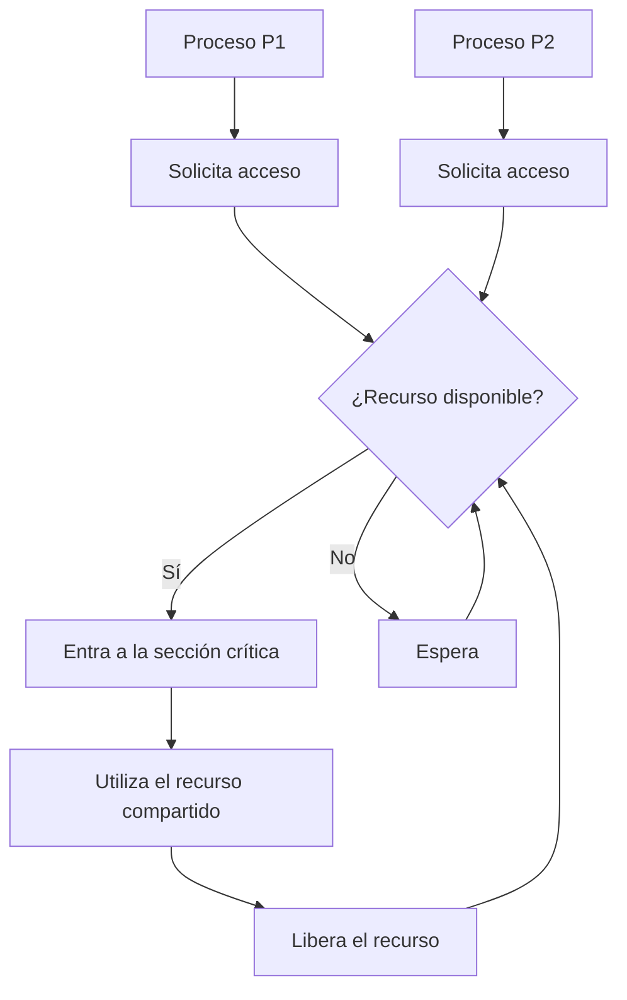
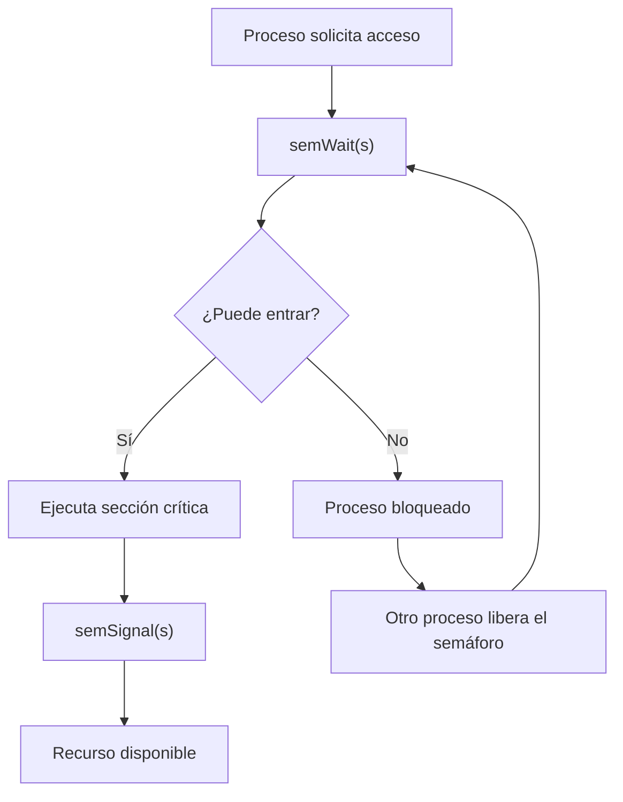
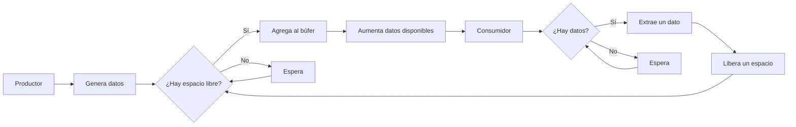

# Concurrencia: Exclusión Mutua y Semáforos

## Introducción

La concurrencia es uno de los conceptos fundamentales de los sistemas operativos, porque permite que varios procesos o hilos avancen durante un mismo intervalo de tiempo. Sin embargo, cuando estos procesos comparten datos o recursos, pueden surgir errores si sus operaciones se ejecutan en un orden inesperado.

Para evitar estos problemas, los sistemas operativos utilizan mecanismos de sincronización que permiten coordinar la ejecución de los procesos. Entre ellos se encuentran las instrucciones especiales de hardware, los semáforos y otros mecanismos de exclusión mutua.

En esta sesión se estudian las condiciones de carrera, las secciones críticas, los requisitos de la exclusión mutua, las soluciones basadas en hardware y los semáforos. También se analiza el problema clásico del productor y consumidor.

## Objetivos

- Comprender cómo se producen los problemas de concurrencia, incluso en sistemas con un solo procesador.
- Identificar las condiciones de carrera y explicar la importancia de las secciones críticas.
- Reconocer los requisitos que debe cumplir un mecanismo de exclusión mutua.
- Explicar cómo funcionan las instrucciones especiales de hardware para controlar el acceso a recursos compartidos.
- Diferenciar los semáforos binarios y los semáforos con contador.
- Aplicar semáforos para resolver problemas de sincronización, especialmente el problema productor-consumidor.

## 1. De los hilos a la concurrencia

La concurrencia ocurre cuando varios procesos o hilos progresan durante un mismo intervalo de tiempo. En un sistema con un solo procesador, sus instrucciones pueden alternarse rápidamente, dando la apariencia de que se ejecutan simultáneamente. En un sistema multiprocesador, además, distintos procesos o hilos pueden ejecutarse realmente al mismo tiempo.

La concurrencia aparece en diferentes escalas:

| Escala | Descripción |
|---|---|
| Multiprogramación | Varios procesos comparten el tiempo de un único procesador. |
| Multiprocesamiento | Varios procesadores ejecutan procesos o hilos concurrentemente. |
| Procesamiento distribuido | Varios sistemas conectados por una red colaboran en la ejecución de tareas. |

También puede presentarse en aplicaciones independientes, aplicaciones organizadas mediante procesos cooperantes y en el propio funcionamiento interno del sistema operativo.

### ¿Por qué es importante?

Cuando dos procesos utilizan un mismo recurso o modifican los mismos datos, el resultado puede depender del orden en que se ejecuten sus instrucciones. Por eso, la concurrencia requiere mecanismos que coordinen las operaciones y eviten inconsistencias.

## 2. El problema fundamental: el procedimiento eco

Un ejemplo sencillo consiste en imaginar una función que lee un carácter del teclado y lo muestra en la pantalla.

```python
def eco():
    caracter_entrada = leer_teclado()
    caracter_salida = caracter_entrada
    mostrar_pantalla(caracter_salida)
```

Supongamos que dos procesos utilizan variables compartidas para almacenar los caracteres introducidos.

1. El proceso P1 lee el carácter `x`, pero es interrumpido antes de mostrarlo.
2. El proceso P2 lee el carácter `y` y termina mostrando ese carácter.
3. P1 continúa su ejecución, pero el valor compartido ya fue reemplazado por `y`.
4. P1 también muestra `y`.

Como resultado, el carácter `x` se pierde y el carácter `y` aparece dos veces.

Este ejemplo demuestra que un programa puede producir resultados incorrectos cuando varios procesos modifican datos compartidos sin coordinación.

### Sección crítica

Una **sección crítica** es la parte de un programa donde se accede a un recurso o dato compartido que necesita protección.

La **exclusión mutua** es el principio que garantiza que solo un proceso a la vez pueda ejecutar la sección crítica protegida sobre ese recurso.



*Figura 1. Representación conceptual de la exclusión mutua.*

## 3. Condición de carrera

Una **condición de carrera** (*race condition*) ocurre cuando el resultado de un programa depende del orden relativo en que se ejecutan las operaciones de varios procesos o hilos sobre datos compartidos.

### Ejemplo 1. Dos escrituras sobre una variable

Dos procesos comparten una variable llamada `saldo`. P1 le asigna el valor 100 y P2 le asigna el valor 250.

Si P1 escribe primero y P2 después, el resultado final será 250. Si el orden se invierte, el resultado final será 100.

El valor definitivo depende de cuál escritura se realice al final.

### Ejemplo 2. Operaciones sobre variables relacionadas

Supongamos que las variables tienen los valores iniciales `b = 1` y `c = 2`, y que dos procesos ejecutan las siguientes operaciones:

- P3 ejecuta `b = b + c`.
- P4 ejecuta `c = b + c`.

Si P3 se ejecuta primero, `b` pasa a valer 3 y luego `c` pasa a valer 5. Si P4 se ejecuta primero, `c` pasa a valer 3 y después `b` pasa a valer 4.

Aunque cada proceso modifica una variable diferente, el resultado combinado depende del orden de ejecución.

### ¿Cómo se pueden evitar?

Entre las medidas principales se encuentran:

- Proteger las secciones críticas.
- Utilizar mecanismos de sincronización apropiados.
- Evitar que varios procesos modifiquen simultáneamente los mismos datos sin coordinación.

## 4. Cómo interactúan los procesos

Los procesos pueden relacionarse de diferentes maneras según el grado en que se perciben o se comunican entre sí.

| Tipo de relación | Características | Problemas posibles |
|---|---|---|
| Competencia | Los procesos son independientes, pero compiten por recursos físicos, como la CPU o una impresora. | Exclusión mutua, interbloqueo e inanición. |
| Cooperación por compartición | Los procesos comparten variables, archivos, búferes u otros datos. | Exclusión mutua, interbloqueo, inanición e inconsistencias de datos. |
| Cooperación por comunicación | Los procesos intercambian información directamente, por ejemplo, mediante mensajes. | Interbloqueo e inanición. |

La forma de interacción determina qué mecanismos de coordinación pueden resultar adecuados.

## 5. Requisitos para la exclusión mutua

Según el material de la sesión, un mecanismo de exclusión mutua debe cumplir seis requisitos:

1. **Exclusión mutua:** solo un proceso puede estar en la sección crítica correspondiente a un recurso.
2. **Independencia de procesos externos:** un proceso detenido fuera de su sección crítica no debe interferir con los demás.
3. **Ausencia de espera indefinida:** ningún proceso debe esperar para siempre para entrar a su sección crítica.
4. **Progreso:** si ningún proceso está en la sección crítica, uno de los que solicita acceso debe poder entrar sin demora innecesaria.
5. **Independencia de velocidades:** no se deben asumir velocidades relativas específicas entre procesos ni un número determinado de procesadores.
6. **Tiempo finito:** un proceso debe permanecer en su sección crítica durante un tiempo limitado.

Estos requisitos permiten evaluar si un mecanismo de sincronización ofrece una solución adecuada.

## 6. Soluciones por software

Antes de recurrir al hardware, existen algoritmos que coordinan los procesos utilizando variables ordinarias.

Entre los ejemplos clásicos se encuentran:

- **Algoritmo de Dekker:** permite coordinar el acceso de dos procesos a una sección crítica.
- **Algoritmo de Peterson:** utiliza variables compartidas para coordinar la entrada de dos procesos.

Estos algoritmos son importantes para comprender la lógica de la exclusión mutua, aunque presentan limitaciones prácticas y no constituyen el enfoque principal de esta sesión.

## 7. Exclusión mutua mediante la deshabilitación de interrupciones

En un sistema con un solo procesador, una estrategia consiste en deshabilitar temporalmente las interrupciones mientras se ejecuta una sección crítica.

```text
mientras True:
    deshabilitar_interrupciones()
    # Sección crítica
    habilitar_interrupciones()
    # Resto del proceso
```

### Ventajas y desventajas

| Ventajas | Desventajas |
|---|---|
| Es un mecanismo sencillo dentro del núcleo del sistema operativo. | Puede reducir la eficiencia al impedir interrupciones durante ese intervalo. |
| En un uniprocesador, evita que otro proceso desplace al actual mediante una interrupción mientras está protegido. | No basta en un multiprocesador, porque otro procesador puede acceder al mismo recurso. |

Esta técnica no es adecuada como solución general para aplicaciones de usuario. En los sistemas reales, el control de interrupciones está reservado principalmente al código privilegiado del sistema operativo.

## 8. Instrucciones especiales de máquina

Los procesadores proporcionan instrucciones atómicas que permiten coordinar el acceso a datos compartidos. Una operación atómica se ejecuta como una unidad indivisible respecto de los demás procesadores.

### 8.1. Test-and-Set

La instrucción *Test-and-Set* permite comprobar y modificar un cerrojo mediante una sola operación atómica.

Conceptualmente, si el cerrojo está libre, la operación lo marca como ocupado y permite que el proceso continúe. Si ya está ocupado, el proceso debe esperar.

```text
cerrojo = 0

mientras True:
    mientras TestAndSet(cerrojo):
        esperar
    # Sección crítica
    cerrojo = 0
    # Resto del proceso
```

El ejemplo es pseudocódigo conceptual: `TestAndSet` representa una instrucción atómica proporcionada por el hardware, no una función ordinaria implementada mediante operaciones separadas.

### 8.2. Exchange

La instrucción *Exchange* intercambia, de forma atómica, el contenido de un registro con el de una posición de memoria. Puede utilizarse para implementar mecanismos de cerrojo que controlan el acceso a una sección crítica.

### Ventajas y limitaciones

Las instrucciones especiales de hardware permiten construir mecanismos de exclusión mutua para sistemas con uno o varios procesadores. Sin embargo, algunos diseños utilizan **espera activa** (*busy waiting*): el proceso permanece comprobando el cerrojo repetidamente, consumiendo tiempo de procesador.

También pueden existir problemas de inanición o de planificación si no se garantiza un reparto adecuado del acceso. Por ello, los sistemas operativos utilizan mecanismos de nivel superior, como los semáforos, que permiten bloquear procesos en lugar de mantenerlos comprobando continuamente un recurso.

## 9. Semáforos

Un **semáforo** es una variable de sincronización que permite controlar el acceso a recursos compartidos y coordinar procesos.

En el modelo presentado en el material de la sesión, las operaciones principales son:

- `semWait(s)`: decrementa el contador del semáforo y bloquea al proceso si debe esperar.
- `semSignal(s)`: incrementa el contador y puede despertar a un proceso bloqueado.

Estas operaciones deben implementarse de forma sincronizada para evitar que varios procesos alteren el semáforo incorrectamente.

### Tipos de semáforos

| Tipo | Descripción |
|---|---|
| Semáforo binario | Se utiliza para representar dos estados, habitualmente libre y ocupado. |
| Semáforo con contador | Permite administrar varias unidades de un recurso. |
| Semáforo fuerte | Utiliza una política definida para atender la cola de espera, como FIFO. |
| Semáforo débil | No garantiza un orden específico para atender los procesos que esperan. |

### Ejemplo de exclusión mutua

Un semáforo inicializado en 1 puede proteger una sección crítica:

```python
s = Semaforo(1)

def proceso():
    while True:
        semWait(s)
        # Sección crítica
        semSignal(s)
        # Resto del proceso
```

Cuando el primer proceso ejecuta `semWait(s)`, adquiere el acceso. Los demás procesos que intenten entrar mientras el recurso esté ocupado deberán esperar. Al terminar, el proceso ejecuta `semSignal(s)` para liberar el acceso.



*Figura 2. Funcionamiento conceptual de un semáforo para proteger una sección crítica.*

## 10. El problema productor-consumidor

El problema productor-consumidor es un ejemplo clásico de sincronización.

- **Productor:** genera datos y los coloca en un búfer.
- **Consumidor:** retira datos del búfer para procesarlos.
- **Búfer:** espacio compartido donde se almacenan temporalmente los datos.

La solución debe impedir que el consumidor retire datos cuando no hay ninguno disponible y que el productor agregue datos cuando un búfer de capacidad limitada está lleno.

### 10.1. Un primer intento incorrecto

Una solución basada en semáforos binarios puede fallar si el consumidor decide esperar, pero el productor envía una señal justo antes de que el consumidor ejecute la operación de espera. Si esa señal no queda registrada, el consumidor puede bloquearse aunque ya haya datos disponibles.

Este error demuestra la importancia de coordinar correctamente las operaciones de sincronización.

### 10.2. Solución con semáforos generales y búfer infinito

Para un búfer que no tiene un límite de capacidad, se pueden utilizar dos semáforos:

- `n`, inicializado en 0, cuenta los datos disponibles.
- `s`, inicializado en 1, protege el acceso al búfer.

```text
n = Semaforo(0)
s = Semaforo(1)

productor():
    mientras True:
        producir_dato()
        semWait(s)
        agregar_al_buffer()
        semSignal(s)
        semSignal(n)

consumidor():
    mientras True:
        semWait(n)
        semWait(s)
        extraer_del_buffer()
        semSignal(s)
        consumir_dato()
```

El productor avisa mediante `semSignal(n)` cuando agrega un dato. El consumidor ejecuta `semWait(n)` antes de intentar extraerlo, por lo que espera si todavía no hay datos disponibles.

### 10.3. Solución con búfer finito

Cuando el búfer tiene una capacidad limitada, se utiliza un tercer semáforo para contar los espacios vacíos.

- `e`: cantidad de espacios disponibles; comienza con el valor de la capacidad.
- `n`: cantidad de datos disponibles; comienza en 0.
- `s`: protege el acceso al búfer; comienza en 1.

```text
e = Semaforo(CAPACIDAD)
n = Semaforo(0)
s = Semaforo(1)

productor():
    mientras True:
        producir_dato()
        semWait(e)
        semWait(s)
        agregar_al_buffer()
        semSignal(s)
        semSignal(n)

consumidor():
    mientras True:
        semWait(n)
        semWait(s)
        extraer_del_buffer()
        semSignal(s)
        semSignal(e)
        consumir_dato()
```

El productor espera a que exista un espacio libre antes de agregar un dato. El consumidor espera a que haya datos disponibles y, al extraer uno, libera un espacio para el productor.



*Figura 3. Sincronización entre productor, búfer y consumidor.*

**Importante:** el orden de las operaciones es fundamental. Por ejemplo, si el consumidor adquiere el semáforo de exclusión mutua antes de comprobar que existen datos, podría mantener bloqueado el búfer mientras espera un dato que el productor no puede introducir. Esto puede provocar un interbloqueo.

## 11. Comparación de los mecanismos estudiados

| Mecanismo | Característica principal | Limitación importante |
|---|---|---|
| Deshabilitar interrupciones | Impide ciertas interrupciones durante la sección crítica en un uniprocesador. | No garantiza por sí solo la exclusión mutua entre procesadores diferentes. |
| Test-and-Set y Exchange | Utilizan operaciones atómicas de hardware para controlar cerrojos. | Pueden generar espera activa. |
| Semáforos | Permiten bloquear y despertar procesos para coordinar el acceso a recursos. | Un uso incorrecto o un orden inadecuado puede causar interbloqueo o pérdida de señales. |

Cada mecanismo ofrece un nivel diferente de control. Los semáforos permiten resolver problemas de sincronización más complejos, pero requieren que el programador respete cuidadosamente el orden de las operaciones.

## 12. Resumen de la sesión

La concurrencia permite que varios procesos o hilos avancen durante un mismo intervalo de tiempo, pero también introduce riesgos cuando comparten datos y recursos.

Las condiciones de carrera aparecen cuando el resultado depende del orden de ejecución. Para evitarlas, se utilizan secciones críticas protegidas mediante exclusión mutua.

Las instrucciones especiales de hardware, como Test-and-Set y Exchange, permiten implementar cerrojos atómicos, aunque pueden ocasionar espera activa. Los semáforos ofrecen un mecanismo de sincronización que permite bloquear procesos cuando un recurso no está disponible.

Finalmente, el problema productor-consumidor demuestra cómo se pueden combinar varios semáforos para controlar la disponibilidad de datos, proteger un búfer y evitar accesos incorrectos.

## 13. Preguntas de repaso

1. ¿Por qué pueden ocurrir problemas de concurrencia incluso en un sistema con un solo procesador?
2. ¿Qué es una condición de carrera? Explique un ejemplo.
3. ¿Qué diferencia existe entre una sección crítica y la exclusión mutua?
4. Enumere los seis requisitos que debe cumplir un mecanismo de exclusión mutua.
5. ¿Por qué deshabilitar interrupciones no es suficiente en un sistema multiprocesador?
6. ¿Cómo ayuda la instrucción Test-and-Set a controlar el acceso a una sección crítica?
7. ¿Cuál es la diferencia entre un semáforo binario y uno con contador?
8. ¿Qué función cumplen los semáforos `e`, `n` y `s` en el problema productor-consumidor con búfer finito?
9. ¿Cómo puede producirse una señal perdida en una solución incorrecta con semáforos?
10. ¿Por qué es importante el orden de las operaciones `semWait` y `semSignal`?

## Referencias bibliográficas

Stallings, W. (2005). *Sistemas operativos: aspectos internos y principios de diseño* (5.ª ed.). Pearson Educación.

*Material elaborado y reorganizado con fines didácticos a partir del capítulo 5, «Concurrencia, exclusión mutua y sincronización», de William Stallings.*