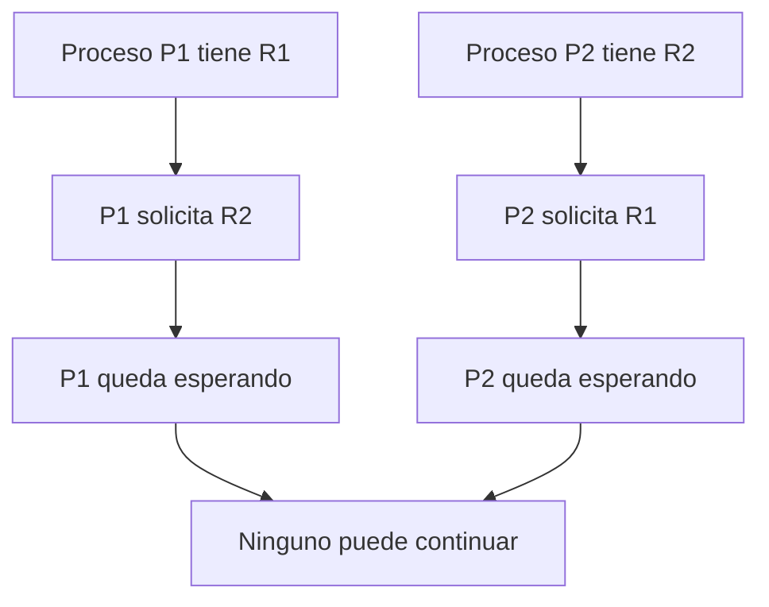
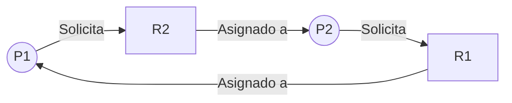

---
sidebar_position: 3
---

# Interbloqueos en los Sistemas Operativos

## Introducción

Los interbloqueos, también conocidos como *deadlocks*, son situaciones que pueden presentarse cuando varios procesos compiten por recursos limitados del sistema. Ocurren cuando un conjunto de procesos queda bloqueado porque cada uno espera un recurso que está siendo utilizado por otro proceso del mismo conjunto.

Este problema es importante en los sistemas operativos porque puede impedir que los procesos terminen sus tareas y que los recursos utilizados sean liberados. Para comprenderlo, es necesario conocer sus condiciones, la forma de representarlo y los métodos que permiten prevenirlo, evitarlo, detectarlo y recuperarse de él.

## ¿Qué es un interbloqueo?

Un interbloqueo ocurre cuando dos o más procesos quedan esperando indefinidamente por recursos o acciones que dependen de otros procesos que también están bloqueados.

Por ejemplo, un proceso puede tener acceso a una impresora y esperar un archivo bloqueado por otro proceso. Al mismo tiempo, el segundo proceso puede tener bloqueado ese archivo y esperar la impresora. Si ninguno libera lo que posee, ambos quedan detenidos.

### Ejemplo de interbloqueo

Supongamos que existen dos procesos y dos recursos compartidos:

- **Proceso P1:** tiene el recurso R1 y necesita R2 para continuar.
- **Proceso P2:** tiene el recurso R2 y necesita R1 para continuar.

En esta situación, P1 no puede continuar sin R2 y P2 tampoco puede avanzar sin R1.

El problema no se resuelve simplemente esperando, porque los recursos necesarios están retenidos por los mismos procesos que los solicitan.

## Condiciones necesarias para un interbloqueo

Para que ocurra un interbloqueo deben presentarse simultáneamente cuatro condiciones conocidas como condiciones de Coffman.

### 1. Exclusión mutua

Un recurso solo puede ser utilizado por un proceso a la vez cuando su naturaleza exige acceso exclusivo. Si otro proceso necesita ese recurso, deberá esperar hasta que esté disponible.

### 2. Retención y espera

Un proceso conserva uno o varios recursos que ya tiene asignados mientras espera que se le concedan otros recursos adicionales.

### 3. Ausencia de expropiación

Un recurso no puede retirarse por la fuerza a un proceso que lo está utilizando. Generalmente, debe ser liberado voluntariamente por el proceso que lo posee.

### 4. Espera circular

Existe una cadena cerrada de procesos en la que cada uno espera un recurso retenido por el siguiente proceso de la cadena.

| Condición | Descripción | Ejemplo |
| --- | --- | --- |
| Exclusión mutua | Un recurso requiere uso exclusivo. | Una impresora ocupada por un proceso. |
| Retención y espera | Un proceso conserva recursos mientras solicita otros. | P1 tiene R1 y solicita R2. |
| Ausencia de expropiación | No se puede retirar el recurso por la fuerza. | El recurso debe liberarse antes de reasignarse. |
| Espera circular | Los procesos se esperan entre sí formando un ciclo. | P1 espera a P2 y P2 espera a P1. |

Las cuatro condiciones deben coexistir para que se produzca un interbloqueo. Los métodos de prevención buscan impedir que al menos una de ellas pueda cumplirse.

## Modelo de recursos del sistema

Los procesos necesitan distintos recursos para ejecutar sus instrucciones. Estos recursos pueden ser físicos, como impresoras y dispositivos de almacenamiento, o lógicos, como archivos bloqueados y mecanismos de sincronización.

En el modelo de asignación de recursos se distinguen tres operaciones principales:

- **Solicitud:** un proceso pide un recurso.
- **Asignación:** el sistema concede el recurso si está disponible.
- **Liberación:** el proceso deja de utilizarlo y permite que pueda asignarse nuevamente.

### Tipos de recursos

| Tipo | Ejemplos |
| --- | --- |
| Recursos de hardware | Impresoras, dispositivos de almacenamiento y unidades de cinta. |
| Recursos de software | Archivos bloqueados, bloqueos y estructuras compartidas. |
| Recursos reutilizables | Recursos que pueden utilizarse nuevamente después de ser liberados. |

El sistema operativo administra estos recursos y debe decidir cómo asignarlos para permitir que los procesos continúen su ejecución.

## Grafos de asignación de recursos

Un grafo de asignación de recursos representa gráficamente la relación entre los procesos y los recursos del sistema. Ayuda a identificar solicitudes pendientes, recursos asignados y posibles ciclos relacionados con un interbloqueo.

En este tipo de representación:

- Los **círculos** representan procesos.
- Los **cuadrados** representan tipos de recursos.
- Una flecha de un proceso hacia un recurso representa una solicitud.
- Una flecha de un recurso hacia un proceso representa una asignación.

### Ejemplo de un grafo

En este ejemplo, P1 solicita R2, que está asignado a P2. A su vez, P2 solicita R1, que está asignado a P1. Se forma un ciclo que representa la espera circular.

Cuando cada tipo de recurso tiene una sola instancia, un ciclo en el grafo implica un interbloqueo. Cuando existen varias instancias de un mismo tipo de recurso, un ciclo indica una posible situación de interbloqueo, pero no siempre la confirma.

## Métodos para tratar los interbloqueos

Los sistemas operativos pueden utilizar diferentes estrategias para administrar este problema. La elección depende de los recursos involucrados, el comportamiento de los procesos y los requisitos del sistema.

### Prevención de interbloqueos

La prevención consiste en diseñar las reglas de asignación de recursos de forma que al menos una de las cuatro condiciones necesarias para el interbloqueo no pueda cumplirse.

Algunas estrategias son:

- **Eliminar la retención y espera:** exigir que un proceso solicite todos los recursos necesarios antes de comenzar o que libere los que posee antes de solicitar otros.
- **Permitir la expropiación cuando sea posible:** retirar recursos a un proceso bajo condiciones controladas.
- **Evitar la espera circular:** establecer un orden para solicitar los recursos y exigir que los procesos respeten ese orden.
- **Compartir recursos cuando sea posible:** reducir la necesidad de exclusión mutua para recursos que permitan un uso compartido seguro.

La prevención puede reducir la flexibilidad de los procesos y ocasionar que algunos recursos permanezcan sin utilizar durante períodos innecesarios.

### Evitación de interbloqueos

La evitación consiste en analizar las solicitudes de recursos antes de concederlas. El sistema evalúa si la asignación mantendría un estado seguro.

Un **estado seguro** es aquel en el que existe al menos una secuencia de ejecución que permite que todos los procesos terminen, suponiendo que soliciten recursos dentro de sus necesidades declaradas y los liberen al finalizar.

Un estado inseguro no significa necesariamente que ya exista un interbloqueo. Significa que el sistema no puede garantizar que todos los procesos puedan terminar mediante una secuencia segura con la información disponible.

### Algoritmo del banquero

El algoritmo del banquero es un método de evitación de interbloqueos. Evalúa si conceder una solicitud de recursos mantendría al sistema en un estado seguro.

Su funcionamiento general es el siguiente:

1. Cada proceso declara su necesidad máxima de recursos.
2. El sistema registra los recursos disponibles, los asignados y los que todavía necesita cada proceso.
3. Cuando llega una solicitud, se comprueba si hay recursos disponibles.
4. Se evalúa temporalmente la asignación.
5. Si existe una secuencia segura, la solicitud puede concederse; de lo contrario, se pospone.

| Concepto | Significado |
| --- | --- |
| Disponible | Recursos que todavía no están asignados. |
| Asignación | Recursos que ya posee cada proceso. |
| Necesidad | Recursos adicionales que cada proceso podría requerir para terminar. |
| Estado seguro | Estado que permite encontrar una secuencia en la que todos los procesos terminen. |

El algoritmo del banquero requiere información sobre las necesidades máximas de los procesos y resulta útil para estudiar cómo se toman decisiones de asignación.

### Detección de interbloqueos

La detección permite que los interbloqueos ocurran y posteriormente busca determinar si existen procesos bloqueados por dependencias circulares.

El sistema puede examinar las solicitudes pendientes, los recursos asignados y las relaciones de espera entre procesos. Según el modelo de recursos, puede utilizar grafos o algoritmos que analizan qué procesos pueden terminar con los recursos disponibles.

La detección no resuelve por sí sola el problema: únicamente identifica la situación para que se pueda tomar una medida de recuperación.

### Recuperación de interbloqueos

Después de detectar un interbloqueo, el sistema debe tomar medidas para permitir que los procesos continúen.

Entre las estrategias de recuperación se encuentran:

- **Finalización de procesos:** terminar uno o varios procesos bloqueados para liberar sus recursos.
- **Expropiación de recursos:** retirar determinados recursos y reasignarlos cuando sea posible.
- **Retroceso o rollback:** devolver un proceso a un estado anterior guardado, si el sistema permite hacerlo.

Estas estrategias pueden provocar pérdida de trabajo, por lo que es necesario seleccionar cuidadosamente los procesos afectados y considerar el costo de recuperación.

## Comparación de los métodos

| Método | ¿Cuándo actúa? | Objetivo |
| --- | --- | --- |
| Prevención | Durante el diseño de las reglas de asignación. | Impedir que se cumpla alguna condición necesaria. |
| Evitación | Antes de conceder una solicitud. | Mantener el sistema en un estado seguro. |
| Detección | Después de que puede ocurrir el problema. | Identificar los interbloqueos existentes. |
| Recuperación | Después de detectar el interbloqueo. | Liberar recursos y permitir que los procesos avancen. |

## Diferencia entre interbloqueo, inanición y espera activa

Aunque estos conceptos se relacionan con la administración de procesos, representan situaciones diferentes.

| Concepto | Descripción |
| --- | --- |
| Interbloqueo | Un conjunto de procesos queda bloqueado esperando recursos que se retienen mutuamente. |
| Inanición | Un proceso espera indefinidamente porque otros procesos obtienen repetidamente los recursos que necesita. |
| Espera activa | Un proceso comprueba repetidamente si puede continuar, consumiendo tiempo de procesador. |

La diferencia principal es que un interbloqueo implica una dependencia que impide que los procesos involucrados avancen, mientras que la inanición puede afectar a un proceso aunque otros sigan ejecutándose. La espera activa, por su parte, consiste en comprobar continuamente una condición.

## Importancia de estudiar los interbloqueos

El estudio de los interbloqueos permite comprender las dificultades que aparecen cuando los procesos compiten por recursos limitados.

Su análisis ayuda a diseñar mecanismos de asignación más seguros, reconocer dependencias entre procesos y seleccionar estrategias adecuadas para prevenir, evitar, detectar o resolver situaciones de bloqueo.

Este conocimiento también resulta útil al trabajar con bases de datos, sistemas concurrentes, bloqueos y aplicaciones que administran varios recursos compartidos.

## Resumen

Los interbloqueos ocurren cuando varios procesos quedan esperando recursos retenidos por otros procesos del mismo conjunto. Para que se produzcan deben coexistir cuatro condiciones: exclusión mutua, retención y espera, ausencia de expropiación y espera circular.

Los grafos de asignación de recursos ayudan a representar las relaciones entre procesos y recursos. Para tratar los interbloqueos se utilizan métodos de prevención, evitación, detección y recuperación. El algoritmo del banquero es una técnica de evitación que analiza si una asignación mantiene un estado seguro.

## Conclusiones

1. Los interbloqueos son un problema importante en los sistemas operativos porque pueden impedir que determinados procesos terminen sus tareas.
2. Las cuatro condiciones necesarias permiten identificar las circunstancias que pueden conducir a un interbloqueo.
3. Los grafos de asignación de recursos facilitan el análisis de las dependencias entre procesos y recursos.
4. La prevención, la evitación, la detección y la recuperación ofrecen estrategias diferentes para administrar este problema.

## Recomendaciones

- Identificar los recursos compartidos y las dependencias entre procesos.
- Establecer reglas de asignación que reduzcan la posibilidad de espera circular.
- Diferenciar entre prevención y evitación al analizar las estrategias de control.
- Verificar las solicitudes de recursos antes de concederlas cuando se utilicen métodos de evitación.
- Considerar el costo de terminar procesos o retirar recursos al diseñar mecanismos de recuperación.
