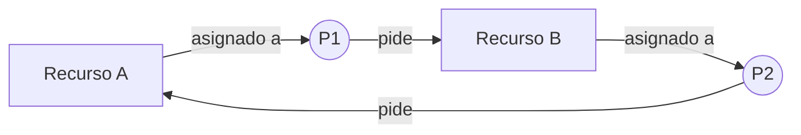

# Interbloqueos: qué son y cómo se reconocen

Un interbloqueo (en inglés, *deadlock*) pasa cuando un grupo de procesos se queda esperando para siempre porque cada uno necesita algo que tiene otro del mismo grupo. Ninguno puede avanzar, y tampoco pueden arreglarlo solos, porque lo único que los desbloquearía es justo lo que están esperando.

La imagen que más ayuda a entenderlo es un cruce de calles lleno de autos. Cada auto bloquea el paso del siguiente, y para que uno avance otro tiene que moverse primero, pero ese otro está igual de atorado. Otro caso es un puente de un solo carril con un carro entrando desde cada lado y ninguno dispuesto a retroceder.

## Cómo pasa en un programa

El caso típico son dos procesos y dos recursos. P toma el recurso D y después pide C. Q toma C y después pide D. Si cada uno ya tiene su primer recurso cuando intenta tomar el segundo, los dos se duermen y no despiertan nunca.

```python
import threading

D = threading.Lock()   # un recurso
C = threading.Lock()   # otro recurso

def proceso_p():
    D.acquire()        # P toma D
    C.acquire()        # y se queda esperando C

def proceso_q():
    C.acquire()        # Q toma C
    D.acquire()        # y se queda esperando D
```

En el laboratorio de interbloqueo se agrega un `time.sleep(1)` entre los dos `acquire()`. No es necesario para que exista el interbloqueo, solo sirve para que el mal orden ocurra siempre. Sin el sleep a veces se atora y a veces no, porque depende de cómo el planificador reparta la CPU en ese momento.

El mismo patrón aparece en otros lados. En una base de datos, dos transferencias cruzadas (de la cuenta A a la B y de la B a la A) pueden bloquearse si cada una toma primero la cuenta de origen. También puede pasar con mensajes: si dos procesos esperan recibir un mensaje antes de enviar el suyo, ninguno envía nunca. Eso se probó en el laboratorio con dos tuberías con nombre (`mkfifo`), y se arregla invirtiendo el orden en uno de los dos.

### Recursos reutilizables y consumibles

Los libros distinguen dos tipos de recursos, y los dos pueden causar interbloqueo.

Los **reutilizables** se usan y se devuelven: el procesador, la memoria, los archivos, los dispositivos y los candados. El ejemplo de los dos locks es de este tipo.

Los **consumibles** se crean y se destruyen: mensajes, señales, interrupciones. Se producen una vez y desaparecen cuando alguien los recibe. El ejemplo de las tuberías es de este tipo, y ahí no hay nada retenido, solo dos procesos esperando algo que el otro todavía no produjo.

## Cómo se ve desde afuera

Lo curioso de un interbloqueo es que el sistema operativo no avisa. No hay ningún error en pantalla. En el laboratorio, al mirar el proceso colgado desde otra terminal, se veía así:

- Estado `S` (durmiendo) y casi nada de CPU.
- Los hilos esperando en `futex_do_wait`, que es la función del kernel con la que Linux implementa estos candados.
- Con candados de archivo (`flock`), el archivo `/proc/locks` mostraba cuatro líneas, dos de ellas con una flecha `->`. Una línea sin flecha es el dueño del recurso y una con flecha es alguien esperándolo. Con eso se puede dibujar a mano el grafo de qué proceso espera a cuál.

## Las cuatro condiciones de Coffman

En 1971 Coffman y sus colaboradores describieron las condiciones que tienen que darse **a la vez** para que exista un interbloqueo. Si falta una sola, no puede haberlo. Aquí se aplican al ejemplo de P, Q, D y C:

1. **Exclusión mutua.** Un recurso lo usa un solo proceso a la vez. Un `Lock` solo lo puede tener un hilo.
2. **Retención y espera.** Un proceso se queda con lo que ya tiene mientras pide más. P retiene D mientras espera C.
3. **Sin expropiación.** A nadie se le puede quitar un recurso por la fuerza, solo lo suelta su dueño. Nadie le puede quitar D a P.
4. **Espera circular.** Hay un ciclo de procesos donde cada uno espera a otro. P espera lo que tiene Q, y Q espera lo que tiene P.

Stallings explica algo que a veces se pasa por alto: las tres primeras son parte de cómo está diseñado el sistema, y por sí solas no bastan para que haya interbloqueo. La cuarta depende de cómo se den las peticiones en un momento concreto. Juntas sí lo garantizan.

## El grafo de asignación de recursos

Una forma de ver todo esto en un dibujo es el grafo de asignación de recursos (RAG, por *Resource Allocation Graph*). Los procesos son círculos y los recursos son cuadros. Una flecha de un recurso hacia un proceso quiere decir "este recurso ya se le dio a ese proceso", y una flecha de un proceso hacia un recurso quiere decir "este proceso lo está pidiendo".



Aquí P1 tiene A y pide B, mientras P2 tiene B y pide A. Las flechas forman un ciclo, y eso es la espera circular.

Un detalle que conviene tener claro: cuando cada recurso tiene **una sola unidad** (como un candado), un ciclo en el grafo significa que hay interbloqueo seguro. Cuando los recursos tienen **varias unidades** (por ejemplo, tres impresoras iguales), un ciclo solo indica que puede haberlo, porque otro proceso fuera del ciclo podría devolver una unidad y deshacer el bloqueo (Silberschatz et al., 2018).

## No confundir con inanición ni livelock

Se parecen, pero no son lo mismo.

En el **interbloqueo** todos los procesos del grupo están bloqueados y nada avanza. En la **inanición** el sistema sí avanza, pero un proceso casi nunca consigue el recurso. En el laboratorio se vio con dos procesos compitiendo por el mismo núcleo: el normal usó cerca del 98 % de la CPU y el de prioridad mínima (`nice 19`) apenas el 1.5 %. En el **livelock** los procesos no están bloqueados sino que siguen cambiando de estado, pero sin lograr nada. Es como dos personas que se encuentran en un pasillo y las dos se mueven al mismo lado una y otra vez.

La siguiente página explica cómo se enfrentan los interbloqueos: prevenirlos, evitarlos, detectarlos o ignorarlos.

## Referencias

- Stallings, W. (2005). *Sistemas operativos: aspectos internos y principios de diseño* (5.ª ed.), cap. 6. Pearson Educación.
- Tanenbaum, A. S., & Bos, H. (2015). *Modern operating systems* (4.ª ed.), cap. 6. Pearson.
- Silberschatz, A., Galvin, P. B., & Gagne, G. (2018). *Operating system concepts* (10.ª ed.), cap. 8. Wiley.
- Coffman, E. G., Elphick, M. J., & Shoshani, A. (1971). System deadlocks. *ACM Computing Surveys, 3*(2), 67-78.