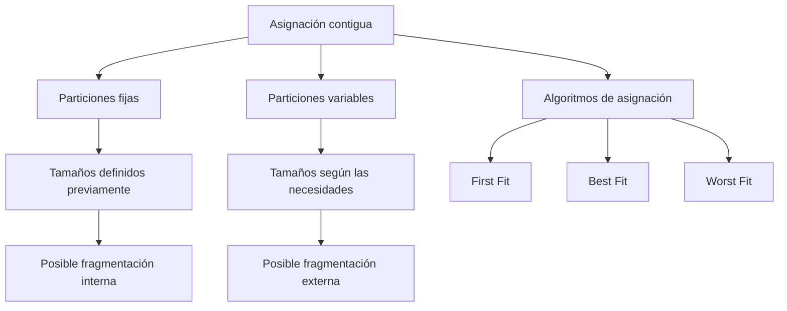
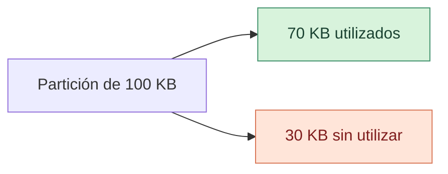
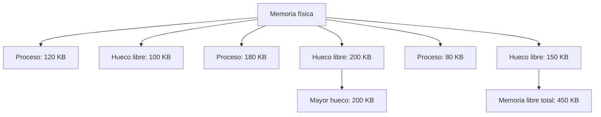

# Asignación Contigua de Memoria

## Introducción

La asignación contigua es uno de los mecanismos clásicos de administración de memoria. Consiste en reservar para cada proceso una región continua de direcciones físicas, de manera que todo el espacio asignado al proceso se encuentre dentro de un único bloque.

El sistema operativo debe localizar un espacio que cumpla con el tamaño requerido, registrar qué región está ocupada y comprobar que el proceso no acceda a direcciones fuera de sus límites. Aunque este mecanismo es sencillo de comprender, la distribución de los procesos puede dejar espacios libres difíciles de reutilizar.

Su funcionamiento permite estudiar dos problemas importantes: cómo elegir una región para un nuevo proceso y cómo aprovechar la memoria que queda disponible después de varias asignaciones y liberaciones.

## 1. Organización de la memoria

En la asignación contigua, la memoria puede organizarse mediante particiones fijas o variables.

### 1.1 Particiones fijas

La memoria se divide previamente en particiones de tamaño establecido. Cada partición puede alojar un proceso, siempre que su tamaño no supere la capacidad disponible.

El principal inconveniente aparece cuando un proceso ocupa menos espacio del que tiene asignado. La diferencia queda dentro de la partición reservada y no puede utilizarse para alojar otro proceso de manera independiente.

### 1.2 Particiones variables

Las particiones se crean de acuerdo con las necesidades de los procesos y los espacios libres disponibles. Esto permite ajustar mejor el tamaño de cada asignación, pero con el tiempo pueden quedar huecos separados entre las regiones ocupadas.

Por ejemplo, después de cargar y retirar varios procesos, la memoria podría contener espacios libres de 100 KB, 200 KB y 150 KB. Aunque en conjunto suman 450 KB, un proceso que necesite 300 KB no podrá alojarse si el sistema requiere un único bloque contiguo.

## 2. Mapa conceptual de la asignación contigua

Este mapa resume la relación entre las formas de organizar la memoria y las decisiones que debe tomar el sistema operativo para asignar espacio.

## 3. Algoritmos de asignación

Cuando existen varios bloques libres, el sistema necesita seleccionar uno para alojar el proceso. First Fit, Best Fit y Worst Fit son tres estrategias clásicas para tomar esa decisión.

### 3.1 First Fit

Recorre los espacios libres en el orden establecido y selecciona el primero que tenga capacidad suficiente. Una vez encontrado, no necesita examinar todos los bloques restantes.

Su ventaja es que puede reducir el trabajo de búsqueda. Sin embargo, su resultado depende del orden de los espacios libres y de las asignaciones anteriores.

### 3.2 Best Fit

Busca el bloque libre más pequeño que todavía pueda alojar el proceso. Para identificarlo, normalmente debe examinar todos los bloques disponibles, salvo que la estructura de administración permita una búsqueda más eficiente.

Puede reducir el espacio sobrante de una asignación individual, pero no garantiza el mejor aprovechamiento global. También puede dejar pequeños huecos que resulten difíciles de utilizar posteriormente.

### 3.3 Worst Fit

Selecciona el bloque libre de mayor tamaño entre los que están disponibles. Su planteamiento busca dejar un espacio restante relativamente grande después de realizar la asignación.

No garantiza que ese espacio restante vaya a ser útil para los siguientes procesos. Su rendimiento depende de la secuencia de solicitudes y de las características de la memoria disponible.

## 4. Ejemplo comparativo de los algoritmos

Supongamos que la memoria tiene tres bloques libres, en este orden:

| Bloque | Capacidad |
|---|---:|
| A | 100 KB |
| B | 500 KB |
| C | 300 KB |

Llega un proceso que necesita 250 KB. Suponiendo que el espacio sobrante permanece disponible como otro bloque libre, las decisiones serían:

| Algoritmo | Bloque elegido | Espacio sobrante |
|---|---|---:|
| First Fit | B (500 KB) | 250 KB |
| Best Fit | C (300 KB) | 50 KB |
| Worst Fit | B (500 KB) | 250 KB |

**¿Cómo se interpreta el resultado?**

First Fit ignora el bloque A porque es demasiado pequeño y selecciona el primer bloque válido: B. Best Fit selecciona C porque es el bloque válido de menor tamaño. Worst Fit también elige B porque es el bloque de mayor capacidad.

En este caso, Best Fit deja menos espacio sobrante en la asignación individual. Sin embargo, eso no significa que siempre sea el algoritmo más eficiente: para comparar su rendimiento global también habría que considerar las solicitudes posteriores, los huecos restantes y el costo de búsqueda.

## 5. Fragmentación de memoria

La fragmentación reduce el aprovechamiento de la memoria, pero puede presentarse de formas diferentes.

### 5.1 Fragmentación interna

Aparece cuando el espacio reservado a un proceso es mayor que la cantidad de memoria que necesita. La parte que no utiliza queda dentro de la región asignada.

**Ejemplo:** si un proceso necesita 70 KB y recibe una partición fija de 100 KB, quedan 30 KB sin utilizar dentro de esa partición.

### 5.2 Fragmentación externa

Se produce cuando la memoria libre queda distribuida en espacios separados entre regiones ocupadas. Puede existir suficiente memoria libre en total, pero no un bloque contiguo del tamaño necesario.

**Ejemplo:** hay tres huecos libres de 100 KB, 200 KB y 150 KB. La memoria libre total es de 450 KB, pero un proceso que necesita 300 KB no puede cargarse si ninguno de los bloques individuales alcanza ese tamaño.

El diagrama representa una distribución hipotética. La fragmentación externa se observa porque los huecos están separados por regiones ocupadas.

### 5.3 Diferencias principales

| Aspecto | Fragmentación interna | Fragmentación externa |
|---|---|---|
| Dónde aparece | Dentro de la región asignada | Entre regiones ocupadas |
| Causa típica | Se reserva más espacio del necesario | El espacio libre queda dividido |
| Ejemplo | Partición de 100 KB para un proceso de 70 KB | Huecos de 100, 200 y 150 KB |
| Posible tratamiento | Ajustar el tamaño de las asignaciones | Compactación, cuando sea viable, o técnicas no contiguas |

## 6. Compactación de memoria

La compactación consiste en mover procesos dentro de la memoria para reunir los espacios libres dispersos en un bloque continuo de mayor tamaño.

Puede ayudar a reducir la fragmentación externa, pero requiere mover datos y actualizar las referencias o estructuras de traducción correspondientes. Por eso no es una operación gratuita ni puede aplicarse sin las condiciones necesarias para reubicar los procesos.

La compactación no soluciona la fragmentación interna, porque el espacio desperdiciado en ese caso se encuentra dentro de las regiones asignadas.

## 7. Mapa comparativo: particiones fijas y variables

| Criterio | Particiones fijas | Particiones variables |
|---|---|---|
| Tamaño de las regiones | Definido previamente | Ajustado a la solicitud |
| Complejidad de administración | Relativamente baja | Mayor control de espacios libres |
| Fragmentación característica | Interna | Externa |
| Flexibilidad | Limitada por las particiones | Depende de los bloques disponibles |
| Reorganización | Generalmente sencilla | Puede requerir compactación |

## 8. Análisis técnico

La asignación contigua permite comprender cómo una decisión local puede afectar el uso posterior de la memoria. Elegir un bloque adecuado no depende únicamente de que tenga suficiente capacidad: también influye en los espacios que quedan disponibles para las próximas solicitudes.

Por esa razón, ningún algoritmo debe considerarse universalmente superior. First Fit puede reducir la búsqueda al detenerse en el primer bloque válido; Best Fit intenta minimizar el sobrante inmediato, y Worst Fit prioriza el bloque más grande. El comportamiento final depende del patrón de asignaciones y liberaciones.

Estas limitaciones ayudan a explicar el interés por técnicas como la paginación, que permite asignar páginas de un proceso a marcos físicos no consecutivos y elimina la necesidad de encontrar un único bloque físico para todo el proceso.

## Conclusión

La asignación contigua organiza cada proceso en una región continua de memoria. Las particiones fijas ofrecen una administración sencilla, mientras que las variables permiten adaptar el espacio a las necesidades de cada proceso. Los algoritmos First Fit, Best Fit y Worst Fit utilizan criterios diferentes para seleccionar bloques libres, y sus resultados dependen de la distribución de la memoria.

La fragmentación interna y externa representan problemas distintos y requieren medidas diferentes. Comprenderlos permite analizar las limitaciones de la asignación contigua y establecer una base para estudiar la paginación y la segmentación.

## Bibliografía y fuentes de consulta

- Silberschatz, A., Galvin, P. B. y Gagne, G. *Operating System Concepts*. Wiley. Capítulo sobre memoria principal, especialmente asignación contigua. [Consultar el material editorial](https://www.wiley-vch.de/en/areas-interest/computing-computer-sciences/silberschatz-39-s-operating-system-concepts-978-1-119-45408-3).
- Silberschatz, A., Galvin, P. B. y Gagne, G. *Operating System Concepts*, 8.ª edición. Capítulo sobre memoria principal. [Consultar el capítulo](https://www.oreilly.com/library/view/operating-system-concepts/9780470128725/silb_9780470128725_oeb_c08_r1.html).
