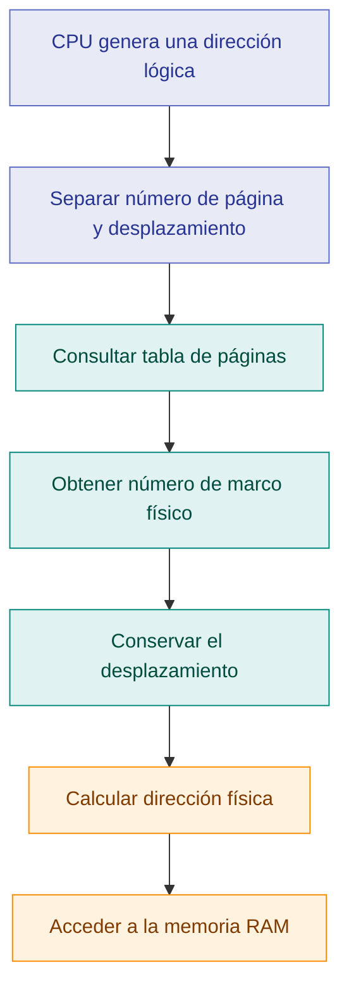
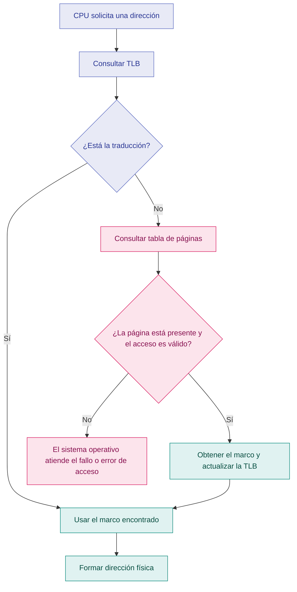

# Paginación de memoria

## 1. Introducción

La paginación es una técnica de administración de memoria que permite cargar los procesos en espacios físicos que no necesariamente se encuentran juntos. Para lograrlo, la memoria lógica de un proceso se divide en bloques de tamaño fijo llamados **páginas**, mientras que la memoria física se organiza en bloques del mismo tamaño denominados **marcos de página**.

El sistema operativo relaciona las páginas con los marcos mediante una estructura llamada **tabla de páginas**. Gracias a esta correspondencia, un proceso puede utilizar direcciones lógicas consecutivas aunque sus datos estén distribuidos en distintas posiciones de la memoria RAM.

Esta técnica reduce el problema de la fragmentación externa asociado con la asignación de bloques contiguos, aunque requiere espacio adicional para las tablas y puede producir fragmentación interna.

## 2. Conceptos fundamentales

| Concepto | Descripción |
|---|---|
| Página | Bloque de tamaño fijo en el que se divide el espacio de direcciones de un proceso. |
| Marco de página | Bloque de tamaño fijo en el que se divide la memoria física. Tiene el mismo tamaño que una página. |
| Tabla de páginas | Estructura que relaciona cada página lógica con su marco físico correspondiente. |
| Dirección lógica | Dirección generada por la CPU dentro del espacio de direcciones de un proceso. |
| Dirección física | Dirección real que identifica una ubicación en la memoria RAM. |
| Desplazamiento (*offset*) | Posición específica dentro de una página o marco. |
| MMU | Unidad de gestión de memoria que participa en la traducción de direcciones y en la aplicación de permisos. |
| TLB | Memoria caché especializada que conserva traducciones recientes para acelerar el acceso a memoria. |

## 3. Funcionamiento de la paginación

El proceso comienza cuando la CPU genera una dirección lógica. Esta dirección se divide en dos componentes: el número de página y el desplazamiento. El número de página permite localizar la entrada correspondiente en la tabla de páginas, mientras que el desplazamiento indica la posición exacta dentro del bloque.

Una vez localizado el marco físico asociado a la página, el sistema conserva el desplazamiento y lo combina con el número del marco para formar la dirección física.

### Diagrama del proceso

## 4. Traducción de direcciones lógicas a físicas

Para realizar la traducción se utilizan dos datos principales: el número del marco físico y el desplazamiento dentro de ese marco.

La dirección física se calcula con la siguiente fórmula:

**Dirección física = (número de marco × tamaño de página) + desplazamiento**

La fórmula funciona porque los marcos tienen un tamaño fijo y el desplazamiento identifica una posición dentro de ellos.

### Ejemplo numérico

Supongamos que un sistema utiliza páginas de **1,000 bytes** y recibe una dirección lógica que corresponde a la página 2, con un desplazamiento de 150 bytes. Para este ejemplo se utiliza numeración de páginas y marcos desde cero.

La tabla de páginas indica que la página 2 está ubicada en el marco 7.

| Dato | Valor |
|---|---:|
| Tamaño de página | 1,000 bytes |
| Número de página | 2 |
| Desplazamiento | 150 bytes |
| Marco asignado | 7 |

Aplicamos la fórmula:

**Dirección física = (7 × 1000) + 150 = 7150**

Por lo tanto, la dirección física es **7150**, siempre que la entrada de la tabla sea válida y la página esté disponible en memoria.

### Representación de la traducción

## 5. Tabla de páginas

La tabla de páginas es una estructura fundamental de la paginación. Mantiene la correspondencia entre las páginas del espacio lógico de un proceso y los marcos de la memoria física.

Cada entrada puede contener el número de marco y otros indicadores, como el estado de presencia de la página y los permisos de acceso. La organización exacta depende de la arquitectura y del sistema operativo.

### Ejemplo de una tabla de páginas

| Página lógica | Marco físico asignado | Estado |
|---:|---:|---|
| 0 | 4 | Presente |
| 1 | 1 | Presente |
| 2 | 7 | Presente |
| 3 | — | No residente |

En este ejemplo, las páginas 0, 1 y 2 se encuentran en los marcos 4, 1 y 7, respectivamente. La página 3 no está actualmente residente en memoria física.

Que una página no esté residente no significa necesariamente que el proceso haya cometido un error. Si el sistema utiliza memoria virtual, el sistema operativo puede tener que cargarla antes de continuar. Si el acceso no es válido o está prohibido, puede producirse un error de acceso.

## 6. TLB (Translation Lookaside Buffer)

La TLB es una memoria caché pequeña y rápida que guarda traducciones recientes de direcciones virtuales a físicas. Su objetivo es evitar consultar repetidamente la tabla de páginas en la memoria principal cuando una traducción ya está disponible en esta caché.

La unidad de gestión de memoria, o MMU, consulta la TLB durante el proceso de traducción.

### ¿Cómo funciona?

- **Acierto de TLB (*TLB hit*):** la traducción se encuentra en la caché y puede utilizarse sin realizar una nueva búsqueda completa en la tabla de páginas.
- **Fallo de TLB (*TLB miss*):** la traducción no está en la caché, por lo que el sistema debe buscarla en la tabla de páginas. Si la página está presente y el acceso es válido, la traducción puede incorporarse a la TLB.
- **Fallo de página (*page fault*):** ocurre cuando se necesita una intervención del sistema operativo para resolver el acceso, por ejemplo, porque la página no está actualmente en memoria física o porque el acceso infringe las reglas establecidas.

**Importante:** un fallo de TLB no es lo mismo que un fallo de página. La traducción puede no estar en la TLB y, aun así, la página encontrarse disponible en la RAM.

### Diagrama de la TLB

## 7. Ventajas de la paginación

- **Reduce la fragmentación externa:** los marcos libres pueden utilizarse sin exigir que todo el proceso ocupe un bloque físico continuo.
- **Facilita la asignación de memoria:** las páginas pueden ubicarse en distintos marcos disponibles.
- **Permite una traducción organizada:** la tabla de páginas establece la correspondencia entre direcciones lógicas y físicas.
- **Favorece la protección:** las entradas de las tablas pueden incorporar permisos que controlan el acceso a determinadas páginas.
- **Sirve de base para la memoria virtual:** junto con los mecanismos correspondientes del sistema operativo, permite mantener en RAM las páginas que se necesitan en cada momento.

## 8. Desventajas y limitaciones

- **Fragmentación interna:** si un proceso no ocupa un número exacto de páginas, parte de la última página puede quedar sin utilizar.
- **Memoria adicional:** las tablas de páginas necesitan espacio para almacenar las correspondencias y los indicadores.
- **Costo de traducción:** consultar las tablas puede añadir trabajo a cada acceso a memoria; la TLB ayuda a reducir este costo.
- **Gestión más compleja:** el sistema operativo debe controlar los marcos, las tablas, los permisos y, cuando corresponde, la carga y retirada de páginas.

### Ejemplo de fragmentación interna

Si una asignación utiliza páginas de 1,000 bytes y necesita 2,350 bytes, deberá ocupar tres páginas, con una capacidad total de 3,000 bytes.

**Espacio sin utilizar = 3000 − 2350 = 650 bytes**

En este ejemplo, quedan 650 bytes sin utilizar dentro de la capacidad asignada. Es una ilustración simplificada de la fragmentación interna; el desperdicio real depende de cómo se distribuyan las asignaciones y de las reglas de gestión de memoria utilizadas.

## 9. Análisis técnico

La paginación resuelve una limitación importante de la asignación contigua: un proceso no necesita encontrar un único bloque físico suficientemente grande para alojarse. En su lugar, el sistema puede distribuir sus páginas entre distintos marcos disponibles y mantener la correspondencia mediante la tabla de páginas.

Sin embargo, esta flexibilidad tiene un costo. La administración de las tablas requiere memoria adicional y la traducción de direcciones puede añadir latencia. La TLB reduce ese impacto al conservar traducciones recientes, mientras que los indicadores de las entradas ayudan a controlar la presencia y los permisos de las páginas.

Por ello, la paginación representa un equilibrio entre flexibilidad en la asignación, control de acceso y costos de administración.

## 10. Conclusión

La paginación permite administrar la memoria física mediante bloques de tamaño fijo y asignar las páginas de un proceso a marcos que no tienen que estar contiguos. La tabla de páginas realiza la correspondencia entre direcciones lógicas y físicas, mientras que la TLB acelera las traducciones utilizadas con frecuencia.

Aunque esta técnica reduce la fragmentación externa, no elimina todos los costos de administración: puede producir fragmentación interna y necesita estructuras adicionales. Comprender la relación entre páginas, marcos, tablas y traducciones permite explicar cómo un sistema operativo organiza la memoria y facilita el funcionamiento de la memoria virtual.

## Bibliografía

- Linux Kernel Documentation. *Page Tables*. https://docs.kernel.org/mm/page_tables.html
- Linux Kernel Documentation. *Concepts overview*. https://docs.kernel.org/admin-guide/mm/concepts.html
- Rinard, M. C. *Operating Systems Lecture Notes: Introduction to Paging*. MIT. https://people.csail.mit.edu/rinard/teaching/osnotes/h9.html
- University of Washington. *CSE 451: Operating Systems — Paging*. https://courses.cs.washington.edu/courses/cse451/04sp/lectures/3-memory.pdf
