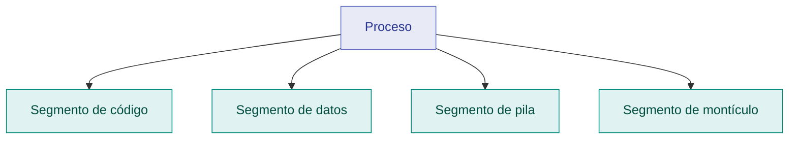
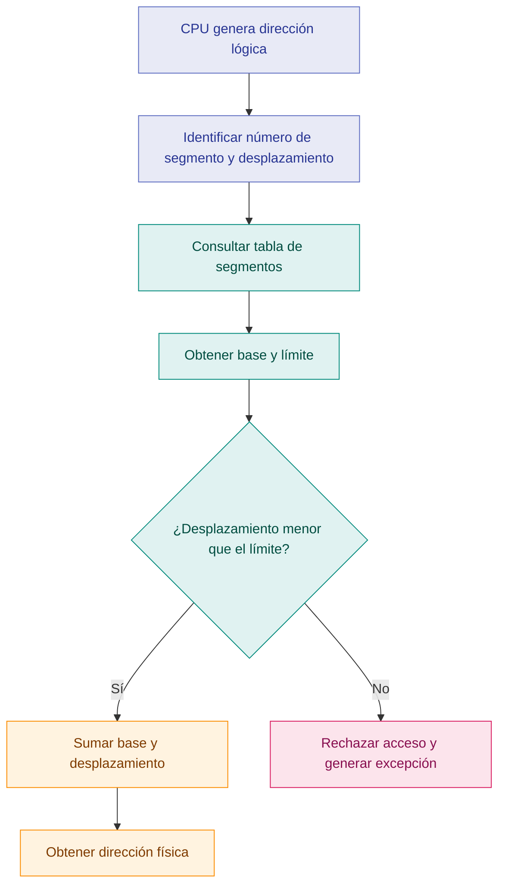
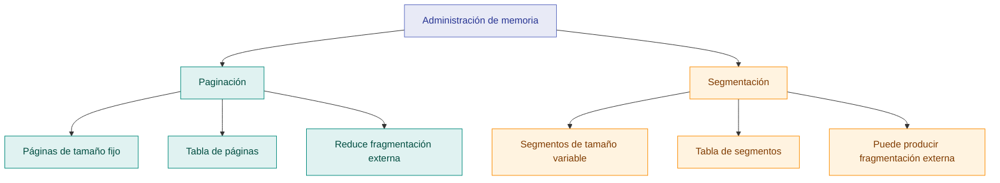

# Segmentación de memoria

## 1. Introducción

La segmentación es una técnica de administración de memoria que divide el espacio lógico de un proceso en unidades de tamaño variable llamadas **segmentos**. Cada segmento representa una parte lógica del programa, como el código, los datos, la pila o determinadas estructuras utilizadas durante su ejecución.

A diferencia de la paginación, que utiliza bloques de tamaño fijo, la segmentación organiza la memoria de acuerdo con la estructura lógica del programa. Cada segmento posee una dirección base y un límite que permiten localizarlo y comprobar si un acceso se encuentra dentro de su rango válido.

Para realizar esta administración, el sistema utiliza una **tabla de segmentos**, donde se registra la información necesaria para traducir las direcciones lógicas a direcciones físicas.

## 2. ¿Cómo se organiza la memoria mediante segmentos?

Un programa puede dividirse en diferentes segmentos según la función que cumple cada parte. Por ejemplo:

| Segmento | Función |
|---|---|
| Código | Contiene las instrucciones ejecutables del programa. |
| Datos | Almacena variables globales y otros datos del proceso. |
| Pila (*stack*) | Guarda información relacionada con las llamadas a funciones, parámetros y variables locales, según el entorno de ejecución. |
| Montículo (*heap*) | Se utiliza para la asignación dinámica de memoria durante la ejecución del programa. |

Los segmentos tienen tamaños diferentes porque cada uno almacena información distinta. En un esquema clásico de segmentación, cada segmento se ubica en una región contigua de memoria física, aunque los distintos segmentos de un mismo proceso pueden estar en regiones separadas.

### Diagrama de la organización lógica

Este esquema representa la división lógica del proceso. No significa que los segmentos tengan el mismo tamaño ni que estén ubicados uno junto a otro en la memoria física.

## 3. Tabla de segmentos

La tabla de segmentos permite al sistema operativo y al hardware de administración de memoria localizar los segmentos y validar los accesos realizados por un proceso.

En el modelo clásico, cada entrada contiene principalmente:

- **Base:** dirección física donde comienza el segmento.
- **Límite:** tamaño del segmento, que determina el rango de desplazamientos permitidos.
- **Permisos:** información que establece las operaciones autorizadas, como lectura, escritura o ejecución, según la arquitectura.

La organización exacta de las entradas puede variar entre sistemas y arquitecturas.

### Ejemplo de una tabla de segmentos

| Número de segmento | Base física | Límite (bytes) |
|---:|---:|---:|
| 0 | 4000 | 1000 |
| 1 | 8000 | 500 |
| 2 | 12000 | 2000 |
| 3 | 16000 | 800 |

En este ejemplo, el segmento 0 comienza en la dirección física 4000 y tiene un tamaño de 1000 bytes. Por tanto, sus desplazamientos válidos van desde 0 hasta 999.

La tabla permite localizar cada segmento sin exigir que todos los segmentos del proceso se encuentren en una sola región continua de memoria física.

## 4. Traducción de direcciones lógicas a físicas

En la segmentación, una dirección lógica está formada por dos componentes:

- **Número de segmento:** identifica la unidad lógica a la que se desea acceder.
- **Desplazamiento (*offset*):** indica la posición dentro del segmento.

El sistema consulta la tabla para obtener la base y el límite del segmento solicitado. Después comprueba que el desplazamiento esté dentro del rango permitido. Si el acceso es válido y cuenta con los permisos necesarios, suma el desplazamiento a la dirección base para obtener la dirección física.

**Dirección física = dirección base + desplazamiento**

La condición principal de validez es:

**Desplazamiento menor que el límite del segmento.**

Si el desplazamiento es igual o superior al límite, el acceso queda fuera del segmento y debe rechazarse.

### Ejemplo numérico

Supongamos que un proceso necesita acceder al segmento 1 con un desplazamiento de 200 bytes.

Según la tabla anterior:

| Dato | Valor |
|---|---:|
| Número de segmento | 1 |
| Dirección base | 8000 |
| Límite | 500 bytes |
| Desplazamiento solicitado | 200 bytes |

**Paso 1. Validar el desplazamiento**

200 es menor que 500, por lo que el desplazamiento está dentro del límite del segmento.

**Paso 2. Calcular la dirección física**

Dirección física = 8000 + 200

**Resultado: dirección física = 8200**

La dirección física resultante es 8200, siempre que el acceso también cumpla con los permisos correspondientes.

### Diagrama de traducción

## 5. Protección y compartición de memoria

La segmentación puede contribuir a la protección de memoria porque cada segmento puede contar con límites y permisos de acceso específicos.

Por ejemplo, un segmento de código puede configurarse para permitir la lectura y la ejecución, pero no la escritura. De esta manera, un intento de modificarlo podría ser rechazado si la arquitectura y la configuración de protección así lo establecen.

Además, algunos sistemas pueden permitir que varios procesos compartan determinados segmentos, como bibliotecas de código, siempre que se configuren correctamente las direcciones y los permisos.

Entre sus mecanismos de protección se encuentran:

- **Comprobación de límites:** impide acceder a posiciones que quedan fuera del tamaño del segmento.
- **Permisos de acceso:** restringen las operaciones permitidas sobre un segmento.
- **Separación lógica:** facilita distinguir entre las diferentes regiones de memoria de un proceso.

Estas medidas dependen del soporte de hardware y de la configuración del sistema operativo; la segmentación por sí sola no garantiza una protección completa.

## 6. Ventajas de la segmentación

- **Organización lógica:** permite representar las distintas partes de un programa de acuerdo con su función.
- **Protección diferenciada:** cada segmento puede disponer de límites y permisos específicos.
- **Compartición selectiva:** facilita compartir segmentos determinados entre procesos cuando el sistema lo permite.
- **Asignación de tamaños variables:** los segmentos pueden ajustarse al tamaño de la región lógica que representan.
- **Separación de componentes:** facilita identificar y administrar por separado el código, los datos y otras áreas del proceso.

## 7. Desventajas y limitaciones

- **Fragmentación externa:** como los segmentos tienen tamaños diferentes, pueden quedar espacios libres dispersos entre las regiones asignadas.
- **Necesidad de espacio contiguo:** en el modelo clásico, cada segmento necesita una región física continua suficientemente grande.
- **Administración adicional:** el sistema debe mantener la tabla de segmentos y validar los accesos.
- **Posible compactación:** en determinados esquemas, puede ser necesario reorganizar la memoria para reunir espacios libres contiguos.
- **Complejidad de asignación:** encontrar una región adecuada para cada segmento puede ser más difícil a medida que la memoria se fragmenta.

La segmentación clásica no elimina la fragmentación externa. Sin embargo, evita la fragmentación interna propia de los bloques fijos en la misma forma que la paginación, aunque pueden existir otros tipos de desperdicio asociados con la asignación y la alineación.

## 8. Comparación entre paginación y segmentación

Ambas técnicas permiten administrar direcciones lógicas y localizar información en la memoria física, pero utilizan criterios de organización diferentes.

| Característica | Paginación | Segmentación |
|---|---|---|
| Unidad de división | Páginas de tamaño fijo. | Segmentos de tamaño variable. |
| Criterio de organización | Bloques de tamaño uniforme. | Partes lógicas del programa. |
| Tabla utilizada | Tabla de páginas. | Tabla de segmentos. |
| Información principal | Número de marco y otros indicadores. | Dirección base, límite y posibles permisos. |
| Traducción | Número de página y desplazamiento. | Número de segmento y desplazamiento. |
| Fragmentación externa | Se evita en la asignación de marcos de tamaño fijo. | Puede producirse en la asignación de segmentos contiguos. |
| Fragmentación interna | Puede presentarse, especialmente en la última página asignada. | No surge por dividir cada segmento en bloques físicos de tamaño fijo, aunque puede haber desperdicio por otros motivos. |
| Organización lógica | No depende de las divisiones naturales del programa. | Representa unidades lógicas del programa. |

### Mapa comparativo

## 9. Análisis técnico

La segmentación organiza la memoria desde una perspectiva lógica. En lugar de dividir el espacio de direcciones en bloques uniformes, permite identificar regiones que cumplen funciones diferentes dentro de un proceso.

La tabla de segmentos facilita la traducción de direcciones y la comprobación de límites. Esto permite controlar el acceso a cada región y, cuando el hardware lo admite, establecer permisos diferentes según la función del segmento.

No obstante, la asignación de segmentos de tamaño variable plantea dificultades para aprovechar los espacios libres. Con el tiempo pueden aparecer huecos entre regiones ocupadas, incluso cuando la memoria libre total es suficiente, pero no existe un bloque contiguo lo bastante grande para una nueva asignación.

Por esta razón, la segmentación y la paginación representan enfoques distintos: la primera prioriza la organización lógica, mientras que la segunda facilita la asignación física mediante bloques uniformes. Algunos diseños pueden combinar ambas técnicas para aprovechar características de cada una.

## 10. Conclusión

La segmentación es una técnica de administración de memoria que divide los procesos en unidades lógicas de tamaño variable. Mediante una tabla de segmentos, el sistema puede localizar cada región, calcular direcciones físicas y comprobar los límites y permisos de acceso.

Su principal ventaja es que representa de forma natural las distintas partes de un programa y permite aplicar protección diferenciada. Sin embargo, la asignación de segmentos contiguos puede producir fragmentación externa y dificultar el aprovechamiento de la memoria disponible.

Comprender la segmentación y compararla con la paginación permite reconocer que la administración de memoria debe equilibrar la organización lógica, la protección y el uso eficiente de la memoria física.

## Bibliografía

- Gottlieb, A. (s. f.). *OS 202 Class Notes*. New York University. https://cs.nyu.edu/~gottlieb/courses/os/class-notes.html
- Rinard, M. C. (s. f.). *Operating Systems Lecture Notes: Segments*. Massachusetts Institute of Technology. https://people.csail.mit.edu/rinard/teaching/osnotes/h15.html
- Arpaci-Dusseau, A. C. (s. f.). *CS 537: Segmentation and Paging*. University of Wisconsin–Madison. https://pages.cs.wisc.edu/~eli/537/lectures/lecture14.2x2.pdf
- *Operating Systems Study Notes: Memory and Address Translation*. https://note.jaja7749.com/en/os/ch04.html
